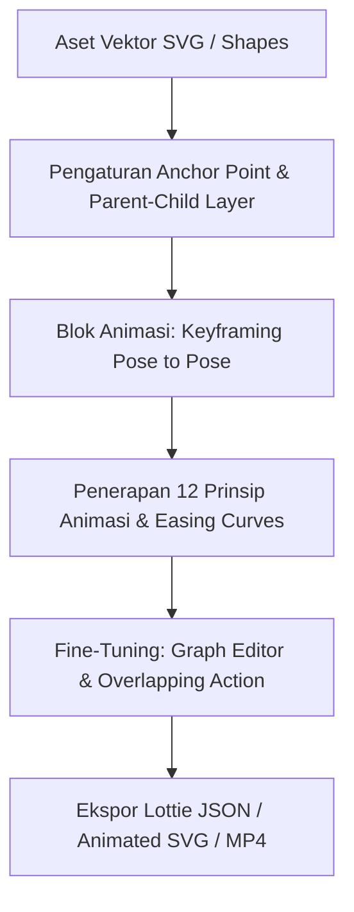

# AniCraft Skill

Skill ini memandu AI untuk merancang animasi vektor 2D yang ekspresif, berbobot fisik alami (*natural physics*), dan dioptimalkan untuk ekspor ringan di **AniCraft**.

---

## 📌 Alur Kerja Animasi AniCraft

### 1. Periksa Konfigurasi ([config.md](./config.md))
- Tentukan resolusi kanvas (`1080p_fhd`, `square_1_1`, atau `vertical_9_16`) dan framerate (biasanya `30 fps` untuk UI atau `24 fps` untuk kartun).
- Tentukan format target (misalnya `lottie_json` untuk aplikasi mobile/web atau `mp4` untuk video).

### 2. Standar Keyframing & Easing ([references/timeline-keyframing.md](./references/timeline-keyframing.md))
- **Anchor Point Selalu Utama**: Posisikan titik poros (*anchor point*) sebelum membuat keyframe pertama (misal: di dasar kaki untuk karakter melompat, atau di tengah untuk ikon berputar).
- **Kurva Kecepatan (Graph Editor)**: Jangan pernah biarkan kurva linier datar. Terapkan *ease-out* (`0.16, 1, 0.3, 1`) untuk gerakan yang berhenti natural.
- **Anticipation & Follow Through**: Berikan ancang-ancang sebelum gerakan besar (mundur sedikit 2-3 frame) dan overshoot setelah mendarat.

### 3. Optimasi Ekspor ([references/export-formats.md](./references/export-formats.md))
- Untuk Lottie: hindari efek berat seperti *gaussian blur* berlebih atau raster image tersemat yang memperbesar ukuran JSON.
- Gunakan *shape path* murni dengan jumlah titik jangkar (*anchor vertices*) yang efisien.

### 4. Pelajari Acuan Nyata ([examples/animated-icon-example.md](./examples/animated-icon-example.md))
- Lihat contoh konversi ikon statis menjadi animasi interaktif (Hamburger to Cross) lengkap dengan tabel frame dan interpolasi nilai.

---

## 📂 Struktur Berkas

| Berkas | Fungsi |
| :--- | :--- |
| [config.md](./config.md) | Saklar canvas preset, framerate, kurva bezier, dan target format. |
| [references/timeline-keyframing.md](./references/timeline-keyframing.md) | Panduan mendalam: 12 prinsip animasi, graph editor, parenting, dan path morphing. |
| [references/export-formats.md](./references/export-formats.md) | Spesifikasi ekspor Lottie JSON, dotLottie, SVG SMIL, dan video ProRes. |
| [examples/animated-icon-example.md](./examples/animated-icon-example.md) | Contoh nyata: Animasi morphing ikon Hamburger ke 'X' Close button. |
