# Modul 04: Standard Output Format & Pipeline Architecture

Modul ini mendefinisikan template baku laporan perancangan animasi vektor di **AniCraft**, mencakup diagram linimasa animasi (*timeline sequence diagram*), tabel keyframe frame-by-frame, dan kode implementasi (Lottie JSON / React Framer Motion / SVG SMIL).

---

## 1. Struktur Baku Laporan AniCraft

Setiap respons perancangan animasi di AniCraft wajib mengikuti urutan berikut:

```markdown
# AniCraft Motion Design Specification: [Nama Animasi / Aset]

## 1. Parameter Waktu & Kanvas (Animation Setup)
- Gaya Animasi: [ui-micro-interactions / motion-graphics / character-animation / custom]
- Resolusi & Format: [1920x1080 FHD / 512x512 Canvas, Lottie JSON / dotLottie / MP4]
- Framerate & Durasi: [60 FPS / 30 FPS, Durasi Total: 1.5 detik (90 frames)]
- Pengaturan Perulangan: [Looping: True / False, Play on Click/Hover]

## 2. Diagram Linimasa Animasi (Timeline Sequence Diagram)
[Mermaid diagram linimasa frame-by-frame yang menampilkan overlap aksi antarlayer]

## 3. Tabel Keyframe & Interpolasi Nilai (Keyframe Breakdown)
- Layer Name: [Nama shape layer / grup vektor]
- Properti: [Position, Scale, Rotation, Opacity, Path d]
- Frame Kunci & Nilai: [Frame 0, Frame 15, Frame 45]
- Kurva Easing: [cubic-bezier curve values]

## 4. Kode Animasi Produksi (Production Code Block)
[Kode lengkap mandiri: Lottie JSON teroptimasi / React Framer Motion component / SVG SMIL]

## 5. Instruksi Implementasi & Penanganan Aksesibilitas
- Trigger interaksi (hover, tap, scroll-into-view)
- Fallback CSS `prefers-reduced-motion`

## 6. Checklist Verifikasi Gerak & Kualitas
- [ ] Checklist zero linear easing, anchor point centering, dan bobot file
```

---

## 2. Contoh Diagram Linimasa Animasi (Mermaid)

```mermaid
gantt
    title Linimasa Animasi Tombol Sukses (Total 60 Frame / 1.0 Detik)
    dateFormat X
    axisFormat %s

    section Tombol Utama
    Scale Down (Anticipation)     :0, 10
    Morph to Circle (Container)   :10, 25
    Color Shift to Emerald Green  :20, 35

    section Ikon Centang
    Scale Up (Overshoot 1.15x)    :25, 45
    Path Trim Draw Stroke (0-100%):30, 50
    Settle Back to Normal Scale   :45, 60

    section Partikel Sukses
    Burst Confetti Radiate Out    :40, 55
    Opacity Fade to Zero          :45, 60
```


