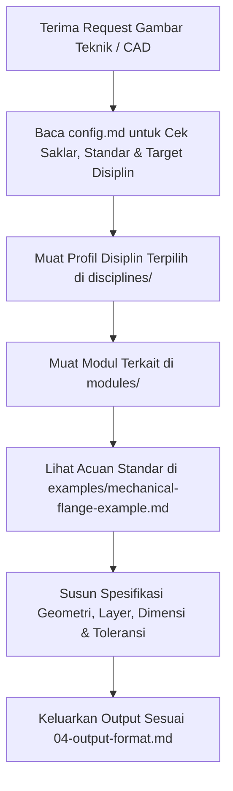

# CADCraft Skill

Skill ini dirancang dengan pendekatan modular berbasis **konfigurasi sentral (`config.md`)**, **profil target disiplin teknik (`disciplines/`)**, **modul spesifikasi drafting (`modules/`)**, dan **contoh nyata ideal (`examples/`)**.

---

## 🎯 Alur Eksekusi AI (Execution Flow)

Setiap kali skill ini aktif, AI **WAJIB** mengikuti urutan prioritas pembacaan berikut:

### 1. Periksa Saklar Utama ([config.md](./config.md))
- Lihat nilai `target_discipline` (misal: `mechanical`, `architectural`, `civil-structural`, atau `custom-discipline`).
- Periksa standar drafting yang aktif (`standard`: `iso` atau `asme-ansi`, `projection_angle`: `first_angle` atau `third_angle`, `unit`, `precision_decimals`).
- Periksa status aktif/non-aktif setiap modul di `modules_enabled`.
- Periksa format ekspor dan ukuran kertas di `preferences`.

### 2. Muat Profil Disiplin Teknik ([disciplines/](./disciplines/))
- Buka file profil disiplin yang terpilih:
  - Teknik Mesin & Manufaktur: [`disciplines/mechanical.md`](./disciplines/mechanical.md)
  - Arsitektur & Gedung: [`disciplines/architectural.md`](./disciplines/architectural.md)
  - Teknik Sipil & Struktur: [`disciplines/civil-structural.md`](./disciplines/civil-structural.md)
  - Disiplin Kustom (MEP / Piping / Listrik): [`disciplines/custom-discipline.md`](./disciplines/custom-discipline.md)

### 3. Terapkan Modul Standar ([modules/](./modules/))
- **01. Layer & Garis**: Terapkan standar ketebalan garis ISO 128 / ASME Y14.2, warna baku, dan linetype dari [`modules/01-standards-layers.md`](./modules/01-standards-layers.md).
- **02. Proyeksi & Pandangan**: Susun pandangan ortografis (depan, atas, samping), potongan penampang (*sections*), dan detail pembesaran dari [`modules/02-projection-views.md`](./modules/02-projection-views.md).
- **03. Dimensi & GD&T**: Terapkan penarikan garis ukur tanpa tumpang tindih, datum A/B/C, toleransi geometris ISO 1101 / ASME Y14.5, dan suaian lubang-poros ISO 286 dari [`modules/03-dimensioning-gdt.md`](./modules/03-dimensioning-gdt.md).
- **05. Kepala Gambar & BOM**: Wajib menyertakan etiket gambar ISO 7200, tabel daftar komponen (Bill of Materials), kolom revisi, dan simbol proyeksi dari [`modules/05-title-block-bom.md`](./modules/05-title-block-bom.md).
- **06. Blok & Simbol**: Sertakan simbol standar finishing permukaan ISO 1302, simbol pengelasan ISO 2553 / AWS, atau simbol arsitektural dari [`modules/06-blocks-symbols.md`](./modules/06-blocks-symbols.md).
- **07. Anotasi & Arsir**: Terapkan pola arsir penampang material standar ISO 128-50 (baja, aluminium, beton, kayu) dan callout teks teknik dari [`modules/07-annotations-hatching.md`](./modules/07-annotations-hatching.md).
- **08. Ekspor & Plotting**: Sesuaikan skala cetak (1:1 s/d 1:100), batas kertas A0-A4 / ANSI, pen table CTB, dan ekspor file dari [`modules/08-export-plotting.md`](./modules/08-export-plotting.md).

### 4. Acuan Gambar Nyata ([examples/mechanical-flange-example.md](./examples/mechanical-flange-example.md))
- Jadikan [mechanical-flange-example.md](./examples/mechanical-flange-example.md) sebagai tolok ukur standar (*benchmark*) penyajian gambar kerja, etiket, penentuan datum, tabel toleransi, dan kode otomasi CAD.

### 5. Format Output ([modules/04-output-format.md](./modules/04-output-format.md))
- Sajikan spesifikasi geometri lengkap, daftar koordinat kunci, script kode otomasi (Python `ezdxf`, AutoLISP, atau OpenSCAD), keputusan teknik, dan checklist verifikasi kualitas CAD resmi.

---

## 📂 Peta Struktur File

| Berkas / Direktori | Fungsi Utama |
| :--- | :--- |
| [config.md](./config.md) | Saklar sentral (target disiplin, standar ISO/ASME, modul aktif, skala cetak). |
| [disciplines/mechanical.md](./disciplines/mechanical.md) | Standar teknik mesin: toleransi permesinan presisi, suaian poros, GD&T, part modeling. |
| [disciplines/architectural.md](./disciplines/architectural.md) | Standar arsitektur: denah lantai, elevasi tampak, potongan gedung, pintu/jendela, grid kolom. |
| [disciplines/civil-structural.md](./disciplines/civil-structural.md) | Standar sipil/struktur: tulangan beton bertulang, profil baja WF/H, detail pondasi, sambungan. |
| [disciplines/custom-discipline.md](./disciplines/custom-discipline.md) | Profil fleksibel untuk disiplin khusus: Piping P&ID, Elektrikal/Wiring, HVAC, atau Topografi. |
| [modules/01-standards-layers.md](./modules/01-standards-layers.md) | Standar sistem layer CAD, warna baku, jenis garis (*linetype*), dan ketebalan garis (ISO 128). |
| [modules/02-projection-views.md](./modules/02-projection-views.md) | Aturan proyeksi 1st & 3rd angle, pandangan ortogonal, potongan penampang, dan detail pembesaran. |
| [modules/03-dimensioning-gdt.md](./modules/03-dimensioning-gdt.md) | Aturan pemberian ukuran, sistem datum, toleransi geometris GD&T, dan suaian ISO 286. |
| [modules/04-output-format.md](./modules/04-output-format.md) | Template format respon AI: spesifikasi gambar, script otomasi CAD, dan checklist engineering. |
| [modules/05-title-block-bom.md](./modules/05-title-block-bom.md) | Kepala gambar / etiket standar ISO 7200, tabel daftar bagian (BOM), dan tabel revisi. |
| [modules/06-blocks-symbols.md](./modules/06-blocks-symbols.md) | Pustaka blok standar, simbol tekstur permukaan ISO 1302, simbol las ISO 2553, dan simbol arsitektur. |
| [modules/07-annotations-hatching.md](./modules/07-annotations-hatching.md) | Pola arsir material ISO 128-50, gaya teks teknik monoline, leader line, dan callouts. |
| [modules/08-export-plotting.md](./modules/08-export-plotting.md) | Pengaturan layout kertas (A0–A4), skala viewport cetak, pen weight CTB, dan ekspor DXF/PDF. |
| [examples/mechanical-flange-example.md](./examples/mechanical-flange-example.md) | Acuan kasus nyata: gambar kerja Flange Coupling presisi lengkap dengan kode otomasi CAD. |

---

## 🚫 Larangan Khusus untuk AI

1. **Dilarang Over-Dimensioning**: Jangan pernah memberikan dimensi redundan atau menduplikasi ukuran pada pandangan yang berbeda dalam gambar kerja.
2. **Dilarang Menimpa Garis Kontur Benda**: Garis dimensi, garis arsir, dan teks anotasi tidak boleh memotong atau menutupi garis tepi benda nyata.
3. **Dilarang Menghilangkan Simbol Proyeksi**: Setiap gambar kerja multi-pandangan wajib mencantumkan simbol kerucut terpancung proyeksi sudut pertama atau ketiga.
4. **Dilarang Menuliskan Ukuran Tanpa Satuan / Toleransi Kritis**: Pada komponen manufaktur presisi, selalu sertakan toleransi umum maupun toleransi khusus suaian poros/lubang.
