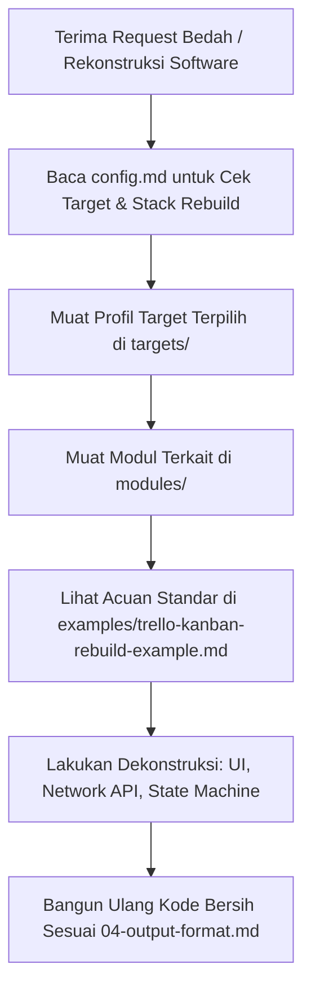

# Craft Anything Skill

Skill ini dirancang dengan pendekatan modular berbasis **konfigurasi sentral (`config.md`)**, **profil tipe target aplikasi (`targets/`)**, **modul spesifikasi dekonstruksi & rekonstruksi (`modules/`)**, dan **contoh nyata ideal (`examples/`)**.

---

## 🎯 Alur Eksekusi AI (Execution Flow)

Setiap kali skill ini aktif, AI **WAJIB** mengikuti urutan prioritas pembacaan berikut:

### 1. Periksa Saklar Utama ([config.md](./config.md))
- Lihat nilai `target_type` (misal: `web-app`, `mobile-app`, `canvas-game`, atau `custom-target`).
- Periksa target stack rekonstruksi (`rebuild_stack`: `framework`, `styling_engine`, `language`, `state_management`, `api_layer`).
- Periksa status aktif/non-aktif setiap modul di `modules_enabled`.
- Periksa preferensi pembersihan tracker dan dataset tiruan di `preferences`.

### 2. Muat Profil Tipe Target ([targets/](./targets/))
- Buka file profil target yang terpilih:
  - Aplikasi Web Modern: [`targets/web-app.md`](./targets/web-app.md)
  - Aplikasi Mobile (Cross-Platform): [`targets/mobile-app.md`](./targets/mobile-app.md)
  - Game Canvas 2D/3D (Game Loop): [`targets/canvas-game.md`](./targets/canvas-game.md)
  - Target Kustom (Backend API / CLI / Scraper): [`targets/custom-target.md`](./targets/custom-target.md)

### 3. Terapkan Modul Standar ([modules/](./modules/))
- **01. Dekonstruksi DOM & Layout**: Petakan struktur kontainer, grid/flexbox, hirarki komponen, dan reverse-engineer style dari [`modules/01-dom-deconstruction.md`](./modules/01-dom-deconstruction.md).
- **02. Penyadapan Network & API**: Identifikasi pola REST/GraphQL/WebSocket, payload request/response, query params, dan skema auth dari [`modules/02-api-network-reverse.md`](./modules/02-api-network-reverse.md).
- **03. Ekstraksi Logika & State Machine**: Ekstrak alur bisnis, siklus event, transition guard, dan state store dari [`modules/03-state-logic-extraction.md`](./modules/03-state-logic-extraction.md).
- **05. Arsitektur Rebuild Bersih**: Bangun ulang arsitektur kode dengan separation of concerns, repository pattern, dan TypeScript strict dari [`modules/05-clean-rebuild-architecture.md`](./modules/05-clean-rebuild-architecture.md).
- **06. Ekstraksi Token & Aset**: Panen palet warna HEX/RGB, skala tipografi, icon SVG mandiri, dan audio/sprite dari [`modules/06-asset-media-extraction.md`](./modules/06-asset-media-extraction.md).
- **07. Mocking & Simulasi Data**: Buat mock store in-memory atau MSW handler lengkap dengan latency realistis dan simulasi error dari [`modules/07-mocking-emulation.md`](./modules/07-mocking-emulation.md).
- **08. Performa & Keamanan**: Bersihkan seluruh tracker/telemetri pihak ketiga, cegah memory leak, dan sanitasi input dari [`modules/08-performance-security.md`](./modules/08-performance-security.md).

### 4. Acuan Rekonstruksi Nyata ([examples/trello-kanban-rebuild-example.md](./examples/trello-kanban-rebuild-example.md))
- Jadikan [trello-kanban-rebuild-example.md](./examples/trello-kanban-rebuild-example.md) sebagai tolok ukur standar (*benchmark*) pembongkaran aplikasi interaktif, diagram arsitektur, ekstraksi state machine, hingga kode rebuild utuh yang langsung dapat dijalankan.

### 5. Format Output ([modules/04-output-format.md](./modules/04-output-format.md))
- Sajikan blueprint arsitektur, diagram alur data Mermaid, kode rekonstruksi lengkap tanpa placeholder komentar terputus, mock data mandiri, dan checklist verifikasi hasil rekonstruksi.

---

## 📂 Peta Struktur File

| Berkas / Direktori | Fungsi Utama |
| :--- | :--- |
| [config.md](./config.md) | Saklar sentral (target tipe aplikasi, stack rekonstruksi, modul aktif, preferensi). |
| [targets/web-app.md](./targets/web-app.md) | Profil dekonstruksi Web App: SPA/SSR, DOM layout, hydration, routing, data-fetching. |
| [targets/mobile-app.md](./targets/mobile-app.md) | Profil dekonstruksi Mobile: gesture sentuhan, navigation stack, offline storage, hardware hooks. |
| [targets/canvas-game.md](./targets/canvas-game.md) | Profil dekonstruksi Game: Game Loop 60 FPS, deteksi tabrakan AABB/Circle, sprite animation. |
| [targets/custom-target.md](./targets/custom-target.md) | Profil target khusus: Backend API microservices, CLI tool, Chrome Extension, scraping bot. |
| [modules/01-dom-deconstruction.md](./modules/01-dom-deconstruction.md) | Teknik bedah hierarki DOM, flexbox/grid layout reverse, CSS-in-JS extraction. |
| [modules/02-api-network-reverse.md](./modules/02-api-network-reverse.md) | Ekstraksi endpoint REST, GraphQL query/mutation, WebSocket real-time, skema payload JSON. |
| [modules/03-state-logic-extraction.md](./modules/03-state-logic-extraction.md) | Pemodelan Finite State Machine (FSM), store reducers, penanganan efek samping async. |
| [modules/04-output-format.md](./modules/04-output-format.md) | Template standar penyajian output: blueprint, diagram alur Mermaid, kode lengkap, checklist. |
| [modules/05-clean-rebuild-architecture.md](./modules/05-clean-rebuild-architecture.md) | Standar Clean Architecture, repository pattern, loose coupling, TypeScript contracts. |
| [modules/06-asset-media-extraction.md](./modules/06-asset-media-extraction.md) | Pemanenan token desain (warna, font, spacing), SVG path inlining, sprite sheet slicing. |
| [modules/07-mocking-emulation.md](./modules/07-mocking-emulation.md) | Pembuatan mock service worker (MSW), dataset tiruan realistis, emulasi latency & error. |
| [modules/08-performance-security.md](./modules/08-performance-security.md) | Pembersihan bloatware/ad-tracker asli, optimasi re-render, pencegahan memory leak & XSS. |
| [examples/trello-kanban-rebuild-example.md](./examples/trello-kanban-rebuild-example.md) | Contoh emas rekonstruksi: Aplikasi Kanban Board Drag-and-Drop dengan Zustand + MSW. |

---

## 🚫 Larangan Khusus untuk AI

1. **Dilarang Menyalin Kode Mentah Terobfuskasi**: Jangan pernah menempelkan (*paste*) variabel yang ter-minifikasi/ter-obfuskasi seperti `function a(b,c){return d(b)}`. AI wajib menulis ulang (*clean rebuild*) dengan nama variabel semantik dan struktur teratur.
2. **Dilarang Membawa Tracker / Adware Pihak Ketiga**: Bersihkan semua tag Google Analytics, Facebook Pixel, Hotjar, Sentry DSN, atau endpoint telemetri pihak ketiga dari aplikasi asli.
3. **Dilarang Menggunakan Placeholder Kode**: Kode implementasi baru harus lengkap, dapat di-copy dan langsung dijalankan tanpa komentar penundaan seperti `// lanjutkan logika fungsi ini sendiri...`.
4. **Dilarang Ketergantungan API Eksternal Tak Berfungsi**: Selalu sertakan lapisan mock service (*in-memory store* atau *MSW*) agar aplikasi hasil rekonstruksi dapat langsung berjalan 100% mandiri secara offline.
