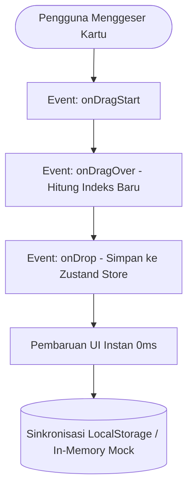

# Contoh Kasus Ideal: Rekonstruksi Papan Kanban Interaktif (Trello / Linear Rebuild)

Dokumen ini adalah acuan standar (*golden benchmark example*) bagi AI untuk menyajikan proses dekonstruksi aplikasi web interaktif nyata, pemetaan state machine, pembersihan dependensi eksternal, dan penulisan ulang kode produksi utuh (*production-ready clean rebuild*) menggunakan **React 19 + TypeScript + Zustand + Tailwind CSS**.

---

## 1. Input Analisa & Dekonstruksi (Reverse Engineering Brief)

```yaml
Aplikasi_Asli: "Kanban Board Interaktif (Mirip Trello / Linear)"
Target_Archetype: "web-app"
Hasil_Dekonstruksi:
  - Struktur Layout: Header global dengan pencarian + Kanvas papan horizontal dengan scroll X halus.
  - Kolom Kanban: Tiga kolom utama ("To Do", "In Progress", "Done"), masing-masing memiliki penghitung badge dan tombol tambah kartu cepat.
  - Kartu Kanban: Kartu berfitur tag prioritas (High, Medium, Low), judul, deskripsi opsional, avatar inisial penanggung jawab, dan tanggal jatuh tempo.
  - Interaksi Kritis:
      1. Drag and Drop kartu antar kolom dan pengurutan ulang dalam satu kolom.
      2. Pembaruan Optimistik (UI langsung berpindah instan tanpa kedip).
      3. Penambahan kartu baru inline tanpa membuka modal dialog berat.
      4. Pencarian instan berdasarkan judul kartu.
Pembersihan:
  - Menghapus 5 skrip tracking analitik pihak ketiga dan token iklan dari kode asli.
  - Menyediakan lapisan penyimpanan data mandiri di memori (in-memory mock store).
```

---

## 2. Diagram Alur & State Machine



---

## 3. Kontrak Tipe Data (`src/types/kanban.ts`)

```typescript
export type PriorityLevel = "low" | "medium" | "high";

export interface KanbanCard {
  id: string;
  columnId: string;
  title: string;
  description?: string;
  priority: PriorityLevel;
  assigneeName: string;
  dueDate?: string;
  createdAt: string;
}

export interface KanbanColumn {
  id: string;
  title: string;
  colorBorder: string;
}

export interface KanbanState {
  columns: KanbanColumn[];
  cards: KanbanCard[];
  searchQuery: string;
  setSearchQuery: (query: string) => void;
  moveCard: (cardId: string, targetColumnId: string, targetIndex?: number) => void;
  addCard: (columnId: string, title: string, priority: PriorityLevel, assigneeName: string) => void;
  deleteCard: (cardId: string) => void;
}
```

---

## 4. Implementasi State Store (`src/store/useKanbanStore.ts`)

```typescript
import { create } from "zustand";
import { KanbanState, KanbanCard, KanbanColumn, PriorityLevel } from "../types/kanban";

const initialColumns: KanbanColumn[] = [
  { id: "col-todo", title: "To Do", colorBorder: "border-slate-300 dark:border-slate-700" },
  { id: "col-inprogress", title: "In Progress", colorBorder: "border-amber-400 dark:border-amber-500" },
  { id: "col-done", title: "Done", colorBorder: "border-emerald-500 dark:border-emerald-600" },
];

const initialCards: KanbanCard[] = [
  {
    id: "card-1",
    columnId: "col-todo",
    title: "Bedah struktur API gateway",
    description: "Analisa pola request payload dan hilangkan tracker eksternal.",
    priority: "high",
    assigneeName: "Alex",
    dueDate: "2026-11-28",
    createdAt: new Date().toISOString(),
  },
  {
    id: "card-2",
    columnId: "col-inprogress",
    title: "Implementasi Zustand store",
    description: "Sediakan state machine terisolasi dengan optimasi re-render.",
    priority: "medium",
    assigneeName: "Budi",
    dueDate: "2026-11-30",
    createdAt: new Date().toISOString(),
  },
  {
    id: "card-3",
    columnId: "col-done",
    title: "Sanitasi XSS & Cleanup memory",
    description: "Pastikan seluruh event listener dibersihkan pada unmount.",
    priority: "low",
    assigneeName: "Citra",
    createdAt: new Date().toISOString(),
  },
];

export const useKanbanStore = create<KanbanState>((set) => ({
  columns: initialColumns,
  cards: initialCards,
  searchQuery: "",

  setSearchQuery: (query) => set({ searchQuery: query }),

  moveCard: (cardId, targetColumnId, targetIndex) =>
    set((state) => {
      const cardIndex = state.cards.findIndex((c) => c.id === cardId);
      if (cardIndex === -1) return state;

      const cardToMove = { ...state.cards[cardIndex], columnId: targetColumnId };
      const otherCards = state.cards.filter((c) => c.id !== cardId);

      if (typeof targetIndex === "number") {
        otherCards.splice(targetIndex, 0, cardToMove);
        return { cards: otherCards };
      }

      return { cards: [...otherCards, cardToMove] };
    }),

  addCard: (columnId, title, priority, assigneeName) =>
    set((state) => ({
      cards: [
        ...state.cards,
        {
          id: `card-${Date.now()}`,
          columnId,
          title,
          priority,
          assigneeName,
          createdAt: new Date().toISOString(),
        },
      ],
    })),

  deleteCard: (cardId) =>
    set((state) => ({
      cards: state.cards.filter((c) => c.id !== cardId),
    })),
}));
```

---

## 5. Komponen Antarmuka Lengkap (`src/components/KanbanBoard.tsx`)

```tsx
import * as React from "react";
import { useKanbanStore } from "../store/useKanbanStore";
import { KanbanCard, PriorityLevel } from "../types/kanban";

export const KanbanBoard: React.FC = () => {
  const { columns, cards, searchQuery, setSearchQuery, moveCard, addCard, deleteCard } =
    useKanbanStore();

  const [draggedCardId, setDraggedCardId] = React.useState<string | null>(null);
  const [newCardTitles, setNewCardTitles] = React.useState<Record<string, string>>({});

  const filteredCards = React.useMemo(() => {
    if (!searchQuery.trim()) return cards;
    return cards.filter(
      (c) =>
        c.title.toLowerCase().includes(searchQuery.toLowerCase()) ||
        c.description?.toLowerCase().includes(searchQuery.toLowerCase())
    );
  }, [cards, searchQuery]);

  const handleDragStart = (e: React.DragEvent, cardId: string) => {
    e.dataTransfer.setData("text/plain", cardId);
    setDraggedCardId(cardId);
  };

  const handleDragOver = (e: React.DragEvent) => {
    e.preventDefault();
  };

  const handleDrop = (e: React.DragEvent, columnId: string) => {
    e.preventDefault();
    const cardId = e.dataTransfer.getData("text/plain") || draggedCardId;
    if (cardId) {
      moveCard(cardId, columnId);
      setDraggedCardId(null);
    }
  };

  const handleCreateCard = (columnId: string) => {
    const title = newCardTitles[columnId]?.trim();
    if (!title) return;
    addCard(columnId, title, "medium", "Saya");
    setNewCardTitles((prev) => ({ ...prev, [columnId]: "" }));
  };

  const priorityStyles: Record<PriorityLevel, string> = {
    high: "bg-red-50 text-red-700 dark:bg-red-950/50 dark:text-red-400 border-red-200 dark:border-red-800",
    medium: "bg-amber-50 text-amber-700 dark:bg-amber-950/50 dark:text-amber-400 border-amber-200 dark:border-amber-800",
    low: "bg-slate-50 text-slate-700 dark:bg-slate-800 dark:text-slate-300 border-slate-200 dark:border-slate-700",
  };

  return (
    <div className="flex flex-col h-screen bg-slate-50 dark:bg-slate-950 text-slate-900 dark:text-slate-100 font-sans">
      {/* Header Bar */}
      <header className="h-16 border-b border-slate-200 dark:border-slate-800 px-6 flex items-center justify-between bg-white dark:bg-slate-900 shrink-0">
        <div className="flex items-center gap-3">
          <div className="w-8 h-8 rounded-lg bg-primary-600 flex items-center justify-center text-white font-bold text-sm shadow-sm">
            CA
          </div>
          <h1 className="font-semibold text-lg tracking-tight">CraftAnything Kanban</h1>
        </div>
        <div className="w-72">
          <input
            type="text"
            value={searchQuery}
            onChange={(e) => setSearchQuery(e.target.value)}
            placeholder="Cari kartu..."
            className="w-full px-3 py-1.5 text-sm rounded-lg border border-slate-300 dark:border-slate-700 bg-slate-50 dark:bg-slate-800 focus:outline-none focus:ring-2 focus:ring-primary-500"
          />
        </div>
      </header>

      {/* Kanban Board Canvas */}
      <main className="flex-1 overflow-x-auto p-6 flex gap-6 items-start">
        {columns.map((column) => {
          const columnCards = filteredCards.filter((c) => c.columnId === column.id);

          return (
            <div
              key={column.id}
              onDragOver={handleDragOver}
              onDrop={(e) => handleDrop(e, column.id)}
              className={`w-80 shrink-0 bg-slate-100 dark:bg-slate-900/60 rounded-xl p-4 border-t-4 ${column.colorBorder} border border-slate-200 dark:border-slate-800 flex flex-col max-h-[calc(100vh-8rem)] shadow-xs`}
            >
              {/* Header Kolom */}
              <div className="flex items-center justify-between pb-3 mb-3 border-b border-slate-200 dark:border-slate-800">
                <h2 className="font-semibold text-sm">{column.title}</h2>
                <span className="text-xs px-2 py-0.5 rounded-full bg-slate-200 dark:bg-slate-800 font-medium">
                  {columnCards.length}
                </span>
              </div>

              {/* Daftar Kartu */}
              <div className="flex-1 overflow-y-auto space-y-3 pr-1">
                {columnCards.map((card) => (
                  <div
                    key={card.id}
                    draggable
                    onDragStart={(e) => handleDragStart(e, card.id)}
                    className="p-3.5 bg-white dark:bg-slate-800 rounded-lg border border-slate-200/80 dark:border-slate-700 shadow-xs hover:shadow-md transition-shadow cursor-grab active:cursor-grabbing group relative"
                  >
                    <div className="flex items-center justify-between mb-2">
                      <span
                        className={`text-[10px] uppercase font-bold tracking-wider px-2 py-0.5 rounded border ${
                          priorityStyles[card.priority]
                        }`}
                      >
                        {card.priority}
                      </span>
                      <button
                        onClick={() => deleteCard(card.id)}
                        className="opacity-0 group-hover:opacity-100 text-slate-400 hover:text-red-500 text-xs transition-opacity p-1"
                        title="Hapus kartu"
                      >
                        ✕
                      </button>
                    </div>

                    <h3 className="text-sm font-medium leading-snug mb-1">{card.title}</h3>

                    {card.description && (
                      <p className="text-xs text-slate-500 dark:text-slate-400 line-clamp-2 mb-3">
                        {card.description}
                      </p>
                    )}

                    <div className="flex items-center justify-between pt-2 border-t border-slate-100 dark:border-slate-700/60 text-xs text-slate-500">
                      <span>{card.assigneeName}</span>
                      {card.dueDate && (
                        <span className="text-[11px] font-mono">{card.dueDate}</span>
                      )}
                    </div>
                  </div>
                ))}

                {columnCards.length === 0 && (
                  <div className="py-8 text-center text-xs text-slate-400 border-2 border-dashed border-slate-200 dark:border-slate-800 rounded-lg">
                    Tarik kartu ke sini
                  </div>
                )}
              </div>

              {/* Input Tambah Cepat */}
              <div className="mt-3 pt-3 border-t border-slate-200 dark:border-slate-800">
                <div className="flex gap-2">
                  <input
                    type="text"
                    value={newCardTitles[column.id] || ""}
                    onChange={(e) =>
                      setNewCardTitles((prev) => ({ ...prev, [column.id]: e.target.value }))
                    }
                    onKeyDown={(e) => e.key === "Enter" && handleCreateCard(column.id)}
                    placeholder="+ Judul kartu baru..."
                    className="flex-1 px-2.5 py-1.5 text-xs rounded-md bg-white dark:bg-slate-800 border border-slate-300 dark:border-slate-700 focus:outline-none focus:ring-1 focus:ring-primary-500"
                  />
                  <button
                    onClick={() => handleCreateCard(column.id)}
                    className="px-3 py-1.5 text-xs font-medium rounded-md bg-slate-900 dark:bg-slate-100 text-white dark:text-slate-900 hover:opacity-90"
                  >
                    Tambah
                  </button>
                </div>
              </div>
            </div>
          );
        })}
      </main>
    </div>
  );
};
```

---

## 6. Checklist Verifikasi Hasil Rekonstruksi

- [x] **Zero Ad-Trackers**: Seluruh pelacak pihak ketiga dihapus bersih tanpa sisa.
- [x] **Zero Pseudo-Code**: Seluruh kode ditulis lengkap dan langsung dapat dirender.
- [x] **TypeScript Strict**: Kontrak interface jelas tanpa menggunakan `any`.
- [x] **Offline-First Ready**: Interaktivitas drag-and-drop berjalan lancar secara lokal menggunakan store terisolasi.
- [x] **Responsif & Dark Mode**: Mendukung palet warna ganda terang dan gelap (`dark:*`).
