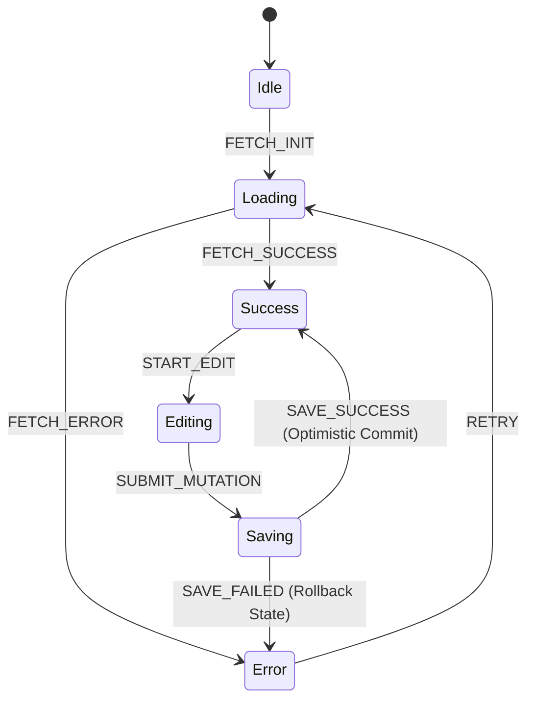

# Modul 03: Ekstraksi Logika Inti & State Machine (State Logic Extraction)

Modul ini menetapkan metode pemisahan logika bisnis dari antarmuka visual, memodelkan siklus status menggunakan Finite State Machine (FSM), serta merekonstruksi alur sinkronisasi data yang bebas efek samping tak terduga (*side effects*).

---

## 1. Pemodelan Finite State Machine (FSM)

Aplikasi interaktif yang kompleks (seperti audio player, checkout cart, drag-and-drop board) harus selalu dipetakan menggunakan status tegas:



1. **Status Eksklusif**: Pada satu waktu, komponen hanya boleh berada di salah satu status (`idle`, `loading`, `success`, `error`).
2. **Kondisi Transisi (Transition Guards)**:
   - Misalnya: Aksi `SUBMIT_MUTATION` tidak boleh dipicu jika data form masih kosong atau sedang dalam status `Saving`.

---

## 2. Ekstraksi Logika Drag-and-Drop (DnD Logic Breakdown)

Jika aplikasi memiliki fitur geser-dan-lepas (*drag and drop*):
1. **Source & Destination**:
   - Catat `sourceColumnId`, `sourceIndex`, `destinationColumnId`, `destinationIndex`.
2. **Algoritma Pengurutan (Ordering Calculation)**:
   - *Array Splice Pattern*: Hapus elemen dari array asal, lalu sisipkan ke array tujuan.
   - *Lexorank / Floating Index Pattern*: Menggunakan angka desimal di antara dua item tetangga (misal: posisi baru = $(index_{kiri} + index_{kanan}) / 2$) untuk menghindari re-indexing seluruh basis data.
3. **Pembaruan Optimistik (Optimistic Update)**:
   - Ubah posisi kartu di layar pengguna secara instan (0 milidetik).
   - Kirim permintaan jaringan ke server di latar belakang.
   - Jika jaringan gagal, kembalikan posisi kartu (*rollback*) ke tempat semula dengan notifikasi toast galat.

---

## 3. Isolasi Logika Bisnis ke Custom Hook / Store (Zustand Pattern)
- Jauhkan logika rumit dari dalam JSX elemen UI.
- Satukan seluruh aksi (actions) dan state ke dalam satu store mandiri:

```typescript
// Pola Store Bersih Terisolasi
interface KanbanState {
  columns: Record<string, BoardColumn>;
  cards: Record<string, KanbanCardItem>;
  moveCard: (cardId: string, fromColId: string, toColId: string, newIndex: number) => void;
  addCard: (columnId: string, title: string) => void;
  deleteCard: (cardId: string) => void;
}
```
