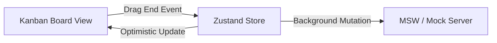

# Modul 04: Format Output Standar AI (Clean Rebuild Output Specification)

Modul ini mendikte bagaimana AI harus menyajikan hasil dekonstruksi dan kode rekonstruksi bersih (*production-ready clean rebuild*) ke pengguna.

---

## 1. Struktur Respon Wajib AI

Setiap kali AI menyajikan rekonstruksi software berdasarkan skill ini, respon **WAJIB** mengikuti urutan 5 bagian berikut:

1. **Ringkasan Dekonstruksi & Target Stack**:
   - Jelaskan dalam 1–2 kalimat aplikasi/fitur apa yang dibongkar dan stack rekonstruksi yang dipilih (misal: React 19 + TypeScript + Tailwind + Zustand).
2. **Diagram Alur Arsitektur & State Machine (Mermaid)**:
   - Sajikan visual diagram alur perpindahan state atau relasi antar komponen.
3. **Kontrak Tipe Data TypeScript (`types.ts`)**:
   - Definisikan tipe entitas lengkap tanpa menggunakan tipe `any`.
4. **Kode Rekonstruksi Utuh & Siap Pakai (Full Production Code)**:
   - Sediakan berkas lengkap: Store/Logic (`useStore.ts`), Komponen UI (`App.tsx` atau `Component.tsx`), dan Mock API (`mockData.ts`).
   - Kode dilarang dipotong atau diringkas dengan placeholder komentar seperti `// tulis sisa kode sendiri...`.
5. **Checklist Kualitas Rekonstruksi**:
   - Daftar centang verifikasi kelayakan kode mandiri, performa, dan pembersihan tracker.

---

## 2. Template Output Markdown Resmi

Contoh format yang harus diikuti oleh AI:

````markdown
### ⚡ Rekonstruksi Mandiri: [Nama Aplikasi / Fitur yang Dibongkar]
Target: `[Target Type dari config.md]` | Stack: `[Framework + State Management + Styling]`

#### 1. Diagram Alur & State Machine


#### 2. Kontrak Tipe Data (`src/types/kanban.ts`)
```typescript
export interface Card { ... }
export interface Column { ... }
```

#### 3. Logika Store & State (`src/store/useKanbanStore.ts`)
```typescript
import { create } from 'zustand';
// ... implementasi lengkap ...
```

#### 4. Komponen Antarmuka (`src/components/KanbanBoard.tsx`)
```tsx
import * as React from 'react';
// ... JSX Tailwind lengkap tanpa pemotongan ...
```

#### 5. Dataset Tiruan Mandiri (`src/mocks/initialData.ts`)
```typescript
export const initialMockData = { ... };
```

#### ✅ Checklist Verifikasi Rekonstruksi:
- [x] Kode bebas 100% dari variabel terobfuskasi
- [x] Seluruh tracker pihak ketiga dibersihkan
- [x] Mendukung drag-and-drop / interaktivitas penuh secara lokal tanpa dependensi eksternal
- [x] TypeScript strict type safety aktif
````

---

## 3. Larangan Khusus untuk AI
- **Dilarang Menghasilkan Pseudo-Code**: Jangan memberikan cuplikan kode yang tidak bisa dikompilasi atau dijalankan langsung.
- **Dilarang Menyisakan Dependensi Rusak**: Pastikan semua import library umum (seperti `lucide-react`, `zustand`, `clsx`, `tailwind-merge`) adalah paket NPM resmi standar.
- **Dilarang Mengabaikan `config.md`**: Selalu baca preferensi stack dan modul aktif yang dipilih oleh pengguna.
