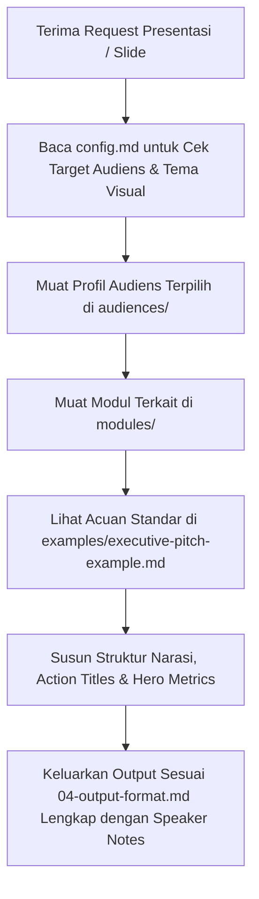

# DeckCraft Skill

Skill ini dirancang dengan pendekatan modular berbasis **konfigurasi sentral (`config.md`)**, **profil target audiens (`audiences/`)**, **modul spesifikasi slide & narasi (`modules/`)**, dan **contoh nyata ideal (`examples/`)**.

---

## 🎯 Alur Eksekusi AI (Execution Flow)

Setiap kali skill ini aktif, AI **WAJIB** mengikuti urutan prioritas pembacaan berikut:

### 1. Periksa Saklar Utama ([config.md](./config.md))
- Lihat nilai `target_audience` (misal: `executive-board`, `investor-pitch`, `keynote-product`, atau `custom-audience`).
- Periksa konfigurasi visual (`aspect_ratio`: `16_9`, `theme_preset`: `dark_executive` atau `minimal_light`, warna aksen, font).
- Periksa status aktif/non-aktif setiap modul di `modules_enabled`.
- Pastikan kepatuhan `preferences`: `require_action_titles: true`, `max_bullets_per_slide: 3`, dan `include_speaker_notes: true`.

### 2. Muat Profil Target Audiens ([audiences/](./audiences/))
- Buka file profil audiens yang terpilih:
  - Dewan Direksi & C-Level: [`audiences/executive-board.md`](./audiences/executive-board.md)
  - Investor & Venture Capital: [`audiences/investor-pitch.md`](./audiences/investor-pitch.md)
  - Keynote Peluncuran Produk: [`audiences/keynote-product.md`](./audiences/keynote-product.md)
  - Audiens Kustom (Sales B2B / Internal Team): [`audiences/custom-audience.md`](./audiences/custom-audience.md)

### 3. Terapkan Modul Standar ([modules/](./modules/))
- **01. Layout & Grid 16:9**: Terapkan rasio 16:9 (1920x1080), sistem grid 2/3/4 kolom, margin luas, dan hirarki 3 detik dari [`modules/01-visual-hierarchy-layout.md`](./modules/01-visual-hierarchy-layout.md).
- **02. Narasi & Minto Pyramid**: Gunakan kerangka Situation-Complication-Resolution (SCR), transisi logis antar slide, dan rumuskan Action Title aktif dari [`modules/02-storytelling-narrative.md`](./modules/02-storytelling-narrative.md).
- **03. Visualisasi Data & Metrik**: Tampilkan angka metrik besar (*Hero Stats*), kartu perbandingan, dan label tren pertumbuhan dari [`modules/03-data-visualization-metrics.md`](./modules/03-data-visualization-metrics.md).
- **05. Naskah Presenter (Speaker Notes)**: Wajib menyertakan kalimat pembuka, cerita analogi pendukung, alokasi menit, dan antisipasi pertanyaan audiens dari [`modules/05-speaker-notes-delivery.md`](./modules/05-speaker-notes-delivery.md).
- **06. Tipografi & Kontras Warna**: Terapkan skala ukuran font terbaca (Title 36-48pt, Hero Number 64-96pt, Body 16-20pt) dan rasio kontras WCAG AA dari [`modules/06-typography-tokens.md`](./modules/06-typography-tokens.md).
- **07. Pola Slide (Slide Archetypes)**: Pilih pola layout yang tepat (Cover, Problem, 3-Pillar Solution, Metric Grid, atau Call to Action) dari [`modules/07-slide-archetypes.md`](./modules/07-slide-archetypes.md).
- **08. Standar Ekspor**: Format struktur presentasi (Marp Markdown, HTML slide container, atau PPTX layout spec) dari [`modules/08-export-presentation.md`](./modules/08-export-presentation.md).

### 4. Acuan Slide Nyata ([examples/executive-pitch-example.md](./examples/executive-pitch-example.md))
- Jadikan [executive-pitch-example.md](./examples/executive-pitch-example.md) sebagai tolok ukur standar (*benchmark*) penyusunan slide deck lengkap 5 slide dengan visual kartu metrik dan naskah presenter profesional.

### 5. Format Output ([modules/04-output-format.md](./modules/04-output-format.md))
- Sajikan metadata deck, spesifikasi layout visual tiap slide, naskah speaker notes verbatim, dan checklist evaluasi kognitif resmi.

---

## 📂 Peta Struktur File

| Berkas / Direktori | Fungsi Utama |
| :--- | :--- |
| [config.md](./config.md) | Saklar sentral (target audiens, tema warna, modul aktif, preferensi batasan poin). |
| [audiences/executive-board.md](./audiences/executive-board.md) | Panduan rapat dewan direksi/C-level: efisiensi waktu, keputusan ROI, Minto Pyramid SCR. |
| [audiences/investor-pitch.md](./audiences/investor-pitch.md) | Panduan pitch deck pendanaan startup: daya tarik pasar (TAM), traksi pertumbuhan, the Ask. |
| [audiences/keynote-product.md](./audiences/keynote-product.md) | Panduan panggung konferensi & produk: dampak visual masif, hook emosional, demo produk. |
| [audiences/custom-audience.md](./audiences/custom-audience.md) | Profil audiens fleksibel: presentasi penawaran B2B Sales, All-Hands internal, atau Workshop. |
| [modules/01-visual-hierarchy-layout.md](./modules/01-visual-hierarchy-layout.md) | Struktur grid 16:9 (1920x1080), pemanfaatan ruang kosong (*white space*), dan tes 3 detik. |
| [modules/02-storytelling-narrative.md](./modules/02-storytelling-narrative.md) | Arsitektur narasi Minto Pyramid, formula Action Titles berbasis pesan, alur cerita slide. |
| [modules/03-data-visualization-metrics.md](./modules/03-data-visualization-metrics.md) | Penyajian metrik keuangan/bisnis, Hero Number format raksasa, kartu komparasi visual. |
| [modules/04-output-format.md](./modules/04-output-format.md) | Template standar output AI: spesifikasi slide visual, kode layout Marp/HTML, speaker notes. |
| [modules/05-speaker-notes-delivery.md](./modules/05-speaker-notes-delivery.md) | Panduan naskah kata-kata presenter, transisi kalimat halus, pembagian durasi, dan Q&A prep. |
| [modules/06-typography-tokens.md](./modules/06-typography-tokens.md) | Skala font presentasi, hierarki ukuran, rasio kontras warna tinggi (Dark/Light mode). |
| [modules/07-slide-archetypes.md](./modules/07-slide-archetypes.md) | Katalog pola layout: Cover, Masalah/Peluang, Solusi 3 Pilar, Grid Metrik, Call to Action. |
| [modules/08-export-presentation.md](./modules/08-export-presentation.md) | Standar ekspor: Marp Markdown, PDF vektor widescreen 16:9, HTML slide container. |
| [examples/executive-pitch-example.md](./examples/executive-pitch-example.md) | Contoh emas deck lengkap: 5 slide eksekutif dengan action titles dan naskah pembicara. |

---

## 🚫 Larangan Khusus untuk AI

1. **Dilarang Menulis Judul Pasif / Statis**: Judul slide tidak boleh berupa frasa deskriptif datar seperti *"Laporan Penjualan"* atau *"Analisa Kompetitor"*. Wajib menulis kalimat aktif yang langsung merangkum pesan utama, misalnya *"Penjualan Semester I Naik 45%, Mengungguli 3 Kompetitor Utama"*.
2. **Dilarang Teks Padat Bertumpuk (Wall of Text)**: Batasi maksimal 3 poin peluru (*bullet points*) per slide, dengan panjang maksimal 1 baris per poin.
3. **Dilarang Menggabungkan Dua Topik Berbeda**: Terapkan prinsip *One Core Idea per Slide*. Jika ada dua ide besar, pisahkan menjadi dua slide berbeda.
4. **Dilarang Melewatkan Speaker Notes**: Setiap slide wajib menyertakan naskah presenter yang menjelaskan apa yang harus diucapkan selama 60–90 detik.
