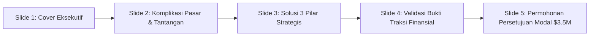

# Contoh Kasus Ideal: Slide Deck Strategis Dewan Direksi (Executive Board Pitch)

Dokumen ini adalah acuan standar (*golden benchmark example*) bagi AI untuk menyusun materi presentasi eksekutif lengkap 5 slide rasio 16:9, mematuhi prinsip Minto Pyramid (SCR), menerapkan Action Titles berbasis kesimpulan aktif, serta menyertakan naskah presenter (*verbatim speaker notes*) dan persiapan tanya jawab kritis.

---

## 1. Input Kebutuhan Presentasi (Executive Brief)

```yaml
Topik: "Persetujuan Ekspansi Layanan Cloud Enterprise & Evaluasi Kinerja Q3"
Target_Audiens: "executive-board" (CEO, CFO, Dewan Komisaris)
Tema_Visual: "dark_executive" (Slate-900 background, Royal Blue & Emerald accents)
Waktu_Alokasi: "10 Menit Presentasi + 15 Menit Diskusi Tanya Jawab"
Kerangka_Narasi: "Minto Pyramid SCR (Situation - Complication - Resolution)"
Tujuan_Akhir: "Mendapatkan persetujuan alokasi modal kerja ekspansi sebesar $3.5M"
```

---

## 2. Peta Alur Narasi 5 Slide (Story Arc)



---

## 3. Rincian Draf 5 Slide & Naskah Pembicara

### 🖥️ Slide 01: Cover Eksekutif (The Anchor)
Tipe: `Cover Slide` | Durasi Bicara: `~30 Detik` | Status: `[Pembuka]`

#### 📌 Action Title:
> **"Mempercepat Kepemimpinan Pasar Cloud Enterprise: Usulan Ekspansi Kuartal IV"**
> *Sub-judul: Tinjauan Kinerja Q3 & Permohonan Alokasi Modal Inisiatif Baru*

#### 🎨 Tata Letak Visual (16:9)
- **Background**: Slate-950 pekat (`#020617`) dengan pendar aksen biru halus di sudut kanan atas.
- **Teks**: Judul besar font 44pt putih tebal di sisi kiri tengah layar.
- **Metadata Bawah**:
  - Presenter: *Ivano Sugiyanto, VP of Engineering & Product*
  - Tanggal: *23 November 2026* | Klasifikasi: *Sangat Rahasia / Board Confidential*

#### 🎙️ Naskah Pembicara (Speaker Notes):
> *"Selamat pagi Bapak dan Ibu anggota dewan direksi. Hari ini saya berdiri di hadapan Anda untuk memaparkan hasil evaluasi kuartal ketiga yang luar biasa, sekaligus mengajukan keputusan strategis paling penting bagi fase pertumbuhan perusahaan kita berikutnya: yaitu ekspansi infrastruktur Cloud Enterprise ke segmen pasar korporat.*
>
> *Dalam waktu kurang dari 10 menit ke depan, saya akan menunjukkan bagaimana efisiensi operasional kita saat ini memberikan fondasi yang sangat kokoh untuk melipatgandakan valuasi perusahaan kita..."*

---

### 🖥️ Slide 02: Komplikasi Pasar (The Complication)
Tipe: `Problem / Tension` | Durasi Bicara: `~90 Detik` | Status: `[Konteks]`

#### 📌 Action Title:
> **"Permintaan Klien Korporat Tumbuh 300%, Namun Kapasitas Server Lama Mencapai Batas Kritis 88%"**

#### 🎨 Tata Letak Visual (16:9)
- **Struktur**: 2 Kartu Kontras Berdampingan (Grid 50% / 50%)
- **Kartu Kiri (Lonjakan Permintaan - Positif)**:
  - Header: `Peluang Masif Terbuka` (Border Emerald Green `#10B981`)
  - Hero Stat: `48 Akun Enterprise` sedang mengantre di pipeline menunggu aktivasi.
  - Nilai Kontrak Tertahan: `~$5.2M Annual Contract Value (ACV)`.
- **Kartu Kanan (Hambatan Teknis - Risiko)**:
  - Header: `Bottleneck Infrastruktur Lama` (Border Rose Red `#F43F5E`)
  - Hero Stat: `88% Beban Server Puncak` (Tingkat utilitas berbahaya mendekati batas SLA 99.9%).
  - Implikasi: Risiko downtime jika menambah 5 klien enterprise baru secara serentak.

#### 🎙️ Naskah Pembicara (Speaker Notes):
> *"Bapak dan Ibu, kita berada di situasi yang menyenangkan sekaligus mendesak. Di kolom sebelah kiri, tim sales kita telah membuktikan daya tarik produk yang luar biasa: ada 48 akun korporat besar dengan total kontrak 5.2 juta dolar yang siap menandatangani perjanjian lisensi.*
>
> *[Jeda 1 Detik - Arahkan perhatian ke kolom kanan]*
>
> *Namun ada kendala operasional yang tidak bisa kita abaikan. Infrastruktur pusat data kita saat ini sudah beroperasi di kapasitas 88% saat jam sibuk. Jika kita memaksakan onboarding klien baru tanpa modernisasi sistem, kita berisiko melanggar jaminan SLA keandalan layanan. Kita membutuhkan lompatan arsitektur yang terukur..."*

---

### 🖥️ Slide 03: Tiga Pilar Solusi Strategis (The Resolution)
Tipe: `3-Pillar Solution` | Durasi Bicara: `~2 Menit` | Status: `[Strategi]`

#### 📌 Action Title:
> **"Arsitektur Multi-Region Baru Menjamin SLA 99.99% dan Menggandakan Kapasitas Layanan"**

#### 🎨 Tata Letak Visual (16:9)
- **Struktur**: 3 Kolom Simetris Berlatar Belakang Kartu Slate-850 (`#1E293B`)
- **Pilar 01: Modernisasi Multi-Region**:
  - Nomor: `01` (Font 28pt Blue `#2563EB`)
  - Judul: *Desentralisasi Server*
  - Poin: Membuka dua zona cluster baru di Jakarta dan Singapura untuk memangkas latensi hingga di bawah 15 milidetik.
- **Pilar 02: Otomasi Auto-Scaling**:
  - Nomor: `02` (Font 28pt Blue `#2563EB`)
  - Judul: *Alokasi Beban Elastis*
  - Poin: Penyesuaian sumber daya komputasi secara otomatis saat jam sibuk, menghemat biaya idle di luar jam kerja.
- **Pilar 03: Standar Kepatuhan SOC2**:
  - Nomor: `03` (Font 28pt Blue `#2563EB`)
  - Judul: *Sertifikasi Keamanan Finansial*
  - Poin: Memenuhi standar wajib perbankan dan asuransi, membuka pintu tender bernilai kontrak di atas \$500k per klien.

#### 🎙️ Naskah Pembicara (Speaker Notes):
> *"Solusi yang kami rancang tidak sekadar membeli server tambahan, melainkan mentransformasi kapabilitas rekayasa kita melalui tiga pilar.*
>
> *Pilar pertama, arsitektur multi-region. Dengan mendistribusikan beban antara Jakarta dan Singapura, kita mengeliminasi single-point of failure sekaligus memberikan performa kilat bagi pengguna.*
>
> *Pilar kedua, auto-scaling dinamis. Kita hanya membayar komputasi yang benar-benar digunakan, sehingga biaya operasional kita tetap efisien.*
>
> *Dan pilar ketiga yang paling penting secara komersial: sertifikasi kepatuhan SOC2 Tipe II. Ini adalah paspor wajib bagi kita untuk memenangkan tender bank-bank papan atas..."*

---

### 🖥️ Slide 04: Bukti Traksi Finansial (The Validation)
Tipe: `Metric Grid` | Durasi Bicara: `~2 Menit` | Status: `[Validasi Data]`

#### 📌 Action Title:
> **"Efisiensi Margin Kuartal III Memberikan Keyakinan Penuh atas Kelayakan Investasi Ini"**

#### 🎨 Tata Letak Visual (16:9)
- **Struktur**: Grid 4 Kartu Metrik Kunci
- **Kartu 1 (Gross Margin)**:
  - Hero Stat: `78.4%` (Warna Emerald `#10B981`)
  - Keterangan: Margin kotor software tertinggi dalam sejarah perusahaan (Naik dari 69% YoY).
- **Kartu 2 (Net Retention Rate)**:
  - Hero Stat: `134%` (Warna Emerald `#10B981`)
  - Keterangan: Tingkat ekspansi akun klien eksisting yang sangat sehat.
- **Kartu 3 (Payback Period)**:
  - Hero Stat: `6.2 Bulan` (Warna Blue `#2563EB`)
  - Keterangan: Waktu balik modal biaya akuisisi pelanggan baru.
- **Kartu 4 (Proyeksi ROI)**:
  - Hero Stat: `3.8x` (Warna Emerald `#10B981`)
  - Keterangan: Estimasi pengembalian modal kerja dalam 18 bulan ke depan.

#### 🎙️ Naskah Pembicara (Speaker Notes):
> *"Pertanyaan wajar dari Ibu CFO tentu adalah: seberapa aman investasi ini bagi neraca keuangan kita? Data di hadapan Anda menjawabnya dengan tegas.*
>
> *Margin kotor kita kuartal ini menyentuh rekor 78.4%. Lebih dari itu, NRR kita berada di angka 134%, membuktikan bahwa produk kita sangat dicintai dan klien terus memperbesar nilai langganannya.*
>
> *Dengan payback period yang hanya 6.2 bulan, setiap dollar yang kita tanamkan untuk infrastruktur ini akan mulai menghasilkan arus kas positif bersih sebelum tutup tahun buku berikutnya..."*

---

### 🖥️ Slide 05: Permohonan Persetujuan Modal (The Ask)
Tipe: `Call to Action` | Durasi Bicara: `~2 Menit` | Status: `[Untuk Persetujuan]`

#### 📌 Action Title:
> **"Alokasi Modal Sebesar \$3.5M Membuka Potensi Pendapatan Baru \$14M Hingga Akhir 2027"**

#### 🎨 Tata Letak Visual (16:9)
- **Struktur**: 1 Kotak Penegasan Nilai Investasi + 3 Kotak Alokasi Milestone
- **Kotak Utama Kiri**:
  - Nilai Permohonan: `$3,500,000 USD` (Font 48pt Tebal Putih)
  - Target Hasil: Membuka potensi ARR tambahan senilai `$14.2M` pada Q4 2027.
- **Tiga Alokasi Dana (Milestone Roadmap)**:
  - *45% (\$1.58M)*: Lisensi & Infrastruktur Cloud Multi-Region (Penyedia AWS & GCP).
  - *35% (\$1.22M)*: Rekrutmen 6 Senior Infrastructure Engineers & Site Reliability Leads.
  - *20% (\$0.70M)*: Audit Sertifikasi Kepatuhan Keamanan & Penetration Testing Independen.

#### 🎙️ Naskah Pembicara (Speaker Notes):
> *"Sebagai penutup, kami mengajukan permohonan alokasi modal sebesar 3.5 juta dolar. Dana ini tidak akan dibelanjakan sekaligus, melainkan dicairkan bertahap berdasarkan pencapaian tiga milestone yang terukur.*
>
> *Dengan persetujuan Bapak dan Ibu hari ini, tim engineering kami dapat segera memulai konfigurasi klaster pertama pada awal bulan depan, dan kita siap menyambut gelombang 48 klien enterprise tersebut tepat pada awal tahun.*
>
> *Terima kasih atas waktu dan perhatian Dewan Direksi. Saya mengundang pertanyaan dan masukan dari Bapak dan Ibu sekalian."*

---

## 4. Antisipasi Pertanyaan Dewan Direksi (Q&A Preparation)

| Kemungkinan Pertanyaan Kritis | Jawaban Singkat & Strategis Presenter |
| :--- | :--- |
| **"Bagaimana jika akuisisi klien enterprise meleset dari target 48 akun?"** | *"Infrastruktur auto-scaling kami dirancang elastis; jika pipeline melambat 50%, belanja server otomatis turun proporsional sehingga titik impas kita tetap terjaga di 9 bulan."* |
| **"Mengapa tidak menggunakan penyedia server lokal yang lebih murah?"** | *"Standar kepatuhan bank enterprise mewajibkan redundansi data tingkat global dengan sertifikasi ISO 27001 dan SOC2, yang saat ini hanya dijamin secara penuh oleh Tier-1 Cloud Providers."* |

---

## 5. Checklist Evaluasi Kognitif

- [x] **100% Action Titles**: Setiap slide memiliki judul kalimat aktif yang merangkum kesimpulan.
- [x] **Zero Wall of Text**: Maksimal 3 poin per kolom dengan jarak spasi longgar (*white space* terjaga).
- [x] **Verbatim Speaker Notes**: Naskah presenter lengkap dengan pembuka, penjelasan konteks, dan kalimat jembatan transisi.
- [x] **Minto Pyramid Compliant**: Kesimpulan di depan, didukung fakta data numerik, dan diakhiri permintaan persetujuan tegas.
