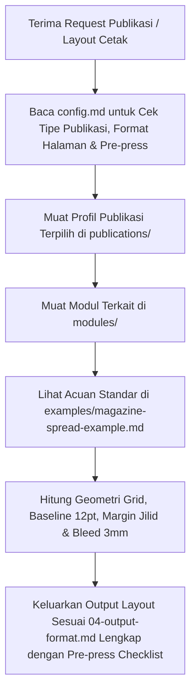

# DesignCraft Skill

Skill ini dirancang dengan pendekatan modular berbasis **konfigurasi sentral (`config.md`)**, **profil tipe publikasi (`publications/`)**, **modul spesifikasi tata letak & pra-cetak (`modules/`)**, dan **contoh nyata ideal (`examples/`)**.

---

## 🎯 Alur Eksekusi AI (Execution Flow)

Setiap kali skill ini aktif, AI **WAJIB** mengikuti urutan prioritas pembacaan berikut:

### 1. Periksa Saklar Utama ([config.md](./config.md))
- Lihat nilai `publication_type` (misal: `magazine-editorial`, `book-novel`, `corporate-brochure`, atau `custom-publication`).
- Periksa parameter geometri lembar (`format`: `a4` atau `a5`, `pages_mode`: `facing_pages` atau `single_page`, `bleed_mm`: `3.0`, margin dalam/luar/atas/bawah).
- Periksa status aktif/non-aktif setiap modul di `modules_enabled`.
- Pastikan kepatuhan preferensi: `baseline_grid_pt: 12.0`, `strict_baseline_lock: true`, dan `prevent_widows_orphans: true`.

### 2. Muat Profil Tipe Publikasi ([publications/](./publications/))
- Buka file profil publikasi yang terpilih:
  - Majalah & Desain Editorial: [`publications/magazine-editorial.md`](./publications/magazine-editorial.md)
  - Buku Fiksi / Non-Fiksi & Monograf: [`publications/book-novel.md`](./publications/book-novel.md)
  - Brosur Korporat & Laporan Tahunan: [`publications/corporate-brochure.md`](./publications/corporate-brochure.md)
  - Publikasi Kustom (Zine / Katalog / Menu): [`publications/custom-publication.md`](./publications/custom-publication.md)

### 3. Terapkan Modul Standar ([modules/](./modules/))
- **01. Grid & Baseline**: Kunci seluruh baris paragraf ke baseline grid (12pt), hitung proporsi leading teks, dan selaraskan grid kolom dari [`modules/01-grid-baseline-alignment.md`](./modules/01-grid-baseline-alignment.md).
- **02. Facing Pages & Jilid**: Terapkan tata letak halaman kiri (Verso) dan kanan (Recto), perlebar margin punggung jilid (*gutter*), dan antisipasi jenis penjilidan (*perfect binding* vs *saddle stitch*) dari [`modules/02-facing-pages-imposition.md`](./modules/02-facing-pages-imposition.md).
- **03. Pra-Cetak, Bleed & Slug**: Berikan toleransi tarikan gambar tembus potong (*bleed*) minimal 3mm ke luar batas kertas, trim box, dan catatan slug dari [`modules/03-prepress-bleed-slug.md`](./modules/03-prepress-bleed-slug.md).
- **05. Hierarki Editorial**: Susun urutan baca dramatis: Kicker $\rightarrow$ Headline $\rightarrow$ Dek pembuka $\rightarrow$ Drop cap 3 baris $\rightarrow$ Body copy $\rightarrow$ Pull quote $\rightarrow$ Running folio dari [`modules/05-editorial-hierarchy-microcopy.md`](./modules/05-editorial-hierarchy-microcopy.md).
- **06. Tipografi Cetak**: Terapkan pasangan font klasik Serif (body) + Sans-serif kontras tinggi (judul), kerning optis, tracking judul, dan cegah baris yatim (*widows & orphans*) dari [`modules/06-typography-font-pairing.md`](./modules/06-typography-font-pairing.md).
- **07. Manajemen Warna CMYK**: Gunakan 100% Black (K) untuk teks isi agar tidak blur saat registrasi cetak meleset, gunakan Rich Black untuk bidang blok hitam pekat, dan jaga Total Area Coverage (TAC) $\le 300\%$ dari [`modules/07-color-cmyk-separation.md`](./modules/07-color-cmyk-separation.md).
- **08. Standar Ekspor PDF/X**: Pastikan kepatuhan standar pertukaran grafis cetak PDF/X-1a atau PDF/X-4 dengan resolusi gambar minimal 300 DPI dari [`modules/08-export-pdf-standards.md`](./modules/08-export-pdf-standards.md).

### 4. Acuan Tata Letak Nyata ([examples/magazine-spread-example.md](./examples/magazine-spread-example.md))
- Jadikan [magazine-spread-example.md](./examples/magazine-spread-example.md) sebagai tolok ukur standar (*benchmark*) tata letak spread 2 halaman majalah arsitektur ber-baseline grid rapi, drop cap 3 baris, pull quote melayang, dan kode CSS Paged Media `@page` siap kompilasi.

### 5. Format Output ([modules/04-output-format.md](./modules/04-output-format.md))
- Sajikan spesifikasi geometri publikasi lengkap, kode layout produksi (CSS Paged Media `@page` / Typst), dan checklist evaluasi teknis pra-cetak resmi.

---

## 📂 Peta Struktur File

| Berkas / Direktori | Fungsi Utama |
| :--- | :--- |
| [config.md](./config.md) | Saklar sentral (tipe publikasi, format lembar, margin jilid, bleed, baseline grid). |
| [publications/magazine-editorial.md](./publications/magazine-editorial.md) | Standar majalah gaya hidup/arsitektur: layout spread dinamis, foto full-bleed, pull quote. |
| [publications/book-novel.md](./publications/book-novel.md) | Standar buku bacaan: satu kolom nyaman, perhitungan tebal punggung, running heads bolak-balik. |
| [publications/corporate-brochure.md](./publications/corporate-brochure.md) | Standar annual report & company profile: infografis data, tabel keuangan rapi, branding korporat. |
| [publications/custom-publication.md](./publications/custom-publication.md) | Profil publikasi fleksibel: Zine independen, katalog produk, menu kafe, atau brosur tri-fold. |
| [modules/01-grid-baseline-alignment.md](./modules/01-grid-baseline-alignment.md) | Prinsip baseline grid 12pt, rasio proporsi leading teks, dan kunci perataan baris lintas kolom. |
| [modules/02-facing-pages-imposition.md](./modules/02-facing-pages-imposition.md) | Pola halaman berdampingan (Verso/Recto), perhitungan margin punggung jilid (gutter), impositions. |
| [modules/03-prepress-bleed-slug.md](./modules/03-prepress-bleed-slug.md) | Standar pra-cetak percetakan: batas potong (trim), tarikan lebihan (bleed 3mm), dan slug area. |
| [modules/04-output-format.md](./modules/04-output-format.md) | Template standar output AI: spesifikasi geometri, kode CSS Paged Media / Typst, dan checklist. |
| [modules/05-editorial-hierarchy-microcopy.md](./modules/05-editorial-hierarchy-microcopy.md) | Anatomi artikel editorial: Kicker, Headline, Standfirst/Dek, Drop cap, Pull quotes, dan Folio. |
| [modules/06-typography-font-pairing.md](./modules/06-typography-font-pairing.md) | Seni tipografi cetak: pasangan Serif + Sans, optical kerning, ligatur, eliminasi widow/orphan. |
| [modules/07-color-cmyk-separation.md](./modules/07-color-cmyk-separation.md) | Profil warna CMYK FOGRA39, teks 100% K vs Rich Black, batas Total Ink Coverage (TAC $\le 300\%$). |
| [modules/08-export-pdf-standards.md](./modules/08-export-pdf-standards.md) | Standar ekspor PDF/X-1a & PDF/X-4, konversi font ke kurva/outline, resolusi raster 300 DPI. |
| [examples/magazine-spread-example.md](./examples/magazine-spread-example.md) | Contoh emas spread 2 halaman majalah: layout 3 kolom, baseline grid 12pt, dan kode CSS Paged Media. |

---

## 🚫 Larangan Khusus untuk AI

1. **Dilarang Teks Tidak Terkunci ke Baseline Grid**: Seluruh paragraf isi (*body text*) lintas kolom wajib memiliki garis dasar yang sejajar horizontal sempurna.
2. **Dilarang Gambar Full-Bleed Tanpa Tarikan Lebih 3mm**: Gambar yang menempel ke tepi kertas wajib ditarik keluar minimal `3 mm` melewati garis potong (*trim line*) untuk mencegah garis putih akibat getaran pisau potong mesin cetak.
3. **Dilarang Menggunakan 4 Warna (CMYK) untuk Teks Tubuh**: Teks isi kecil wajib menggunakan warna hitam murni `100% K` (`C:0 M:0 Y:0 K:100`), dilarang menggunakan Rich Black pada teks kecil karena akan buram jika registrasi silinder cetak meleset $0.1\text{mm}$.
4. **Dilarang Membiarkan Widow & Orphan**: Dilarang menyisakan satu kata sendirian di baris terakhir paragraf (*widow*), atau satu baris tunggal di awal/akhir kolom baru (*orphan*).
