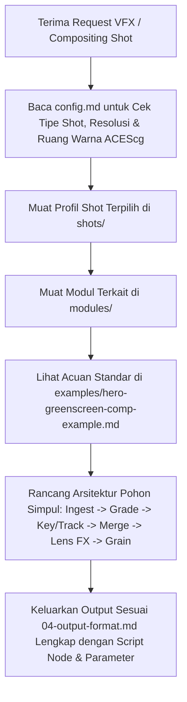

# EffectCraft Skill

Skill ini dirancang dengan pendekatan modular berbasis **konfigurasi sentral (`config.md`)**, **profil tipe shot VFX (`shots/`)**, **modul spesifikasi compositing node graph (`modules/`)**, dan **contoh nyata ideal (`examples/`)**.

---

## 🎯 Alur Eksekusi AI (Execution Flow)

Setiap kali skill ini aktif, AI **WAJIB** mengikuti urutan prioritas pembacaan berikut:

### 1. Periksa Saklar Utama ([config.md](./config.md))
- Lihat nilai `target_shot` (misal: `green-screen-keying`, `cg-multipass-comp`, `tracking-cleanup-plate`, atau `custom-vfx`).
- Periksa konfigurasi teknis (`canvas_resolution`: `4k_uhd`, `framerate`: `24.0`, `working_bit_depth`: `32_float`, `color_management`: `aces_cg`).
- Periksa status aktif/non-aktif setiap modul di `modules_enabled`.
- Pastikan kepatuhan preferensi: `max_tracking_error_px: 0.5`, `separate_core_and_edge_matte: true`, dan `regrain_all_cg_elements: true`.

### 2. Muat Profil Tipe Shot VFX ([shots/](./shots/))
- Buka file profil shot yang terpilih:
  - Ekstraksi Layar Hijau & Integrasi Latar: [`shots/green-screen-keying.md`](./shots/green-screen-keying.md)
  - Rekonstruksi Render CGI Multi-Pass: [`shots/cg-multipass-comp.md`](./shots/cg-multipass-comp.md)
  - Pelacakan Kamera & Pembersihan Plat: [`shots/tracking-cleanup-plate.md`](./shots/tracking-cleanup-plate.md)
  - Efek Khusus Kustom (Partikel / Energi Sci-Fi): [`shots/custom-vfx.md`](./shots/custom-vfx.md)

### 3. Terapkan Modul Standar ([modules/](./modules/))
- **01. Ruang Warna Linear & ACES**: Lakukan compositing pada ruang 32-bit float linear (ACEScg) agar interaksi cahaya, glow, dan blur bernilai fisik alami dari [`modules/01-linear-color-aces.md`](./modules/01-linear-color-aces.md).
- **02. Keying, Despill & Tepi**: Pisahkan matte menjadi Core Matte (tubuh padat) dan Edge Matte (rambut halus), terapkan despill matematika ekspresi, dan tambahkan light wrap dari [`modules/02-keying-despill-edges.md`](./modules/02-keying-despill-edges.md).
- **03. Tracking & Matchmove 3D**: Lakukan pelacakan titik / planar Mocha / solve kamera 3D dengan error $\le 0.5\text{px}$, serta perhitungkan paralaks kedalaman dari [`modules/03-tracking-matchmove-3d.md`](./modules/03-tracking-matchmove-3d.md).
- **05. Rekonstruksi Multi-Pass CGI**: Rakit ulang lapisan render AOVs EXR (Diffuse, Specular, GI, SSS, Reflection, AO) menggunakan rumus matematis baku dari [`modules/05-multipass-aov-rebuild.md`](./modules/05-multipass-aov-rebuild.md).
- **06. Roto & Clean Plate Paint**: Susun kurva bezier rotoscoping berbasis artikulasi anatomi sendi dan teknik clone projection clean plate dari [`modules/06-roto-cleanplate-paint.md`](./modules/06-roto-cleanplate-paint.md).
- **07. Efek Optik & Lensa**: Lakukan undistort lensa sebelum tracking, tambahkan chromatic aberration di tepian frame, anamorphic flare, dan konvolusi bokeh dari [`modules/07-optical-effects-lens.md`](./modules/07-optical-effects-lens.md).
- **08. Film Grain & Delivery**: Hilangkan grain rekaman asli sebelum keying (*degrain*), lalu pasang kembali grain film terkalibrasi (*regrain*) di akhir pipeline sebelum diekspor ke EXR / ProRes 4444 XQ dari [`modules/08-film-grain-delivery.md`](./modules/08-film-grain-delivery.md).

### 4. Acuan Pohon Simpul Nyata ([examples/hero-greenscreen-comp-example.md](./examples/hero-greenscreen-comp-example.md))
- Jadikan [hero-greenscreen-comp-example.md](./examples/hero-greenscreen-comp-example.md) sebagai tolok ukur standar (*benchmark*) penggabungan shot live-action green screen, background planet CGI, dual-matte keying, relighting light wrap, dan kode script simpul Nuke `.nk` yang siap pakai.

### 5. Format Output ([modules/04-output-format.md](./modules/04-output-format.md))
- Sajikan diagram visual pohon simpul (Mermaid), tabel parameter numerik per node, kode script Nuke/Fusion, dan checklist verifikasi pra-render film resmi.

---

## 📂 Peta Struktur File

| Berkas / Direktori | Fungsi Utama |
| :--- | :--- |
| [config.md](./config.md) | Saklar sentral (tipe shot, resolusi kanvas, ruang warna ACEScg, modul aktif). |
| [shots/green-screen-keying.md](./shots/green-screen-keying.md) | Standar shot chroma studio: dual-matte (core vs edge), despill neutral, light wrap lingkungan. |
| [shots/cg-multipass-comp.md](./shots/cg-multipass-comp.md) | Standar integrasi 3D render passes: beauty rebuild, Z-depth haze, relighting normal pass. |
| [shots/tracking-cleanup-plate.md](./shots/tracking-cleanup-plate.md) | Standar pelacakan & cleanup: planar screen replacement, wire removal, rig cleanup. |
| [shots/custom-vfx.md](./shots/custom-vfx.md) | Profil efek khusus: simulasi partikel api/debu, ledakan sihir sci-fi, intro motion graphics. |
| [modules/01-linear-color-aces.md](./modules/01-linear-color-aces.md) | Ruang warna ACEScg, OCIO OpenColorIO, 32-bit floating point, dynamic range tanpa clipping. |
| [modules/02-keying-despill-edges.md](./modules/02-keying-despill-edges.md) | Formula ekstraksi matte hijau/biru, ekspresi despill, edge choke/blur, penyesuaian light wrap. |
| [modules/03-tracking-matchmove-3d.md](./modules/03-tracking-matchmove-3d.md) | Pelacakan kamera 3D, planar tracker Mocha, corner-pin 4 titik, batas toleransi error < 0.5px. |
| [modules/04-output-format.md](./modules/04-output-format.md) | Template standar output AI: diagram simpul Mermaid, parameter tabel node, script .nk, checklist. |
| [modules/05-multipass-aov-rebuild.md](./modules/05-multipass-aov-rebuild.md) | Aljabar rekombinasi AOV: Diffuse + Specular + Reflection + SSS, isolasi Cryptomatte. |
| [modules/06-roto-cleanplate-paint.md](./modules/06-roto-cleanplate-paint.md) | Rotoscoping efisien berbasis sendi anatomi, clone stamping, proyeksi kamera clean plate. |
| [modules/07-optical-effects-lens.md](./modules/07-optical-effects-lens.md) | Undistort/redistort lensa kamera, chromatic aberration pinggir frame, bokeh blur optis. |
| [modules/08-film-grain-delivery.md](./modules/08-film-grain-delivery.md) | Prosedur degrain plate asli, regrain matching elemen CGI/grafis, format master render EXR. |
| [examples/hero-greenscreen-comp-example.md](./examples/hero-greenscreen-comp-example.md) | Contoh emas compositing shot Sci-Fi: aktor green screen + background alien + script Nuke .nk. |

---

## 🚫 Larangan Khusus untuk AI

1. **Dilarang Keying Menggunakan Satu Matte Tunggal**: Wajib memisahkan *Core Matte* (untuk bagian tubuh tengah yang padat tanpa lubang) dan *Edge Matte* (untuk detail helai rambut tipis dan motion blur).
2. **Dilarang Melakukan Operasi Blur pada Ruang Warna Non-Linear (Gamma)**: Operasi blur, glow, dan merging cahaya wajib dilakukan pada ruang 32-bit linear float untuk mencegah garis tepian gelap (*dark edge fringing*).
3. **Dilarang Menggabungkan Elemen CGI Tanpa Matching Film Grain**: Seluruh elemen grafis atau 3D murni wajib diberi butiran grain yang sesuai dengan karakteristik sensor kamera rekaman latar (*plate grain*).
4. **Dilarang Melewati Penyesuaian Nilai Hitam & Putih (Black/White Point Matching)**: Titik hitam paling gelap (*shadow black point*) dan titik putih paling terang pada elemen komposit wajib disamakan dengan titik hitam dan putih pada plate rekaman asli.
