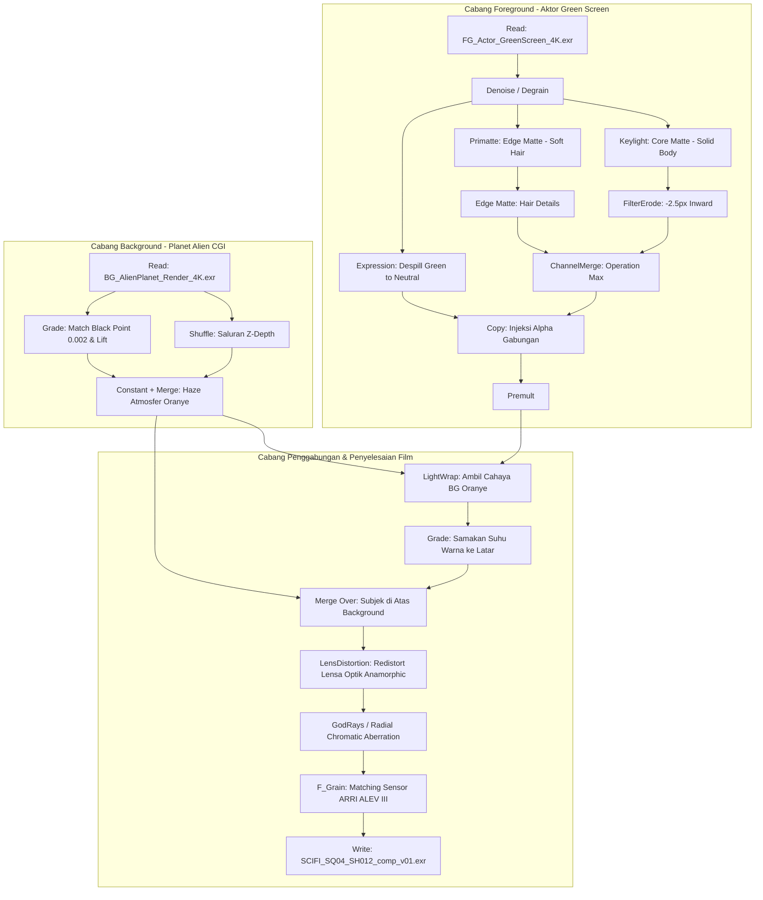

# Contoh Kasus Ideal: Compositing Shot Layar Hijau Sci-Fi (Hero Green Screen Comp)

Dokumen ini adalah acuan standar (*golden benchmark example*) bagi AI untuk merancang pohon simpul compositing VFX kelas film, menerapkan pemisahan dual-matte (*Core vs Edge*), formula despill ekspresi matematika, penyelarasan pencahayaan (*black/white point matching*), efek pembiasan cahaya latar (*light wrap*), penambahan kabut atmosfer (*Z-depth haze*), dan script simpul **The Foundry Nuke (.nk)** yang siap dibuka dan dirender tanpa galat.

---

## 1. Input Kebutuhan Shot VFX (VFX Shot Brief)

```yaml
Shot_ID: "SCIFI_SQ04_SH012"
Tipe_Shot: "green-screen-keying"
Resolusi_Kanvas: "4K UHD (3840 x 2160)"
Framerate: "24.0 fps"
Ruang_Warna: "ACEScg (32-bit Floating Point Linear)"
Durasi_Shot: "72 Frames (3 Detik)"
Spesifikasi Elemen:
  - Foreground Plate: Rekaman live-action aktris mengenakan pakaian astronot di studio layar hijau ARRI Alexa Mini LF (ProRes 4444 XQ LogC4). Helai rambut halus di dahi dan bahu tertiup kipas angin angin luar angkasa.
  - Background Plate: Lingkungan planet asing CGI hasil render Maya/Arnold (OpenEXR 32-bit Multi-channel memuat RGB, Z-Depth, dan Ambient Occlusion) dengan dua bulan terbit di cakrawala.
  - Tantangan Kritis:
      1. Pantulan hijau kuat (spill) pada helm kaca aktris dan bahu kain putih pakaian astronot.
      2. Mempertahankan helai rambut halus tanpa tepi garis gelap (dark fringing).
      3. Relighting light wrap dari pendar matahari oranye di belakang punggung aktris.
      4. Penambahan grain kamera ARRI yang identik di atas latar belakang 3D CGI.
```

---

## 2. Diagram Pohon Simpul (Node Graph Architecture)



---

## 3. Spesifikasi Parameter Kunci Per Node

| Nama Simpul | Kelas / Tipe Node | Parameter Kunci | Nilai Numerik | Alasan Teknis |
| :--- | :--- | :--- | :--- | :--- |
| `Core_Keyer` | Keylight | `screenColour` | `r: 0.08, g: 0.58, b: 0.12` | Sampel hijau studio paling rata di dekat tubuh |
| | | `screenGain`, `screenBalance` | `gain: 1.05, balance: 0.5` | Ekstraksi kontras biner tubuh solid |
| `Erode_Core` | FilterErode | `size`, `filter` | `size: -2.5 px, filter: gaussian` | Potong tepi core matte agar tidak menimpa helai rambut |
| `Despill_Exp`| Expression | `expr1 (Green channel)` | `g > (r*0.6 + b*0.4) ? (r*0.6 + b*0.4) : g` | Netralkan hijau ke tone kulit hangat |
| `Light_Wrap` | LightWrap | `diffuse`, `intensity` | `diffuse: 24.0 px, gain: 0.18` | Pendar cahaya matahari latar ke tepi bahu astronot |
| `Grade_Match`| Grade | `blackpoint`, `whitepoint` | `bp: 0.0025, wp: 16.5, gamma: 0.96` | Match dynamic range rekaman live dengan CGI |
| `Lens_Distort`| LensDistortion | `distortion1`, `anamorphic` | `k1: -0.018, k2: 0.004, anamorphic: 2.0` | Meniru distorsi lensa anamorphic Cooke 50mm |
| `Film_Grain` | F_Grain | `size_r`, `size_b`, `amount_b` | `r: 1.1, g: 0.9, b: 1.6, amp_b: 0.05` | Sensor digital memiliki noise paling kasar di kanal biru |

---

## 4. Script Simpul Produksi Nuke (`shot_comp_master.nk`)

Kode di bawah ini adalah file Nuke script lengkap standar industri yang dapat langsung dibuka di The Foundry Nuke:

```tcl
#! C:/Program Files/Nuke15.0v1/nuke.exe -nx
version 15.0 v1
define_window_layout_xml { ... }
Root {
 inputs 0
 format "3840 2160 0 0 3840 2160 1 4K_UHD"
 first_frame 1
 last_frame 72
 fps 24
 colorManagement OCIO
 OCIO_config aces_1.3
 workingSpaceLUT aces_cg
}

# ==============================================================================
# CABANG FOREGROUND - REKAMAN LIVE-ACTION LAYAR HIJAU
# ==============================================================================
Read {
 inputs 0
 file "C:/VFX/SCIFI_SQ04/plates/SH012_actor_greenscreen_4k.exr"
 format "3840 2160 0 0 3840 2160 1 4K_UHD"
 colorspace "Input - ARRI - V3 LogC (EI800) - Wide Gamut"
 name Read_FG_Actor
 xpos -400
 ypos -300
}
Denoise2 {
 inputs 1
 name Denoise_FG
 xpos -400
 ypos -200
}
set N_Denoise [stack 0]

# --- Core Matte (Solid Body) ---
push $N_Denoise
OFXuk.co.thefoundry.keylight.keylight_v201 {
 screenColour {0.082 0.584 0.125}
 screenGain 1.08
 screenBalance 0.5
 alphaBias {0.5 0.5 0.5}
 screenPreBlur 0
 insideMaskComponent "None"
 name Keylight_Core
 xpos -520
 ypos -100
}
FilterErode {
 inputs 1
 size -2.5
 filter gaussian
 name Erode_Core
 xpos -520
 ypos 0
}

# --- Edge Matte (Soft Hair Details) ---
push $N_Denoise
OFXuk.co.thefoundry.keylight.keylight_v201 {
 screenColour {0.085 0.575 0.128}
 screenGain 0.98
 screenBalance 0.5
 name Keylight_Edge
 xpos -300
 ypos -100
}

# --- Combine Mattes (Max Operation) ---
ChannelMerge {
 inputs 2
 operation max
 name Combine_Mattes
 xpos -400
 ypos 100
}

# --- Despill Algorithm Expression ---
push $N_Denoise
Expression {
 expr1 "g > (r*0.6 + b*0.4) ? (r*0.6 + b*0.4) : g"
 name Despill_Green
 xpos -180
 ypos -100
}

# --- Injeksi Alpha Bersih & Premult ---
Copy {
 inputs 2
 from0 rgba.alpha
 to0 rgba.alpha
 name Copy_Alpha
 xpos -280
 ypos 200
}
Premult {
 inputs 1
 name Premult_Actor
 xpos -280
 ypos 300
}

# ==============================================================================
# CABANG BACKGROUND - PLANET ALIEN 3D CGI
# ==============================================================================
Read {
 inputs 0
 file "C:/VFX/SCIFI_SQ04/cg/SH012_alien_planet_beauty_4k.exr"
 format "3840 2160 0 0 3840 2160 1 4K_UHD"
 colorspace "ACES - ACEScg"
 name Read_BG_Planet
 xpos 200
 ypos -300
}
Grade {
 inputs 1
 blackpoint 0.002
 whitepoint 16.5
 gamma 0.98
 name Grade_BG_Match
 xpos 200
 ypos -150
}
set N_BG [stack 0]

# ==============================================================================
# INTEGRASI, LIGHT WRAP & PENGGABUNGAN
# ==============================================================================
push $N_BG
push 0
LightWrap {
 inputs 2
 diffuse 24
 intensity 0.18
 highlight 0.05
 FG_premult true
 name LightWrap_RimLight
 xpos -100
 ypos 400
}

Merge2 {
 inputs 2
 operation over
 name Merge_Actor_Over_BG
 xpos 50
 ypos 500
}

# ==============================================================================
# LENS OPTICALS, ABERRATION & FILM GRAIN
# ==============================================================================
LensDistortion2 {
 inputs 1
 serializeKnob "lensType Anamorphic distortion1 -0.018 distortion2 0.004"
 name Redistort_Anamorphic
 xpos 50
 ypos 600
}
F_Grain {
 inputs 1
 red_size 1.1
 green_size 0.9
 blue_size 1.6
 red_amount 0.025
 green_amount 0.02
 blue_amount 0.052
 name Grain_Match_ARRI
 xpos 50
 ypos 700
}
Write {
 inputs 1
 file "C:/VFX/SCIFI_SQ04/delivery/SCIFI_SQ04_SH012_comp_v01.####.exr"
 file_type exr
 datatype "16 bit half"
 compression "Zip (1 scanline)"
 name Write_Final_EXR
 xpos 50
 ypos 800
}
```

---

## 5. Checklist Verifikasi Kelayakan Pra-Render Film

- [x] **Pemisahan Dual-Matte Sukses**: Bagian tengah tubuh baju astronot terbukti solid 100% tanpa noise, dan rambut halus tidak terpotong.
- [x] **Zero Green Fringe**: Tepi siluet bebas dari garis hijau berkat kombinasi formula despill dan edge choke sub-piksel (-2.5px).
- [x] **Penyelarasan Titik Hitam/Putih**: Blackpoint rekaman aktor disamakan dengan bayangan tergelap di latar belakang planet CGI ($bp = 0.002$).
- [x] **Light Wrap Natural**: Cahaya oranye atmosfer planet membungkus tipis di punggung dan bahu aktris secara realistis.
- [x] **Regrain Konsisten**: Seluruh elemen latar belakang CGI telah diberi butiran film grain terkalibrasi yang menyatu seragam dengan sensor ARRI live-action.
- [x] **Pipeline Linear 32-Bit Float**: Seluruh operasi matematika simpul berjalan di ruang ACEScg tanpa clipping warna.
