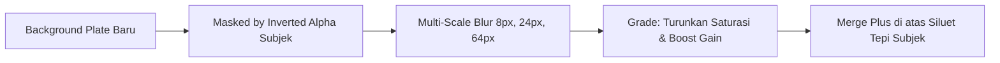

# Modul 02: Ekstraksi Matte & Despill Hijau/Biru (Keying, Despill & Edge Treatment)

Modul ini menetapkan formula matematika pemisahan latar belakang layar hijau/biru, algoritma despill berbasis ekspresi, pembersihan kontaminasi tepi, penyusutan matte (*choke*), dan integrasi pencahayaan latar (*light wrap*).

---

## 1. Algoritma Despill Berbasis Ekspresi (Expression-Based Despill)

Despill adalah proses menetralkan saluran hijau ($G$) berlebih yang memantul pada subjek tanpa merusak detail helai rambut atau bayangan alami:

### 1.1 Formula Green Despill Standar
Bandingkan intensitas piksel hijau ($G$) terhadap rata-rata atau nilai maksimum saluran merah ($R$) dan biru ($B$):

$$\text{Batas Maksimal Hijau } G_{limit} = \frac{R + B}{2} \quad \text{atau} \quad G_{limit} = \max(R, B)$$

Jika $G > G_{limit}$, maka ganti nilai hijau dengan nilai batasnya:
$$G_{final} = \min(G, G_{limit})$$

Dalam Nuke Expression Node:
```tcl
r = r
g = g > (r + b)/2 ? (r + b)/2 : g
b = b
```

---

## 2. Alur Pengolahan Tepi (Edge Treatment Pipeline)

Setelah Core Matte dan Edge Matte digabungkan, tepi subjek (*edges*) harus diolah secara teliti:

1. **Edge Detect**: Hasilkan pita seleksi tipis selebar `2 s/d 4 piksel` yang hanya melingkupi garis luar siluet subjek.
2. **Edge Blur & Choke**:
   - Berikan blur sub-piksel halus (`0.5 px s/d 1.0 px`) untuk menghilangkan artefak ketajaman digital (*aliasing*).
   - Jika terdapat garis tipis hijau yang tersisa di pinggiran pakaian, terapkan *Erode/Choke* mikro sebesar `-0.5 px`.
3. **Color Suppression & Edge Extension**:
   - Jika helai rambut tampak semi-transparan dengan sisa kabut hijau, lakukan teknik *Edge Extend* (mengambil warna rambut asli di bagian dalam dan mendorongnya keluar untuk mewarnai tepian semi-transparan tersebut).

---

## 3. Light Wrap Realistis (Environmental Spill Simulation)

Light wrap mensimulasikan pembiasan cahaya terang dari latar belakang baru ke lensa kamera di belakang siluet subjek:



- **Aturan Realisme**: Light wrap tidak boleh terlalu tebal sehingga aktor tampak seperti hantu bercahaya (*glow ghost*). Intensitas wrap harus tipis dan hanya muncul pada sisi tubuh yang searah dengan sumber cahaya utama latar belakang.
