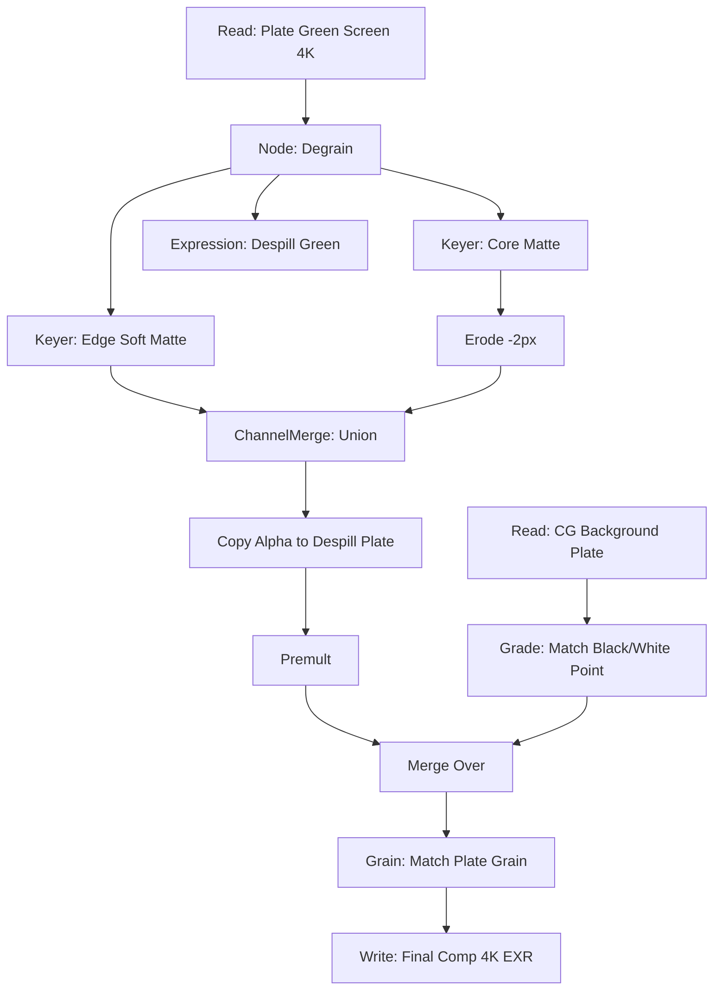

# Modul 04: Format Output Standar AI (Node Graph Compositing Specification)

Modul ini mendikte bagaimana AI harus memformat dan menyajikan respon ketika menyusun diagram pohon simpul (*node tree*), tabel parameter numerik per node, kode script Nuke/Fusion, dan checklist evaluasi visual effects.

---

## 1. Struktur Respon Wajib AI

Setiap kali AI menyajikan solusi compositing berdasarkan skill ini, respon **WAJIB** mengikuti urutan 5 bagian berikut:

1. **Ringkasan Shot & Pipeline Teknis**:
   - Jelaskan tipe shot (`green-screen-keying`, `cg-multipass-comp`, dsb.), resolusi (misal: 4K UHD 3840x2160 @ 24fps), ruang warna kerja (`ACEScg / Linear 32-bit Float`), dan software engine target (Nuke / Fusion).
2. **Diagram Alur Pohon Simpul Lengkap (Mermaid Node Graph)**:
   - Visualisasikan hubungan antar simpul (Nodes) dari sumber input (*Read Plates, CG Passes*), pengolahan matte (*Keyer, Roto*), modifikasi warna (*Grade, ColorCorrect*), penggabungan (*Merge*), hingga output (*Write Node*).
3. **Tabel Parameter Kunci Per Node**:
   - Cantumkan nama node, jenis operasi (Over, Multiply, Plus), nilai parameter numerik kritis (Gain, Gamma, Lift, Blur Radius, Despill Expression, Erode pixels).
4. **Script Pohon Simpul Produksi (Nuke Script `.nk` / Python OpenTimelineIO)**:
   - Kode script simpul lengkap tanpa pemotongan placeholder komentar seperti `// tambahkan sisa node sendiri...`.
5. **Checklist Kualitas Pra-Render Film (Pre-Render VFX Checklist)**:
   - Verifikasi ketat kelayakan compositing sebelum render akhir ke format master OpenEXR.

---

## 2. Template Output Markdown Resmi

Contoh format yang harus diikuti oleh AI:

````markdown
### 🎬 Alur Compositing VFX: [Nama Shot / Sequence]
Tipe: `[Shot Archetype]` | Format: `[4K UHD 3840x2160 @ 24fps]` | Ruang Warna: `ACEScg 32-bit Float`

#### 1. Diagram Pohon Simpul (Node Graph)


#### 2. Spesifikasi Parameter Numerik Node
| Nama Node | Tipe / Kelas | Parameter Kunci | Nilai Numerik | Fungsi Teknis |
| :--- | :--- | :--- | :--- | :--- |
| `Core_Keyer` | Primatte / Keylight | Screen Color: `#1b7a2d` | Clip Black: 0.15, Clip White: 0.85 | Soliditas tubuh tengah (Alpha 1.0) |
| `Edge_Erode` | FilterErode | size | `-2.0 px` | Menghilangkan fringe tepi core matte |
| `Despill_Exp` | Expression | g | `g > (r + b)/2 ? (r + b)/2 : g` | Netralkan pantulan hijau pada kulit |
| `Light_Wrap` | LightWrap | size, intensity | `size: 32px, gain: 0.12` | Bocorkan cahaya latar ke tepi tubuh |
| `Film_Grain` | F_Grain / Grain | red_size, blue_size | `r: 1.2, g: 1.0, b: 1.5, amp: 0.04`| Samakan butiran sensor kamera film |

#### 3. Cuplikan Script Node Nuke (`shot_comp_v01.nk`)
```tcl
#! C:/Program Files/Nuke15.0v1/nuke.exe -nx
version 15.0 v1
define_window_layout_xml { ... }
Root {
 inputs 0
 format "3840 2160 0 0 3840 2160 1 4K_UHD"
 fps 24
 colorManagement OCIO
 OCIO_config aces_1.3
 workingSpaceLUT aces_cg
}
Read {
 inputs 0
 file "C:/VFX/plates/actor_greenscreen_4k.exr"
 colorspace "Input - ARRI - V3 LogC (EI800) - Wide Gamut"
 name Read_Greenscreen
}
# ... script lengkap tanpa pemotongan ...
```

#### ✅ Checklist Verifikasi Pra-Render VFX:
- [x] Dual-matte (Core padat + Edge helai rambut) terpisah dan digabung sempurna
- [x] Despill aktif tanpa merusak saturasi warna kulit alami
- [x] Black point dan white point elemen integrasi match dengan plate latar
- [x] Seluruh elemen CGI/grafis diberi regrain terkalibrasi
- [x] Render output berkedalaman 32-bit floating point tanpa clipping
````

---

## 3. Larangan Khusus untuk AI
- **Dilarang Menghasilkan Diagram Node yang Mengambang**: Setiap node harus memiliki sumber input (*inputs*) dan tujuan output yang jelas.
- **Dilarang Melewatkan Nilai Numerik**: Jangan hanya menulis `"sesuaikan grade secukupnya"`; selalu berikan nilai angka acuan (misal: `gain: 1.15, gamma: 0.95`).
- **Dilarang Mengabaikan `config.md`**: Selalu baca preferensi resolusi kanvas dan batas toleransi error tracking.
