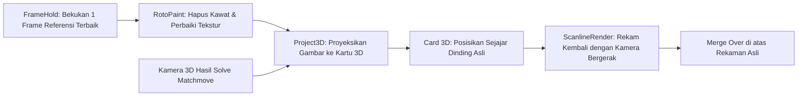

# Modul 06: Rotoscoping & Pembersihan Plat (Roto & Clean Plate Paint)

Modul ini menetapkan metodologi pembuatan kurva rotoscoping presisi berbasis sendi anatomi, teknik proyeksi kamera 3D untuk plat bersih (*clean plate projection*), dan penghapusan kawat (*wire removal*).

---

## 1. Kaidah Emas Rotoscoping Berbasis Sendi (Articulated Roto)

Jangan pernah menggambar satu kurva siluet raksasa yang melingkari seluruh tubuh manusia. Setiap pergerakan organ tubuh harus memiliki bentuk kurva bezier terpisah:

```text
Struktur Kurva Roto Terpisah:
├── Kepala (Head)
├── Leher (Neck)
├── Dada & Bahu (Torso & Shoulders)
├── Lengan Atas (Upper Arm) ── Bergerak dari sendi bahu
├── Lengan Bawah (Forearm)  ── Bergerak dari sendi siku
├── Telapak Tangan (Hand)   ── Bergerak dari pergelangan
└── Jari-Jari Mandiri (Individual Fingers)
```

### Aturan Interpolasi Keyframe Roto:
1. **Animasi Transformasi Terlebih Dahulu**: Animasikan posisi, rotasi, dan skala keseluruhan kurva mengikuti gerak tulang sebelum memindahkan titik kontrol individu (*control points*).
2. **Keyframe Ekstrem**: Tentukan keyframe hanya pada titik awal gerakan (*start*), titik balik ekstrem (*peak*), dan titik akhir (*end*). Biarkan komputer menginterpolasi sisanya; terlalu banyak keyframe membuat kurva bergetar liar (*boiling edge*).

---

## 2. Teknik Proyeksi Kamera Clean Plate (Camera Projection Cleanup)

Untuk menghapus objek yang tidak diinginkan (misal tiang kawat atau bayangan mikrofon di dinding):



- **Kelebihan Proyeksi 3D**: Desainer hanya perlu mengecat 1 frame statis dengan rapi. Kamera 3D yang bergerak akan secara otomatis menganimasikan tambalan tersebut dengan perspektif dan paralaks yang 100% konsisten sepanjang seluruh durasi shot.
