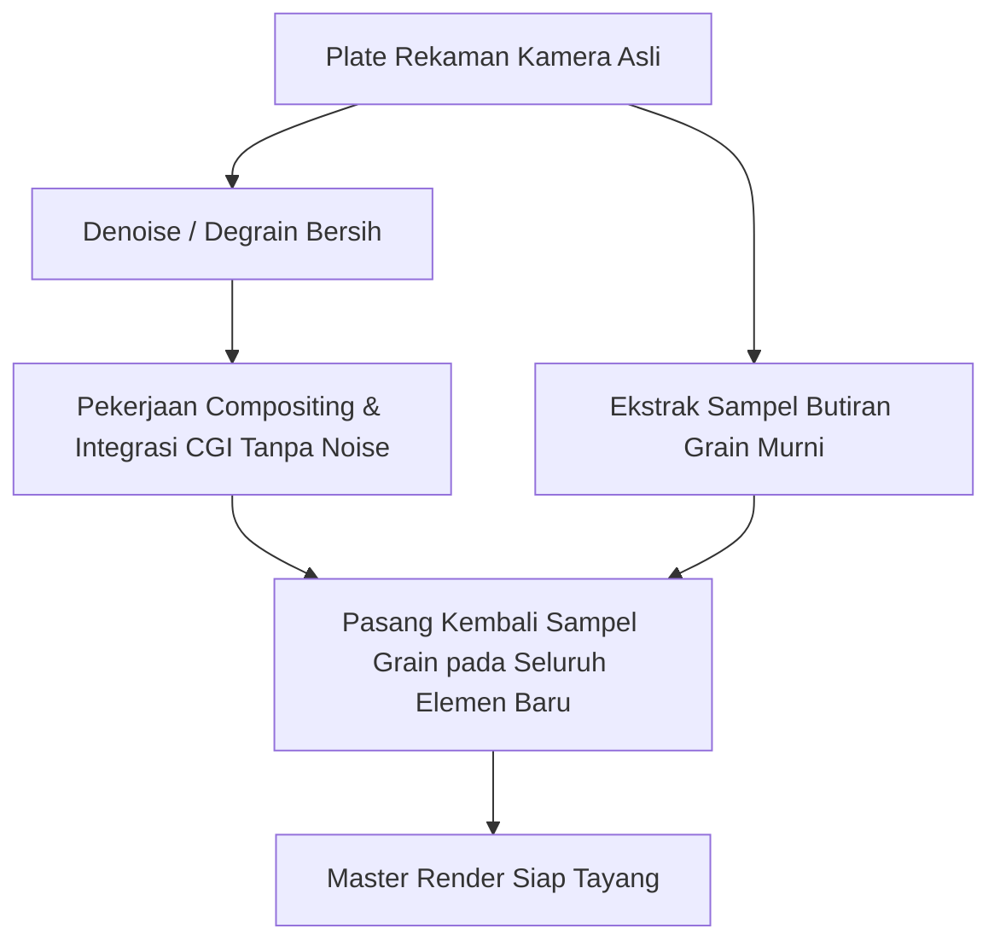

# Modul 08: Manajemen Film Grain & Format Master Render (Film Grain & Master Delivery)

Modul ini menetapkan protokol pembersihan butiran film rekaman asli (*degrain*), pemasangan kembali butiran grain terkalibrasi (*regrain matching*), serta standar format berkas ekspor master film (*OpenEXR 16/32-bit, Apple ProRes 4444 XQ, DPX 12-bit*).

---

## 1. Siklus Degrain & Regrain (The Grain Matching Principle)

Butiran grain film atau noise sensor kamera digital (seperti sensor ARRI ALEV atau RED Monstro) merupakan musuh utama keying dan tracking, namun menjadi elemen paling penting yang menyatukan seluruh elemen komposit:

1. **Langkah 1: Degrain Sebelum Operasi VFX**:
   - Lakukan Denoise/Degrain pada rekaman awal agar algoritma keyer tidak menghasilkan noise semut (*chattering edges*) pada matte alpha, dan titik tracking tidak meleset.
2. **Langkah 2: Regrain Matching**:
   - Seluruh elemen yang ditambahkan (CGI 3D, matte painting langit, ledakan partikel digital) memiliki karakteristik 100% mulus tanpa noise (*noise-free*).
   - Wajib memasang node Grain di atas elemen baru dengan karakteristik ukuran (*size*), bentuk (*aspect*), dan intensitas (*intensity/amplitude*) yang identik per saluran warna ($R, G, B$) dengan rekaman live-action asli. Saluran Biru ($B$) biasanya memuat butiran grain paling kasar dan kuat dibanding saluran Hijau ($G$).

---

## 2. Standar Format Master Pengiriman Film (Master Delivery Formats)

Pilihlah format master render akhir sesuai tujuan pasca-produksi:

| Format Berkas | Bit Depth & Kompresi | Ruang Warna | Kapan Digunakan |
| :--- | :--- | :--- | :--- |
| **OpenEXR (.exr)** | 16-bit Half Float / 32-bit Float (Zip / PIZ compression) | ACEScg / Linear | Format master pertukaran VFX antar vendor film layar lebar dan platform streaming (Netflix/Disney+ spec). |
| **Apple ProRes 4444 XQ** | 12-bit RGB 4:4:4:4 (QuickTime .mov) | Rec.709 / Log / ACES | Format pengiriman master ke studio Color Grading (DaVinci Resolve) dengan ukuran file lebih ringkas. |
| **DPX (.dpx)** | 10-bit / 12-bit Logarithmic (Uncompressed) | Cineon / Film Log | Format arsip laboratorium film seluloid tradisional. |

> Jangan pernah merender keluaran akhir VFX menggunakan format kompresi lossy 8-bit (seperti MP4 H.264 atau PNG 8-bit), karena seluruh rentang dinamis HDR dan gradasi pendar cahaya halus akan hancur dan mengalami pita belang (*banding artifacts*).
