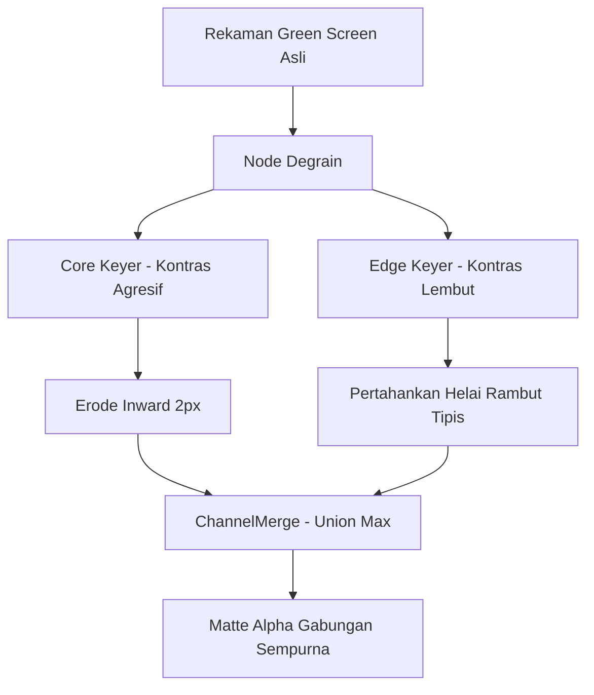

# Profil Shot: Ekstraksi Layar Hijau & Integrasi Latar (Green Screen Keying)

Profil ini mengatur alur kerja compositing untuk rekaman aktor di studio layar hijau (*chroma keying*), penanganan helai rambut halus, pantulan warna hijau (*spill contamination*), dan integrasi ke dalam latar belakang baru (*background plate integration*).

---

## 1. Karakteristik & Tantangan Shot Green Screen
- **Kontaminasi Spill**: Pantulan cahaya hijau dari lantai/dinding studio menempel pada bahu, kulit wajah, dan pakaian aktor.
- **Rambut & Motion Blur**: Area semi-transparan yang memuat campuran antara helai rambut aktor dengan piksel hijau layar.
- **Pencahayaan Studio yang Tidak Rata**: Sisi layar hijau seringkali memiliki gradasi gelap-terang atau bayangan aktor di lantai.

---

## 2. Metodologi Dual-Matte (Core Matte + Edge Matte)

Jangan pernah mencoba mengekstrak layar hijau hanya dengan satu node keyer. Pisahkan menjadi dua alur independen:

1. **Core Matte (Matte Tubuh Tengah)**:
   - Ditarik dengan nilai hitam dan putih yang dipaksa keras agar bagian tengah tubuh aktor 100% solid (Alpha = 1.0) tanpa ada lubang transparan semu di pakaian.
   - Dipotong menyusut ke dalam (*eroded*) sebesar `1.5 s/d 2.5 piksel` agar batas tepinya tidak mengganggu helai rambut.
2. **Edge Matte (Matte Tepi Rambut)**:
   - Ditarik dengan nilai lembut dan halus (*soft keying*) untuk mempertahankan helai rambut tipis, bulu pakaian, dan kelembutan motion blur gerakan tangan.
3. **Penyatuan Matte**:
   - Kedua matte digabungkan menggunakan operasi Boolean Max/Union (`ChannelMerge` operation `max`).

---

## 3. Integrasi Latar Belakang (Relighting & Light Wrap)
1. **Despill**:
   - Terapkan ekspresi despill untuk menetralkan warna hijau menjadi warna abu-abu netral atau warna kulit alami sebelum elemen di-grade.
2. **Light Wrap Lingkungan**:
   - Ambil cahaya terang dari latar belakang baru, blur secara eksponensial (blur radius 8px, 24px, 64px), lalu bocorkan (*wrap*) ke batas tepi luar aktor sebesar `2% s/d 5%`.
   - Hal ini menghilangkan kesan "tempelan" palsu dan membuat aktor benar-benar tampak berada di lokasi baru.
