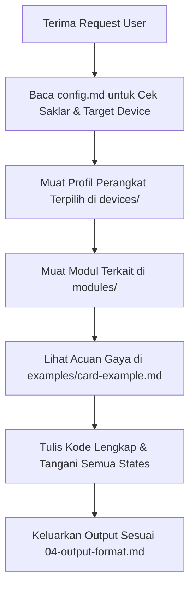

# FigCraft Skill: Master UI Component & Frontend Design Suite

Skill ini dirancang sebagai standar master arsitektur desain komponen antarmuka (UI/UX) dan pengembangan frontend modern di **FigCraft**, berbasis **konfigurasi sentral (`config.md`)**, **modul spesifikasi (`modules/`)**, **profil target perangkat (`devices/`)**, dan **contoh nyata ideal (`examples/`)**.

---

## 🎯 Alur Eksekusi AI (Execution Flow)

Setiap kali skill ini aktif, AI **WAJIB** mengikuti urutan prioritas pembacaan berikut:

### 1. Periksa Saklar Utama ([config.md](./config.md))
- Lihat nilai `target_device` (misal: `mobile`, `tablet-ipad`, `desktop`, atau `custom-device`).
- Periksa status aktif/non-aktif setiap modul (`modules_enabled`).
- Sesuaikan teknologi utama (`framework`, `styling_engine`, `language`).

### 2. Muat Profil Perangkat ([devices/](./devices/))
- Buka file profil perangkat yang terpilih:
  - Mobile: [`devices/mobile.md`](./devices/mobile.md)
  - Tablet / iPad: [`devices/tablet-ipad.md`](./devices/tablet-ipad.md)
  - Desktop: [`devices/desktop.md`](./devices/desktop.md)
  - Custom Device: [`devices/custom-device.md`](./devices/custom-device.md)

### 3. Terapkan Modul Standar ([modules/](./modules/))
- **01. Desain**: Terapkan token warna, spacing, dan tipografi dari [`modules/01-design-system.md`](./modules/01-design-system.md).
- **02. Arsitektur**: Susun struktur folder, komponen, dan state sesuai [`modules/02-architecture.md`](./modules/02-architecture.md).
- **03. Koding**: Patuhi standar clean code, TypeScript, dan performa dari [`modules/03-coding-rules.md`](./modules/03-coding-rules.md).
- **05. States & Animasi**: Wajib menyediakan Loading (skeleton/spinner), Empty state, Error state, dan durasi transisi 150-200ms dari [`modules/05-states-motion.md`](./modules/05-states-motion.md).
- **06. Aset & Media**: Pastikan rasio aspek gambar terkontrol (16:9, 4:3, 1:1), ada fallback avatar/error, dan ukuran ikon konsisten dari [`modules/06-assets-media.md`](./modules/06-assets-media.md).
- **07. Aksesibilitas**: Terapkan kontras WCAG AA (4.5:1), navigasi keyboard penuh, dan `aria-label` dari [`modules/07-accessibility.md`](./modules/07-accessibility.md).
- **08. Tema & i18n**: Dukungan Dark Mode dan antisipasi pemanjangan teks multi-bahasa dari [`modules/08-theme-i18n.md`](./modules/08-theme-i18n.md).

### 4. Acuan Kode Nyata ([examples/card-example.md](./examples/card-example.md))
- Jadikan [card-example.md](./examples/card-example.md) sebagai tolok ukur standar (*benchmark*) gaya penulisan kode, penanganan error/loading, dan penerapan class styling.

### 5. Format Output ([modules/04-output-format.md](./modules/04-output-format.md))
- Sajikan kode lengkap, path direktori file, penjelasan ringkas, dan checklist verifikasi sesuai template output resmi.

---

## 📂 Peta Struktur File

| Berkas / Direktori | Fungsi Utama |
| :--- | :--- |
| [config.md](./config.md) | Saklar sentral (target perangkat, stack teknologi, modul aktif). |
| [modules/01-design-system.md](./modules/01-design-system.md) | Sistem token warna, tipografi, grid kelipatan 4px, dan elevasi. |
| [modules/02-architecture.md](./modules/02-architecture.md) | Pola struktur komponen, pemisahan logika, dan state management. |
| [modules/03-coding-rules.md](./modules/03-coding-rules.md) | Aturan clean code, standar TypeScript ketat, dan performa. |
| [modules/04-output-format.md](./modules/04-output-format.md) | Template standar penyajian output kode untuk AI. |
| [modules/05-states-motion.md](./modules/05-states-motion.md) | Penanganan Loading (skeleton), Empty state, Error, dan durasi micro-interactions. |
| [modules/06-assets-media.md](./modules/06-assets-media.md) | Standarisasi rasio gambar (16:9, 1:1), image/avatar fallbacks, dan matriks ukuran ikon. |
| [modules/07-accessibility.md](./modules/07-accessibility.md) | Kepatuhan WCAG AA, rasio kontras 4.5:1, navigasi keyboard, dan `aria-label`. |
| [modules/08-theme-i18n.md](./modules/08-theme-i18n.md) | Pemetaan Dark/Light mode dan kesiapan multi-bahasa (text expansion buffer). |
| [examples/card-example.md](./examples/card-example.md) | **Golden Example**: Studi kasus kode utuh dengan semua states dan standar modul. |
| [devices/mobile.md](./devices/mobile.md) | Panduan HP: notch/safe-area, min 48px touch target, gesture, bottom-nav. |
| [devices/tablet-ipad.md](./devices/tablet-ipad.md) | Panduan Tablet: split view, adaptasi orientasi, touch + pointer. |
| [devices/desktop.md](./devices/desktop.md) | Panduan Desktop: layout multi-kolom, hover states, keyboard navigation. |
| [devices/custom-device.md](./devices/custom-device.md) | Profil perangkat khusus: Foldable, Smart TV, Ultrawide, Kiosk. |
