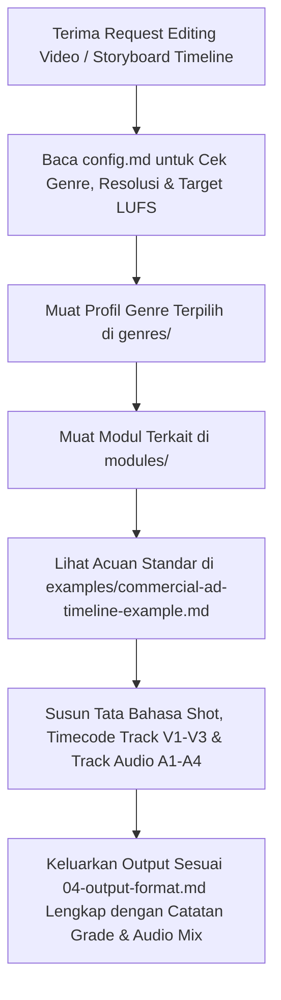

# FilmCraft Skill

Skill ini dirancang dengan pendekatan modular berbasis **konfigurasi sentral (`config.md`)**, **profil tipe genre video (`genres/`)**, **modul spesifikasi penyuntingan & warna (`modules/`)**, dan **contoh nyata ideal (`examples/`)**.

---

## 🎯 Alur Eksekusi AI (Execution Flow)

Setiap kali skill ini aktif, AI **WAJIB** mengikuti urutan prioritas pembacaan berikut:

### 1. Periksa Saklar Utama ([config.md](./config.md))
- Lihat nilai `target_genre` (misal: `commercial-advertising`, `narrative-cinema`, `documentary-interview`, atau `custom-video`).
- Periksa konfigurasi teknis (`project_resolution`: `4k_uhd` atau `1080p_fhd`, `framerate`: `24.0`, `color_management`: `rec709_g24`, `target_lufs`: `-14.0`).
- Periksa status aktif/non-aktif setiap modul di `modules_enabled`.
- Pastikan kepatuhan preferensi: `auto_audio_ducking: true` dan `enforce_180_degree_rule: true`.

### 2. Muat Profil Tipe Genre Video ([genres/](./genres/))
- Buka file profil genre yang terpilih:
  - Film Cerita & Sinema Naratif: [`genres/narrative-cinema.md`](./genres/narrative-cinema.md)
  - Iklan Komersial & Brand Film: [`genres/commercial-advertising.md`](./genres/commercial-advertising.md)
  - Dokumenter & Wawancara A-Roll/B-Roll: [`genres/documentary-interview.md`](./genres/documentary-interview.md)
  - Video Pendek Vertikal (Reels/TikTok/Vlog): [`genres/custom-video.md`](./genres/custom-video.md)

### 3. Terapkan Modul Standar ([modules/](./modules/))
- **01. Tata Bahasa Kamera (Shot Grammar)**: Terapkan variasi ukuran shot (ELS, WS, MS, CU, ECU), aturan garis imajiner 180° (*action line*), dan eye-line match dari [`modules/01-timeline-shot-grammar.md`](./modules/01-timeline-shot-grammar.md).
- **02. Teknik Potong & Ritme (Pacing)**: Terapkan pemotongan saat subjek bergerak (*Cutting on Action*), tumpahan audio J-Cut & L-Cut, dan Match Cut tematik dari [`modules/02-cutting-techniques-pacing.md`](./modules/02-cutting-techniques-pacing.md).
- **03. Koreksi Warna & Scopes**: Kunci rona kulit wajah tepat di atas garis acuan 10:30 vectorscope, ratakan kontras pada Waveform, dan terapkan look film dari [`modules/03-color-grading-scopes.md`](./modules/03-color-grading-scopes.md).
- **05. Tata Suara & Audio Ducking**: Atur dialog vokal pada `-12 dB True Peak`, turunkan volume musik latar `-18 dB s/d -24 dB` saat narator berbicara, dan capai target kenyaringan terintegrasi `-14.0 LUFS` dari [`modules/05-audio-mixing-ducking.md`](./modules/05-audio-mixing-ducking.md).
- **06. Kontinuitas B-Roll & Kecepatan**: Sisipkan shot penjelas B-Roll tanpa memutus kelancaran vokal A-Roll, gunakan efek *speed ramping*, dan jaga arah pergerakan mata dari [`modules/06-broll-visual-continuity.md`](./modules/06-broll-visual-continuity.md).
- **07. Subtitle & Lower Thirds**: Pastikan penempatan teks grafis berada di dalam batas aman *Title-Safe Area 80%* dan terapkan subtitle kinetik yang kontras dari [`modules/07-subtitles-motion-graphics.md`](./modules/07-subtitles-motion-graphics.md).
- **08. Ekspor & Mastering Codecs**: Pilih codec master ProRes 422 HQ atau H.264 web delivery dengan color tag Rec.709-A yang benar untuk mencegah masalah gamma shift QuickTime dari [`modules/08-export-mastering-codecs.md`](./modules/08-export-mastering-codecs.md).

### 4. Acuan Timeline Nyata ([examples/commercial-ad-timeline-example.md](./examples/commercial-ad-timeline-example.md))
- Jadikan [commercial-ad-timeline-example.md](./examples/commercial-ad-timeline-example.md) sebagai tolok ukur standar (*benchmark*) penyusunan timeline iklan 30 detik frame-by-frame, sinkronisasi beat musik, cue audio track, dan parameter color grade resmi.

### 5. Format Output ([modules/04-output-format.md](./modules/04-output-format.md))
- Sajikan lembar breakdown timeline NLE (Timecode In/Out, Track V1-V3, Track A1-A4), catatan transisi potong, keputusan color grading, dan checklist verifikasi pra-ekspor resmi.

---

## 📂 Peta Struktur File

| Berkas / Direktori | Fungsi Utama |
| :--- | :--- |
| [config.md](./config.md) | Saklar sentral (genre target, resolusi kanvas, framerate, target LUFS, modul aktif). |
| [genres/narrative-cinema.md](./genres/narrative-cinema.md) | Standar film fiksi & bioskop: kontinuitas 180°, subteks emosional, pacing dramaturgi. |
| [genres/commercial-advertising.md](./genres/commercial-advertising.md) | Standar iklan TVC/digital: durasi ketat 15s/30s/60s, hook 3 detik awal, grading mewah. |
| [genres/documentary-interview.md](./genres/documentary-interview.md) | Standar dokumenter: sinkronisasi A-Roll wawancara, jalinan B-Roll kontekstual, J/L-Cut. |
| [genres/custom-video.md](./genres/custom-video.md) | Profil format kustom: Video pendek vertikal 9:16 (Reels/TikTok), Music Video, YouTube Vlog. |
| [modules/01-timeline-shot-grammar.md](./modules/01-timeline-shot-grammar.md) | Skala ukuran shot (ELS hingga ECU), aturan sumbu aksi 180°, eye-line match, dan 30° rule. |
| [modules/02-cutting-techniques-pacing.md](./modules/02-cutting-techniques-pacing.md) | Teknik pemotongan: Cutting on Action, J-Cut & L-Cut, Match Cut, ritme montase berdenyut. |
| [modules/03-color-grading-scopes.md](./modules/03-color-grading-scopes.md) | Pembacaan alat ukur Scopes: garis skin tone 10:30 vectorscope, RGB Parade, White Balance. |
| [modules/04-output-format.md](./modules/04-output-format.md) | Template standar output AI: format tabel timeline NLE, timecode frame, audio cues, checklist. |
| [modules/05-audio-mixing-ducking.md](./modules/05-audio-mixing-ducking.md) | Mixing vokal dialog (-12dB), auto-ducking musik latar (-18dB s/d -24dB), standar -14 LUFS. |
| [modules/06-broll-visual-continuity.md](./modules/06-broll-visual-continuity.md) | Penataan B-Roll, sinkronisasi visual cutaways, speed ramping / slow-motion, kontinuitas arah gerak. |
| [modules/07-subtitles-motion-graphics.md](./modules/07-subtitles-motion-graphics.md) | Grafis lower thirds, batas area aman Title-Safe 80%, subtitle kinetik ramah ponsel vertikal. |
| [modules/08-export-mastering-codecs.md](./modules/08-export-mastering-codecs.md) | Format master ProRes 422 HQ vs H.264/H.265, pencegahan gamma shift Rec.709-A, ekspor EDL/OTIO. |
| [examples/commercial-ad-timeline-example.md](./examples/commercial-ad-timeline-example.md) | Contoh emas timeline: Iklan komersial 30 detik lengkap dengan timecode V1-V3, A1-A4 & color grade. |

---

## 🚫 Larangan Khusus untuk AI

1. **Dilarang Melanggar Aturan 180 Derajat (Crossing the Line)**: Jangan menempatkan kamera melewati garis sumbu aksi imajiner antar dua karakter yang sedang berbicara, karena akan membalikkan arah tatapan mata subjek (*eye-line mismatch*).
2. **Dilarang Sambungan Suara Kasar (Hard Audio Cuts)**: Dilarang memotong audio bersamaan tepat di garis potong gambar tanpa tumpahan J-Cut atau L-Cut, kecuali jika sengaja ingin menciptakan efek kejut (*shock cut*).
3. **Dilarang Musik Mengubur Dialog**: Musik latar dilarang bertabrakan frekuensi dengan vokal pembicara; wajib menerapkan *Audio Ducking* minimal `-18 dB` saat dialog aktif.
4. **Dilarang Menghasilkan Rona Kulit Melenceng**: Pada tahap Color Grading, warna kulit manusia tidak boleh menyimpang dari garis acuan Skin Tone Line pada vectorscope.
