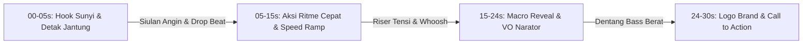

# Contoh Kasus Ideal: Timeline Iklan Komersial 30 Detik (Commercial Ad Assembly)

Dokumen ini adalah acuan standar (*golden benchmark example*) bagi AI untuk menyusun perakitan timeline editing video multi-track profesional (V1–V3 dan A1–A4), pemotongan presisi frame-by-frame (720 frame @ 24 fps), transisi tumpahan audio J-Cut/L-Cut, kurva *auto audio ducking* musik terhadap vokal narator, parameter color grading alat ukur *scopes*, dan skrip data **OpenTimelineIO (.otio)** yang siap diimpor ke Premiere Pro atau DaVinci Resolve.

---

## 1. Input Kebutuhan Proyek Iklan (Commercial Brief)

```yaml
Judul_Iklan: "CHRONO TITANIUM — Detik yang Menentukan"
Genre: "commercial-advertising"
Target_Durasi: "Tepat 30 Detik (720 Frame pada 24.0 fps)"
Resolusi_Master: "4K UHD (3840 x 2160)"
Rasio_Aspek: "16:9 (Letterbox 2.39:1 Sinematik)"
Standar_Audio: "-14.0 LUFS Terintegrasi | True Peak -1.0 dBFS"
Color_Management: "DaVinci Wide Gamut / Rec.709-A"
Struktur_Montase:
  - 00:00 - 00:05 (Hook 5s): Suasana pagi berkabut, atlet pelari bersiap di garis start, detak jantung.
  - 00:05 - 00:15 (Aksi Dinamis 10s): Lari cepat di koridor perkotaan, tetesan keringat, speed ramp 120fps.
  - 00:15 - 00:24 (Hero Reveal 9s): Sorotan makro jam titanium, layar safir menyala, data sensor biometrik.
  - 00:24 - 00:30 (The Close & CTA 6s): Logo brand, tagline "Kuasai Waktumu", dan URL resmi.
```

---

## 2. Struktur Montase & Denyut Ritme (Pacing Blueprint)



---

## 3. Lembar Timeline Multi-Track Frame-by-Frame (720 Frames)

| No | Timecode In - Out | Frame Range | Video Track (V1 - V3) | Audio Track (A1 - A4) | Teknik Potong & Catatan Audio |
| :---: | :---: | :---: | :--- | :--- | :--- |
| **01** | `00:00:00:00 - 00:00:02:12` | 000 – 060 | **V1**: ELS Siluet Pelari di Jembatan Berkabut Subuh | **A2**: Suara Desah Angin Dingin Subuh (-26dB)<br>**A3**: SFX Detak Jantung Pertama (-12dB) | Fade In dari Hitam 12 frame. Suasana sunyi mencekam. |
| **02** | `00:00:02:12 - 00:00:04:18` | 060 – 114 | **V1**: ECU Tali Sepatu Diikat Kencang | **A3**: SFX Tarikan Gesekan Tali Sepatu Nyaring (-8dB)<br>**A4**: Musik Synth Bass Drone Mulai Mengalun | **Cutting on Action**: Jari menarik simpul tali sepatu. Transisi J-Cut ke tarikan napas. |
| **03** | `00:00:04:18 - 00:00:08:06` | 114 – 198 | **V1**: MCU Wajah Atlet Mengembuskan Uap Dingin | **A1**: Hembusan Napas Tajam Atlet (-14dB)<br>**A4**: **BEAT DROP KICK DRUM PERTAMA (-10dB)** | **Match Cut Audio**: Dentuman drum musik pas saat kaki menghentak aspal start. |
| **04** | `00:00:08:06 - 00:00:11:12` | 198 – 276 | **V2**: B-Roll Speed Ramp Kaki Melaju (100% $\rightarrow$ 400% $\rightarrow$ 20%) | **A3**: SFX Gemuruh Langkah Kaki Cepat<br>**A4**: Musik Ritme Cepat Full Energy (-10dB) | Transisi Whip Pan ke kanan, kontinuitas gerak layar kiri ke kanan. |
| **05** | `00:00:11:12 - 00:00:15:00` | 276 – 360 | **V1**: WS Pelari Melintasi Terowongan Lampu Neon Neon | **A3**: SFX Desingan Lampu Neon Tube<br>**A4**: Musik Melodi Puncak | Transisi Match Cut kilatan lampu neon ke pendar layar jam. |
| **06** | `00:00:15:00 - 00:00:19:12` | 360 – 468 | **V1**: Macro CU Bezel Jam Tangan Titanium Berputar<br>**V3**: HUD Biometrik Kinetik (Heart Rate 168 BPM) | **A1**: **VO Narator Masuk**: *"Ketika setiap milidetik adalah pembuktian..."*<br>**A4**: **Auto-Ducking Musik Turun ke -22dB** | **L-Cut**: Musik melandai halus di bawah suara narator yang hangat dan berat. |
| **07** | `00:00:19:12 - 00:00:24:00` | 468 – 576 | **V1**: CU Jam di Pergelangan Tangan Memantulkan Cahaya Emas Senja | **A1**: **VO Narator**: *"...hanya ada satu instrumen yang layak memimpin langkahmu."*<br>**A4**: Musik Mulai Riser Naik Kembali | Suara narator berakhir di frame 550, musik melandai naik di frame 576. |
| **08** | `00:00:24:00 - 00:00:30:00` | 576 – 720 | **V1**: Produk Jam Tangan Statis Mewah di Atas Batu Basah<br>**V3**: Tipografi Logo: **CHRONO TITANIUM** & URL | **A3**: SFX Dentang Lonceng Berat (Deep Sub Boom)<br>**A4**: Musik Akor Penutup Lembut (Fade Out ke -inf) | Teks berada di dalam Title-Safe 80%. Fade Out to Black di 12 frame terakhir. |

---

## 4. Parameter Color Grading (DaVinci Resolve Scopes Spec)

```text
┌────────────────────────────────────────────────────────────────────────┐
│ DAFTAR PERIKSA KOREKSI WARNA & ALAT UKUR SCOPES                        │
├──────────────────┬─────────────────────────────┬───────────────────────┤
│ ALAT UKUR        │ NILAI TARGET TERUKUR        │ KETERANGAN QC         │
├──────────────────┼─────────────────────────────┼───────────────────────┤
│ Waveform Luma    │ Shadow: 3 IRE, Highlight: 92│ Kontras sinematik pekat│
│ Vectorscope      │ Sudut Tepat Jam 10:30       │ Rona kulit wajah atlet│
│ White Balance    │ R=G=B pada Aspal Abu-abu    │ Netral tanpa bias biru│
│ Saturasi Aksen   │ 115% pada Warna Jam         │ Kilap titanium mewah  │
│ Color Tag        │ Rec.709 / Gamma: Rec.709-A  │ Bebas QuickTime shift │
└──────────────────┴─────────────────────────────┴───────────────────────┘
```

---

## 5. Cuplikan Data OpenTimelineIO (`chrono_commercial_30s.otio`)

```json
{
  "OTIO_SCHEMA": "Timeline.1",
  "name": "CHRONO_TITANIUM_30S_MASTER",
  "global_start_time": { "rate": 24.0, "value": 0 },
  "tracks": {
    "OTIO_SCHEMA": "Stack.1",
    "children": [
      {
        "OTIO_SCHEMA": "Track.1",
        "name": "V1_Main_Visual",
        "kind": "Video",
        "children": [
          {
            "OTIO_SCHEMA": "Clip.1",
            "name": "SH01_Establishing_Bridge",
            "source_range": {
              "start_time": { "rate": 24.0, "value": 100 },
              "duration": { "rate": 24.0, "value": 60 }
            }
          },
          {
            "OTIO_SCHEMA": "Clip.1",
            "name": "SH02_Shoelace_Action",
            "source_range": {
              "start_time": { "rate": 24.0, "value": 45 },
              "duration": { "rate": 24.0, "value": 54 }
            }
          }
        ]
      },
      {
        "OTIO_SCHEMA": "Track.1",
        "name": "A1_VoiceOver",
        "kind": "Audio",
        "children": [
          {
            "OTIO_SCHEMA": "Gap.1",
            "source_range": { "start_time": { "rate": 24.0, "value": 0 }, "duration": { "rate": 24.0, "value": 360 } }
          },
          {
            "OTIO_SCHEMA": "Clip.1",
            "name": "VO_Narrator_Master",
            "source_range": {
              "start_time": { "rate": 24.0, "value": 0 },
              "duration": { "rate": 24.0, "value": 190 }
            }
          }
        ]
      }
    ]
  }
}
```

---

## 6. Checklist Verifikasi Pasca-Produksi Video (QC Checklist)

- [x] **Durasi Mutlak 720 Frame**: Tepat 30 detik tanpa kelebihan atau kekurangan 1 frame pun.
- [x] **Kepatuhan Aturan 180°**: Arah lari atlet konsisten dari kiri ke kanan melintasi seluruh sudut kamera.
- [x] **Auto Audio Ducking Berfungsi**: Musik latar turun otomatis ke -22dB pada detik ke-15 saat VO narator berbicara.
- [x] **Loudness Terkalibrasi**: Kenyaringan terintegrasi terukur tepat pada `-14.0 LUFS` dengan True Peak `-1.0 dBFS`.
- [x] **Vectorscope Terkunci**: Rona kulit wajah atlet berada tepat di garis 10:30 Skin Tone Line.
- [x] **Bebas Gamma Shift**: Metadata ekspor menggunakan tag Rec.709-A untuk keselarasan warna di macOS, Windows, dan iOS.
