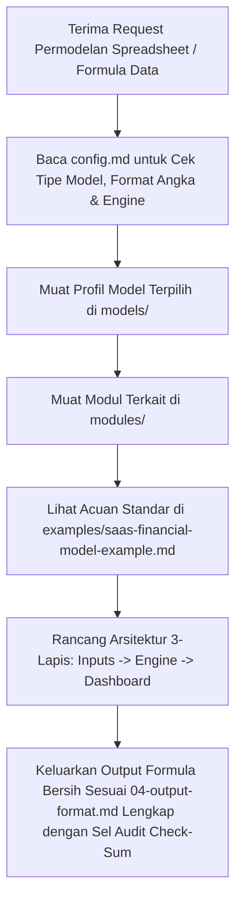

# GridCraft Skill

Skill ini dirancang dengan pendekatan modular berbasis **konfigurasi sentral (`config.md`)**, **profil tipe model spreadsheet (`models/`)**, **modul spesifikasi formula & akuntansi (`modules/`)**, dan **contoh nyata ideal (`examples/`)**.

---

## 🎯 Alur Eksekusi AI (Execution Flow)

Setiap kali skill ini aktif, AI **WAJIB** mengikuti urutan prioritas pembacaan berikut:

### 1. Periksa Saklar Utama ([config.md](./config.md))
- Lihat nilai `target_model` (misal: `financial-3statement`, `saas-unit-economics`, `inventory-operations`, atau `custom-model`).
- Periksa standar kalkulasi (`spreadsheet_engine`: `excel_modern`, `formula_language`: `english`, `number_format`: `currency_idr` atau `currency_usd`, `decimal_places`: `2`).
- Periksa status aktif/non-aktif setiap modul di `modules_enabled`.
- Pastikan kepatuhan preferensi: `ban_volatile_functions: true`, `require_audit_checksums: true`, dan `highlight_inputs: true`.

### 2. Muat Profil Tipe Model Spreadsheet ([models/](./models/))
- Buka file profil model yang terpilih:
  - Permodelan Finansial 3 Laporan: [`models/financial-3statement.md`](./models/financial-3statement.md)
  - Metrik Bisnis SaaS & Kohort: [`models/saas-unit-economics.md`](./models/saas-unit-economics.md)
  - Manajemen Rantai Pasok & Inventaris: [`models/inventory-operations.md`](./models/inventory-operations.md)
  - Model Permodelan Kustom (ROAS / KPI / Proyek): [`models/custom-model.md`](./models/custom-model.md)

### 3. Terapkan Modul Standar ([modules/](./modules/))
- **01. Arsitektur 3-Lapis**: Pisahkan buku kerja menjadi 3 lembar kerja terisolasi (Inputs $\rightarrow$ Engine $\rightarrow$ Outputs/Dashboard) dan terapkan kode warna sel standar dari [`modules/01-three-tier-architecture.md`](./modules/01-three-tier-architecture.md).
- **02. Formula Dinamis Modern**: Utamakan fungsi `XLOOKUP`, simpan komputasi berulang dalam fungsi `LET`, buat fungsi kustom dengan `LAMBDA`, dan gunakan array dinamis (`FILTER`, `SORT`, `UNIQUE`) dari [`modules/02-modern-formulas-arrays.md`](./modules/02-modern-formulas-arrays.md).
- **03. Logika Keuangan & Sel Audit**: Hubungkan Laba Bersih ke Ekuitas Neraca dan Arus Kas Operasional, serta sertakan baris pengecekan keseimbangan mutlak (`Balance Check = 0`) dari [`modules/03-financial-logic-tieins.md`](./modules/03-financial-logic-tieins.md).
- **05. Validasi Data & Kontrol**: Terapkan menu pilihan dropdown (*Data Validation Lists*), batas nilai numerik (*range clamping*), dan kunci sel formula penting dari [`modules/05-data-validation-controls.md`](./modules/05-data-validation-controls.md).
- **06. Format Bersyarat & KPI**: Buat kartu ringkasan eksekutif (*KPI Cards*), mini grafik tren (*Sparklines*), dan heatmap 3-warna lembut tanpa warna neon yang menyilaukan dari [`modules/06-conditional-formatting-kpi.md`](./modules/06-conditional-formatting-kpi.md).
- **07. Format Angka Akuntansi**: Terapkan pemisah ribuan standar, angka negatif di dalam tanda kurung `(Rp 1,000)`, dan angka nol diganti tanda strip `-` dari [`modules/07-number-formatting-accounting.md`](./modules/07-number-formatting-accounting.md).
- **08. Ekspor & Interoperabilitas**: Pastikan formula kompatibel 100% saat diekspor ke berkas XLSX, Google Sheets, atau dimanipulasi dengan script Python `openpyxl`/`pandas` dari [`modules/08-export-interoperability.md`](./modules/08-export-interoperability.md).

### 4. Acuan Model Nyata ([examples/saas-financial-model-example.md](./examples/saas-financial-model-example.md))
- Jadikan [saas-financial-model-example.md](./examples/saas-financial-model-example.md) sebagai tolok ukur standar (*benchmark*) penyusunan model keuangan SaaS 12 bulan lengkap dengan tabel asumsi, formula engine `LET`/`XLOOKUP`, KPI dashboard, dan audit rekonsiliasi kas.

### 5. Format Output ([modules/04-output-format.md](./modules/04-output-format.md))
- Sajikan tabel koordinat sel markdown yang bersih, rumus formula persis yang siap disalin (*copy-paste*), penjelasan logika komputasi, dan checklist verifikasi integritas data resmi.

---

## 📂 Peta Struktur File

| Berkas / Direktori | Fungsi Utama |
| :--- | :--- |
| [config.md](./config.md) | Saklar sentral (tipe model, format mata uang, arsitektur 3-lapis, modul aktif). |
| [models/financial-3statement.md](./models/financial-3statement.md) | Standar permodelan finansial: P&L, Neraca, Cash Flow, tie-ins, dan audit balance check. |
| [models/saas-unit-economics.md](./models/saas-unit-economics.md) | Standar bisnis berbasis langganan: MRR/ARR waterfall, Churn, LTV, CAC, dan cohort matrix. |
| [models/inventory-operations.md](./models/inventory-operations.md) | Standar operasi pergudangan: Safety stock, Economic Order Quantity (EOQ), reorder points. |
| [models/custom-model.md](./models/custom-model.md) | Profil model fleksibel: ROAS pemasaran digital, tracker KPI HR karyawan, RAB/BoQ proyek. |
| [modules/01-three-tier-architecture.md](./modules/01-three-tier-architecture.md) | Pemisahan lembar kerja Inputs -> Engine -> Outputs, standarisasi warna sel internasional. |
| [modules/02-modern-formulas-arrays.md](./modules/02-modern-formulas-arrays.md) | Formula modern: XLOOKUP, optimasi kecepatan LET, LAMBDA kustom, larangan fungsi volatil. |
| [modules/03-financial-logic-tieins.md](./modules/03-financial-logic-tieins.md) | Keterkaitan antar laporan keuangan, skedul depresiasi aktiva tetap, dan check-sum zero-tolerance. |
| [modules/04-output-format.md](./modules/04-output-format.md) | Template standar output AI: representasi sel markdown, sintaks formula, verifikasi audit. |
| [modules/05-data-validation-controls.md](./modules/05-data-validation-controls.md) | Validasi data dropdown, pencegahan kesalahan input pengguna, penguncian sel formula. |
| [modules/06-conditional-formatting-kpi.md](./modules/06-conditional-formatting-kpi.md) | Visualisasi data spreadsheet: KPI cards, sparklines in-cell, gradasi warna heatmap pastel. |
| [modules/07-number-formatting-accounting.md](./modules/07-number-formatting-accounting.md) | Format akuntansi angka: mata uang, angka negatif dalam kurung `(1,000)`, dan angka nol `-`. |
| [modules/08-export-interoperability.md](./modules/08-export-interoperability.md) | Standar ekspor: XLSX 365, Google Sheets interoperability, Python openpyxl scripting. |
| [examples/saas-financial-model-example.md](./examples/saas-financial-model-example.md) | Contoh emas model keuangan: SaaS 12-bulan dengan formula LET/XLOOKUP dan audit seimbang. |

---

## 🚫 Larangan Khusus untuk AI

1. **Dilarang Menggunakan Fungsi Volatil Usang (`OFFSET`, `INDIRECT`)**: Fungsi volatil menghitung ulang seluruh sel setiap kali ada perubahan sekecil apa pun di lembar kerja, menyebabkan spreadsheet besar mengalami lag parah. Gunakan `INDEX/MATCH` atau `XLOOKUP` sebagai gantinya.
2. **Dilarang Hardcoded Angka di Dalam Sel Formula**: Angka asumsi (seperti persentase pajak, suku bunga, atau target pertumbuhan) **dilarang keras** ditulis langsung di dalam rumus seperti `=A1 * 1.11`. Angka asumsi wajib ditempatkan di sel input tersendiri di lembar *Inputs/Assumptions*.
3. **Dilarang Menghasilkan Referensi Melingkar (Circular References)**: Seluruh formula harus mengalir satu arah. Sel A1 tidak boleh bergantung pada B1 jika B1 bergantung pada A1.
4. **Dilarang Mengabaikan Baris Pengecekan Keseimbangan (Audit Check-Sum)**: Pada model keuangan atau neraca, AI wajib menyertakan sel verifikasi keseimbangan `=IF(Total_Aktiva=Total_Pasiva, "OK", "ERROR - TIDAK SEIMBANG")`.
