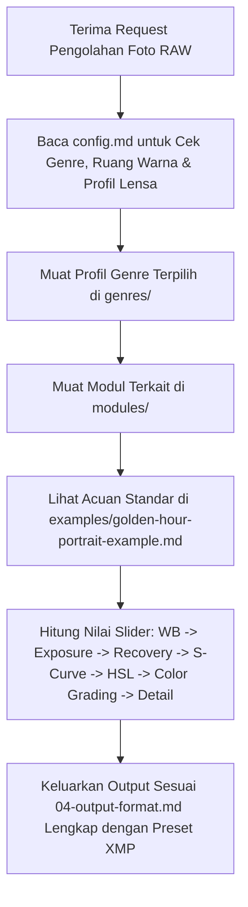

# LightCraft Skill

Skill ini dirancang dengan pendekatan modular berbasis **konfigurasi sentral (`config.md`)**, **profil tipe genre fotografi (`genres/`)**, **modul spesifikasi pengembangan RAW & warna (`modules/`)**, dan **contoh nyata ideal (`examples/`)**.

---

## 🎯 Alur Eksekusi AI (Execution Flow)

Setiap kali skill ini aktif, AI **WAJIB** mengikuti urutan prioritas pembacaan berikut:

### 1. Periksa Saklar Utama ([config.md](./config.md))
- Lihat nilai `target_genre` (misal: `portrait-skintones`, `landscape-nature`, `architecture-interior`, atau `custom-photography`).
- Periksa ruang warna kerja (`working_color_space`: `prophoto_rgb` atau `adobe_rgb`), koreksi lensa aktif, dan opsi penghapusan metadata GPS.
- Periksa status aktif/non-aktif setiap modul di `modules_enabled`.
- Pastikan kepatuhan preferensi: `protect_skin_textures: true` dan `zero_clipping_tolerance: true`.

### 2. Muat Profil Tipe Genre Fotografi ([genres/](./genres/))
- Buka file profil genre yang terpilih:
  - Potret Manusia & Rona Kulit Alami: [`genres/portrait-skintones.md`](./genres/portrait-skintones.md)
  - Pemandangan Alam & Bentang Alam: [`genres/landscape-nature.md`](./genres/landscape-nature.md)
  - Arsitektur & Interior Garis Lurus: [`genres/architecture-interior.md`](./genres/architecture-interior.md)
  - Fotografi Kustom (Street / Produk / Astro): [`genres/custom-photography.md`](./genres/custom-photography.md)

### 3. Terapkan Modul Standar ([modules/](./modules/))
- **01. Eksposur & Histogram**: Kalibrasi White Balance Kelvin & Tint pada area netral abu-abu 18%, geser Exposure hingga histogram seimbang tanpa menyentuh batas dinding kiri/kanan dari [`modules/01-raw-exposure-histogram.md`](./modules/01-raw-exposure-histogram.md).
- **02. Pemulihan Rentang Dinamis**: Tarik Highlights (-40 s/d -100) untuk memunculkan detail awan/langit, buka Shadows (+20 s/d +60) untuk menampilkan tekstur gelap tanpa noise, dan tetapkan titik Whites/Blacks dari [`modules/02-dynamic-range-recovery.md`](./modules/02-dynamic-range-recovery.md).
- **03. Manipulasi Tone Curve**: Bentuk kurva kontras S-Curve halus, sesuaikan kurva titik saluran Merah/Hijau/Biru independen, dan angkat titik hitam paling bawah untuk efek matte film halus dari [`modules/03-tone-curve-scurve.md`](./modules/03-tone-curve-scurve.md).
- **05. Kalibrasi Warna HSL**: Kunci rona kulit di saluran Oranye (Hue 0, Saturation -5, Luminance +15), desaturasi warna hijau dedaunan berlebih, dan ubah biru langit menjadi teal dari [`modules/05-hsl-color-mixer.md`](./modules/05-hsl-color-mixer.md).
- **06. Color Grading 3-Way**: Berikan rona sejuk/teal pada Shadows, rona hangat/emas pada Highlights, dan netralkan Midtones dengan blending 60% dari [`modules/06-color-grading-split-toning.md`](./modules/06-color-grading-split-toning.md).
- **07. Detail, Ketajaman & Reduksi Noise**: Tingkatkan Texture (+15) dan batasi Clarity (+5) agar kulit tidak kasar, gunakan Masking ketajaman (Alt-drag) agar hanya garis tepi yang dipertajam, dan bersihkan noise dari [`modules/07-detail-sharpening-denoise.md`](./modules/07-detail-sharpening-denoise.md).
- **08. Koreksi Optik & Ekspor**: Terapkan profil lensa bawaan kamera untuk menghilangkan distorsi cembung dan vinyet sudut, bersihkan aberasi kromatik fringing ungu, dan ekspor ke preset XMP dari [`modules/08-lens-optics-export.md`](./modules/08-lens-optics-export.md).

### 4. Acuan Pengolahan Nyata ([examples/golden-hour-portrait-example.md](./examples/golden-hour-portrait-example.md))
- Jadikan [golden-hour-portrait-example.md](./examples/golden-hour-portrait-example.md) sebagai tolok ukur standar (*benchmark*) pengembangan foto potret senja dengan pencahayaan latar (*backlight*), pemulihan rona kulit keemasan, kurva S-curve, dan preset XMP lengkap.

### 5. Format Output ([modules/04-output-format.md](./modules/04-output-format.md))
- Sajikan tabel parameter slider numerik lengkap (-100 s/d +100), blok kode XML preset XMP resmi, panduan masking kuas/gradien, dan checklist kualitas pra-ekspor.

---

## 📂 Peta Struktur File

| Berkas / Direktori | Fungsi Utama |
| :--- | :--- |
| [config.md](./config.md) | Saklar sentral (genre fotografi, profil warna ProPhoto RGB, koreksi lensa, modul aktif). |
| [genres/portrait-skintones.md](./genres/portrait-skintones.md) | Standar potret manusia: isolasi rona kulit Oranye/Kuning, eye enhancement, tekstur alami. |
| [genres/landscape-nature.md](./genres/landscape-nature.md) | Standar pemandangan: dynamic range lebar, sky recovery, polarisasi hijau dedaunan, dehaze. |
| [genres/architecture-interior.md](./genres/architecture-interior.md) | Standar arsitektur: pelurusan garis vertikal Upright, koreksi distorsi lensa, window pull. |
| [genres/custom-photography.md](./genres/custom-photography.md) | Profil fotografi kustom: Street photography hitam-putih kontras, produk katalog, astro. |
| [modules/01-raw-exposure-histogram.md](./modules/01-raw-exposure-histogram.md) | Demosaicing sensor RAW, pembacaan 5 zona histogram, white balance Kelvin netral abu-abu 18%. |
| [modules/02-dynamic-range-recovery.md](./modules/02-dynamic-range-recovery.md) | Pemulihan highlight terbakar, pembukaan shadow gelap, penetapan titik clipping Whites/Blacks. |
| [modules/03-tone-curve-scurve.md](./modules/03-tone-curve-scurve.md) | Kurva kontras S-Curve parametrik, kurva titik RGB independen, efek matte film shadow. |
| [modules/04-output-format.md](./modules/04-output-format.md) | Template standar output AI: tabel slider numerik, blok XML preset XMP, checklist QC. |
| [modules/05-hsl-color-mixer.md](./modules/05-hsl-color-mixer.md) | Kalibrasi 8 saluran warna (Hue, Saturation, Luminance), perlindungan pigmen rona kulit. |
| [modules/06-color-grading-split-toning.md](./modules/06-color-grading-split-toning.md) | Pewarnaan 3 roda warna (Shadows, Midtones, Highlights), pengaturan Blending & Balance. |
| [modules/07-detail-sharpening-denoise.md](./modules/07-detail-sharpening-denoise.md) | Penajaman selektif dengan Masking slider, Texture vs Clarity, pembersihan color noise. |
| [modules/08-lens-optics-export.md](./modules/08-lens-optics-export.md) | Koreksi profil distorsi lensa otomatis, defringe aberasi kromatik, standar ekspor XMP/TIFF. |
| [examples/golden-hour-portrait-example.md](./examples/golden-hour-portrait-example.md) | Contoh emas alur RAW: Potret Golden Hour lengkap dengan tabel slider dan preset XMP XML. |

---

## 🚫 Larangan Khusus untuk AI

1. **Dilarang Menghancurkan Tekstur Kulit Alami**: Dilarang memberikan nilai negatif Clarity atau Noise Reduction berlebih yang membuat wajah subjek tampak seperti boneka lilin plastik tanpa pori-pori (*plastic face syndrome*).
2. **Dilarang Membiarkan Kliping Putih pada Wajah**: Area dahi, hidung, atau pipi subjek utama dilarang keras menyentuh angka 100% RGB putih mutlak (*blown out highlights*).
3. **Dilarang Menaikkan Saturasi Global Secara Berlebihan**: Gunakan slider *Vibrance* daripada *Saturation* global, karena Vibrance secara cerdas melindungi rona kulit manusia agar tidak menjadi merah menyala atau oranye abnormal.
4. **Dilarang Penajaman Tanpa Masking**: Parameter Sharpening wajib selalu disertai dengan nilai `Masking > 50` untuk mencegah noise pada area halus (seperti langit atau kulit rata) ikut dipertajam.
