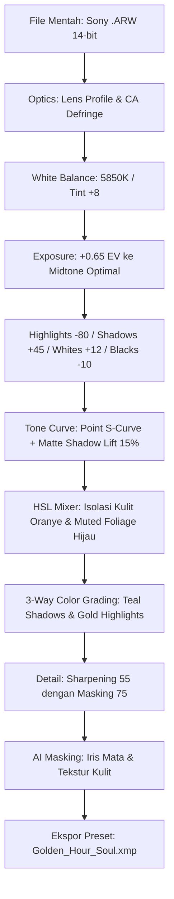

# Contoh Kasus Ideal: Pengembangan Foto RAW Potret Golden Hour (Golden Hour Portrait Workflow)

Dokumen ini adalah acuan standar (*golden benchmark example*) bagi AI untuk merancang parameter pengembangan foto digital RAW non-destruktif, menyelamatkan detail langit senja yang hampir terbakar (*backlight highlight recovery*), mengangkat bayangan wajah subjek tanpa noise (*shadow lifting*), mengisolasi rona kulit (*skin tones*) bersih bercahaya alami, membentuk kurva S-Curve sinematik, dan mengekspor berkas preset **Adobe XMP XML** yang siap diimpor ke Adobe Lightroom atau Capture One.

---

## 1. Input Metadata & Kondisi Pemotretan RAW (Shooting Brief)

```yaml
Kamera: "Sony Alpha 7 IV (Sensor 33MP BSI Full-Frame)"
Lensa: "Sony FE 85mm f/1.4 GM (G-Master)"
Format_File: "Sony RAW Tidak Terkompresi (.ARW 14-bit)"
Pengaturan_Pencahayaan:
  - Aperture: f/1.8 (Kedalaman bidang sempit / bokeh lembut)
  - Shutter Speed: 1/1250 detik
  - ISO: 100 (ISO Dasar Murni)
Kondisi_Pencahayaan:
  - "Golden Hour Backlight": Matahari terbenam tepat di belakang rambut subjek (rim light keemasan).
  - Wajah subjek sedikit berada di zona bayangan (under-exposed sekitar -0.7 stop).
  - Langit senja memuat semburat jingga dan awan tipis yang nyaris mengalami kliping putih di histogram.
Target_Editorial:
  - Rona kulit bersih bercahaya alami (*warm glowing skin*), detail helai rambut emas tajam, mata berbinar, dan kontras sinematik lembut dengan bayangan hitam pekat bergaya film analog.
```

---

## 2. Diagram Alur Pengembangan RAW (Development Pipeline)



---

## 3. Tabel Parameter Slider Numerik Lengkap

### 3.1 Panel Dasar (Basic Adjustments)
| Slider Parameter | Nilai Slider | Alasan Teknis & Dampak Visual |
| :--- | :---: | :--- |
| **White Balance Temp** | `5850 K` | Memberikan kehangatan senja alami pada adegan (asli kamera: 5100K dingin) |
| **Tint** | `+8` | Menetralkan bias hijau daun pada bayangan leher dan dagu |
| **Exposure** | `+0.65 EV` | Mengangkat kecerahan wajah subjek ke zona eksposur ideal |
| **Contrast** | `+8` | Penegasan kontras moderat sebelum kurva S-Curve |
| **Highlights** | `-80` | Menyelamatkan detail awan senja dan mencegah pendar rim light berlebih |
| **Shadows** | `+45` | Membuka mata dan tekstur pakaian gelap tanpa menimbulkan noise |
| **Whites** | `+14` | Menetapkan batas putih puncak tepat di titik 98% histogram |
| **Blacks** | `-12` | Mengunci kontras hitam pekat di rambut dan iris mata |
| **Texture** | `+10` | Menajamkan helai rambut dan kain tanpa mengasarkan pori wajah |
| **Clarity** | `+3` | Mikro-kontras moderat (mencegah efek halo kasar) |
| **Dehaze** | `+6` | Menembus uap kabut tipis di latar belakang horizon |
| **Vibrance** | `+16` | Menaikkan saturasi warna alam tanpa membuat kulit over-saturated |
| **Saturation** | `-2` | Menjaga stabilitas warna keseluruhan |

---

### 3.2 Kurva Nada Kontras (Tone Curve Points)
- **Tipe**: Point Curve (RGB Gabungan)
- **Titik 1 (Black Anchor / Matte Lift)**: `Input: 0, Output: 14` (Efek pudar matte film arang lembut)
- **Titik 2 (Shadows)**: `Input: 58, Output: 52` (Menekan shadow lembut untuk dimensi)
- **Titik 3 (Midtones)**: `Input: 128, Output: 128` (Menjaga kestabilan eksposur wajah)
- **Titik 4 (Highlights)**: `Input: 195, Output: 206` (Menaikkan pendar cahaya matahari keemasan)
- **Titik 5 (White Anchor)**: `Input: 255, Output: 252` (Mencegah kliping putih kasar 100%)

---

### 3.3 Kalibrasi 8-Saluran Warna HSL (Color Mixer)

| Saluran Warna | Hue (Rona) | Saturation (Kejenuhan) | Luminance (Kecerahan) | Catatan Khusus |
| :--- | :---: | :---: | :---: | :--- |
| **Red (Merah)** | `0` | `+6` | `-4` | Memberikan kesegaran alami pada warna bibir |
| **Orange (Oranye)** | **`+3`** | **`-8`** | **`+18`** | **Formula Kulit: Bersih, bercahaya, tanpa kesan terbakar** |
| **Yellow (Kuning)** | `+18` | `-15` | `+4` | Menghilangkan warna kuning mentah pada rumput kering |
| **Green (Hijau)** | `+25` | `-35` | `-12` | Mengubah dedaunan hijau neon menjadi hijau zaitun tenang |
| **Aqua (Sian)** | `+5` | `-10` | `0` | Menetralkan pantulan kaca jendela di kejauhan |
| **Blue (Biru)** | `-8` | `+12` | `-18` | Memperdalam gradasi langit senja ke arah teal pekat |
| **Purple (Ungu)** | `0` | `-10` | `0` | Menekan fringing pakaian sintetis |
| **Magenta** | `0` | `-5` | `0` | Menjaga keseimbangan rona tepi |

---

### 3.4 Pewarnaan Tiga Roda Warna (Color Grading)
- **Shadows**: Hue `218°` (Teal Sejuk), Saturation `10`, Luminance `-4`
- **Midtones**: Hue `42°` (Oranye Lembut), Saturation `5`, Luminance `+2`
- **Highlights**: Hue `48°` (Emas Kehangatan Matahari), Saturation `14`, Luminance `0`
- **Blending**: `72` (Peleburan warna sangat halus antar zona)
- **Balance**: `+15` (Memberi sedikit dominasi pada kehangatan highlights)

---

### 3.5 Panel Detail & Optik Lensa
- **Sharpening Amount**: `55` | **Radius**: `0.9 px` | **Detail**: `28`
- **Sharpening Masking**: **`76`** *(Hanya menajamkan garis kontur mata, bibir, dan rambut; kulit pipi dan latar belakang bokeh dilindungi 100% dari noise)*
- **Luminance Noise Reduction**: `12` (Detail: `50`)
- **Color Noise Reduction**: `25` (Smoothness: `50`)
- **Lens Profile**: Sony FE 85mm f/1.4 GM (Distortion: `100%`, Vignette: `85%`)
- **Remove Chromatic Aberration**: `ON` (Aktif)

---

## 4. Panduan Masking AI Lokal (Local Retouching)

1. **Masker 1: Mata Subjek (Iris & Pupil)**:
   - Pilih *Select People $\rightarrow$ Iris*.
   - Slider: `Exposure: +0.25 EV`, `Clarity: +12`, `Saturation: +8`.
   - Hasil: Sorot mata tampak berbinar dan hidup tanpa kesan palsu.
2. **Masker 2: Kulit Wajah (Facial Skin Softening)**:
   - Pilih *Select People $\rightarrow$ Facial Skin*.
   - Slider: `Texture: -12`, `Clarity: -4`, `Highlights: -5`.
   - Hasil: Menghaluskan noda kulit kemerahan sementara pori-pori dan tekstur alami tetap utuh.
3. **Masker 3: Radial Gradient Matahari (Sun Flare Enhancer)**:
   - Buat gradien melingkar besar di sudut kiri atas tempat matahari terbenam.
   - Slider: `Dehaze: -8`, `Temperature: +12`, `Exposure: +0.15`.
   - Hasil: Mensimulasikan tumpahan pendar cahaya lensa (*optical lens flare bloom*).

---

## 5. Berkas Preset Lengkap Adobe XMP XML (`Golden_Hour_Soul.xmp`)

Kode XML di bawah ini dapat disimpan langsung sebagai file teks `Golden_Hour_Soul.xmp` dan siap diimpor ke Adobe Lightroom atau Camera Raw:

```xml
<x:xmpmeta xmlns:x="adobe:ns:meta/" x:xmptk="Adobe XMP Core 7.0">
 <rdf:RDF xmlns:rdf="http://www.w3.org/1999/02/22-rdf-syntax-ns#">
  <rdf:Description xmlns:crs="http://ns.adobe.com/camera-raw-settings/1.0/"
   crs:PresetType="Normal"
   crs:Cluster=""
   crs:UUID="LIGHTCRAFT-GOLDEN-HOUR-PORTRAIT-2026"
   crs:SupportsAmount2="True"
   crs:ProcessVersion="15.4"
   crs:WhiteBalance="Custom"
   crs:Temperature="5850"
   crs:Tint="8"
   crs:Exposure2012="+0.65"
   crs:Contrast2012="+8"
   crs:Highlights2012="-80"
   crs:Shadows2012="+45"
   crs:Whites2012="+14"
   crs:Blacks2012="-12"
   crs:Texture="+10"
   crs:Clarity2012="+3"
   crs:Dehaze="+6"
   crs:Vibrance="+16"
   crs:Saturation="-2"
   crs:ParametricShadows="-10"
   crs:ParametricDarks="-4"
   crs:ParametricLights="+10"
   crs:ParametricHighlights="-18"
   crs:HueAdjustmentRed="0"
   crs:HueAdjustmentOrange="+3"
   crs:HueAdjustmentYellow="+18"
   crs:HueAdjustmentGreen="+25"
   crs:HueAdjustmentAqua="+5"
   crs:HueAdjustmentBlue="-8"
   crs:SaturationAdjustmentRed="+6"
   crs:SaturationAdjustmentOrange="-8"
   crs:SaturationAdjustmentYellow="-15"
   crs:SaturationAdjustmentGreen="-35"
   crs:SaturationAdjustmentBlue="+12"
   crs:LuminanceAdjustmentRed="-4"
   crs:LuminanceAdjustmentOrange="+18"
   crs:LuminanceAdjustmentYellow="+4"
   crs:LuminanceAdjustmentGreen="-12"
   crs:LuminanceAdjustmentBlue="-18"
   crs:ColorGradeMidtoneHue="42"
   crs:ColorGradeMidtoneSat="5"
   crs:ColorGradeShadowHue="218"
   crs:ColorGradeShadowSat="10"
   crs:ColorGradeHighlightHue="48"
   crs:ColorGradeHighlightSat="14"
   crs:ColorGradeBlending="72"
   crs:ColorGradeBalance="+15"
   crs:Sharpness="55"
   crs:SharpenRadius="+0.9"
   crs:SharpenDetail="28"
   crs:SharpenEdgeMasking="76"
   crs:LuminanceSmoothing="12"
   crs:ColorNoiseReduction="25"
   crs:AutoLateralCA="1"
   crs:LensProfileEnable="1">
   <crs:ToneCurvePV2012>
    <rdf:Seq>
     <rdf:li>0, 14</rdf:li>
     <rdf:li>58, 52</rdf:li>
     <rdf:li>128, 128</rdf:li>
     <rdf:li>195, 206</rdf:li>
     <rdf:li>255, 252</rdf:li>
    </rdf:Seq>
   </crs:ToneCurvePV2012>
  </rdf:Description>
 </rdf:RDF>
</x:xmpmeta>
```

---

## 6. Checklist Verifikasi Kualitas Pra-Ekspor (QC Checklist)

- [x] **Histogram Bebas Kliping**: Highlights langit di bawah 98%, dahi subjek aman di zona 75% tanpa titik putih mati (*blown out*).
- [x] **Rona Kulit Sempurna**: Nilai Luminance Orange `+18` memancarkan rona kulit bercahaya alami tanpa saturasi berlebih.
- [x] **Tekstur Pori Kulit Alami Terjaga**: Masker wajah hanya mereduksi tekstur secara moderat (-12), bukan menghapus seluruh pori.
- [x] **Penajaman Selektif Berbasis Masking**: Masking slider diatur pada `76`, memastikan area langit dan latar belakang bokeh tetap bersih bebas noise.
- [x] **Koreksi Distorsi Lensa Aktif**: Profil lensa 85mm f/1.4 GM berhasil meluruskan vinyet sudut dan membersihkan aberasi kromatik.
- [x] **Color Tagging sRGB**: Untuk ekspor JPEG web/Instagram, profil warna dikonversi ke sRGB agar tidak tampak pudar di perangkat ponsel konsumen.
