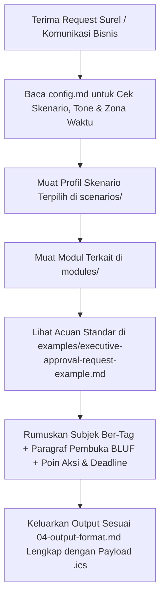

# MailCraft Skill

Skill ini dirancang dengan pendekatan modular berbasis **konfigurasi sentral (`config.md`)**, **profil skenario komunikasi (`scenarios/`)**, **modul spesifikasi surel & kalender (`modules/`)**, dan **contoh nyata ideal (`examples/`)**.

---

## 🎯 Alur Eksekusi AI (Execution Flow)

Setiap kali skill ini aktif, AI **WAJIB** mengikuti urutan prioritas pembacaan berikut:

### 1. Periksa Saklar Utama ([config.md](./config.md))
- Lihat nilai `target_scenario` (misal: `executive-decision`, `client-negotiation`, `meeting-scheduling`, atau `custom-email`).
- Periksa bahasa dan gaya komunikasi (`tone`: `executive_polite`, `default_language`: `id` atau `en`, `time_zone`: `Asia/Jakarta`).
- Periksa status aktif/non-aktif setiap modul di `modules_enabled`.
- Pastikan kepatuhan preferensi: `max_paragraphs: 3`, `enforce_explicit_deadlines: true`, dan `generate_ics_payload: true`.

### 2. Muat Profil Skenario Komunikasi ([scenarios/](./scenarios/))
- Buka file profil skenario yang terpilih:
  - Permohonan Keputusan & Persetujuan Direksi: [`scenarios/executive-decision.md`](./scenarios/executive-decision.md)
  - Negosiasi Kontrak & Komunikasi Klien B2B: [`scenarios/client-negotiation.md`](./scenarios/client-negotiation.md)
  - Penjadwalan Rapat & Koordinasi Agenda: [`scenarios/meeting-scheduling.md`](./scenarios/meeting-scheduling.md)
  - Skenario Kustom (Insiden Krisis / Investor Update): [`scenarios/custom-email.md`](./scenarios/custom-email.md)

### 3. Terapkan Modul Standar ([modules/](./modules/))
- **01. Subjek Ber-Tag & BLUF**: Gunakan tag awalan wajib (`[Butuh Persetujuan]`, `[Tindakan Diminta]`, `[FYI]`), dan nyatakan inti kesimpulan di kalimat pertama dari [`modules/01-subject-lines-bluf.md`](./modules/01-subject-lines-bluf.md).
- **02. Poin Aksi & Batas Waktu**: Sajikan permintaan dalam bentuk daftar poin bernomor dengan PIC (Person in Charge) dan batas waktu eksplisit (*Hari, Tanggal, Jam, dan Zona Waktu*) dari [`modules/02-action-items-deadlines.md`](./modules/02-action-items-deadlines.md).
- **03. Payload Kalender RFC 5545**: Buat blok data `text/calendar` (.ics) lengkap dengan VEVENT, UID, rentang waktu UTC, ringkasan, dan alarm pengingat dari [`modules/03-calendar-ics-payload.md`](./modules/03-calendar-ics-payload.md).
- **05. Diplomasi & Asertivitas**: Tolak permintaan yang tidak masuk akal secara sopan tanpa meminta maaf berlebihan, pertahankan batasan ruang lingkup (*scope creep*), dan pilih kata-kata diplomatis dari [`modules/05-tone-diplomacy-assertiveness.md`](./modules/05-tone-diplomacy-assertiveness.md).
- **06. Ritme Follow-Up & Eskalasi**: Terapkan jeda waktu follow-up (3 hari kerja $\rightarrow$ 7 hari kerja), gunakan teknik menghubungkan kembali nilai manfaat, dan tangga eskalasi hirarki dari [`modules/06-followup-escalation-cadence.md`](./modules/06-followup-escalation-cadence.md).
- **07. Tanda Tangan Korporat**: Sertakan nama, jabatan resmi, logo/brand text, link pemesanan jadwal kalender instan, dan klausul kerahasiaan legal dari [`modules/07-corporate-signatures-branding.md`](./modules/07-corporate-signatures-branding.md).
- **08. Keterkiriman & Kebersihan Spam**: Hindari kata-kata pemicu filter spam (*free, click here, urgent* berlebih), pertahankan rasio teks di atas 80%, dan kepatuhan standar RFC 822 dari [`modules/08-deliverability-spam-hygiene.md`](./modules/08-deliverability-spam-hygiene.md).

### 4. Acuan Surel Nyata ([examples/executive-approval-request-example.md](./examples/executive-approval-request-example.md))
- Jadikan [executive-approval-request-example.md](./examples/executive-approval-request-example.md) sebagai tolok ukur standar (*benchmark*) surel persetujuan anggaran ke CFO dengan tabel perbandingan ringkas, tenggat waktu tegas, dan lampiran payload kalender `.ics`.

### 5. Format Output ([modules/04-output-format.md](./modules/04-output-format.md))
- Sajikan metadata penerima (To / Cc / Bcc), baris subjek resmi, badan surel berformat markdown bersih, blok kode kalender `.ics`, dan checklist etiket surel resmi.

---

## 📂 Peta Struktur File

| Berkas / Direktori | Fungsi Utama |
| :--- | :--- |
| [config.md](./config.md) | Saklar sentral (skenario komunikasi, tone bahasa, zona waktu kalender, modul aktif). |
| [scenarios/executive-decision.md](./scenarios/executive-decision.md) | Standar surel pimpinan C-Level: BLUF tegas, ringkasan pilihan strategis, batas waktu putusan. |
| [scenarios/client-negotiation.md](./scenarios/client-negotiation.md) | Standar komunikasi klien & vendor: penawaran B2B, penolakan sopan, proteksi scope creep. |
| [scenarios/meeting-scheduling.md](./scenarios/meeting-scheduling.md) | Standar koordinasi rapat: agenda 3 pilar, tautan konferensi video, undangan kalender .ics. |
| [scenarios/custom-email.md](./scenarios/custom-email.md) | Profil surel kustom: tanggap darurat insiden downtime, laporan bulanan investor, tagihan. |
| [modules/01-subject-lines-bluf.md](./modules/01-subject-lines-bluf.md) | Rumus baris subjek dengan tag niat ([Action Required]), metode BLUF, eliminasi basa-basi. |
| [modules/02-action-items-deadlines.md](./modules/02-action-items-deadlines.md) | Penyusunan daftar aksi (Who does What by When), penegasan batas waktu jam dan zona waktu. |
| [modules/03-calendar-ics-payload.md](./modules/03-calendar-ics-payload.md) | Standar iCalendar RFC 5545: struktur VEVENT, VCALENDAR, UID, DTSTART/DTEND, dan VALARM. |
| [modules/04-output-format.md](./modules/04-output-format.md) | Template standar output AI: header To/Cc, subjek, naskah surel, blok kode .ics, checklist. |
| [modules/05-tone-diplomacy-assertiveness.md](./modules/05-tone-diplomacy-assertiveness.md) | Asertivitas diplomatis: seni mengatakan tidak secara profesional tanpa merusak relasi. |
| [modules/06-followup-escalation-cadence.md](./modules/06-followup-escalation-cadence.md) | Jadwal pengingat bertahap (cadence), aturan 3-touch points, dan tangga eskalasi manajerial. |
| [modules/07-corporate-signatures-branding.md](./modules/07-corporate-signatures-branding.md) | Blok tanda tangan email profesional, tautan kalender online, dan disclaimer kerahasiaan legal. |
| [modules/08-deliverability-spam-hygiene.md](./modules/08-deliverability-spam-hygiene.md) | Protokol anti-spam filter, kebersihan header RFC 822, penghindaran kata pemicu spam. |
| [examples/executive-approval-request-example.md](./examples/executive-approval-request-example.md) | Contoh emas surel persetujuan kontrak vendor ke CFO lengkap dengan payload kalender .ics. |

---

## 🚫 Larangan Khusus untuk AI

1. **Dilarang Menulis Paragraf Pembuka Basa-Basi yang Kosong**: Dilarang mengawali email bisnis dengan kalimat klise tanpa makna seperti *"Semoga email ini menemui Anda dalam keadaan sehat walafiat..."*. Langsung sampaikan alasan email dikirim pada kalimat pertama.
2. **Dilarang Memberikan Batas Waktu yang Mengambang (Vague Deadlines)**: Dilarang menulis kata-kata ambigu seperti *"secepatnya"*, *"ASAP"*, atau *"akhir minggu ini"*. Wajib menyebutkan hari, tanggal kalender, jam, dan zona waktu spesifik (misal: `Jumat, 27 November 2026, pukul 17:00 WIB`).
3. **Dilarang Menulis Dinding Teks (Wall of Text)**: Surel dibatasi maksimal 3 paragraf pendek. Permintaan atau poin penting wajib disajikan dalam bentuk daftar peluru (*bullet points*) atau tabel ringkas.
4. **Dilarang Mengirim Undangan Rapat Tanpa Agenda Jelas**: Setiap surel koordinasi rapat wajib menyertakan minimal 3 poin agenda pembicaraan dan durasi rapat yang terukur.
