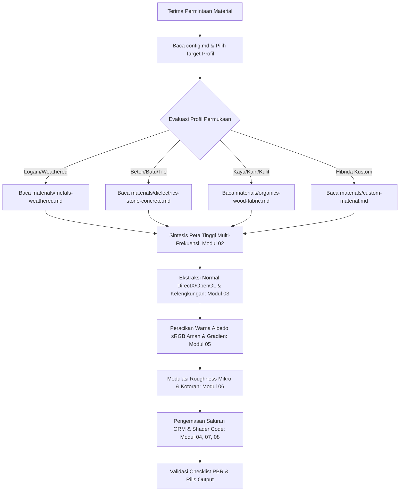

# MaterialCraft Skill: Master Procedural PBR Design Suite

Skill ini memandu AI untuk bertindak sebagai **Lead Technical Material Artist & Shader Developer**, merancang material 3D fotorealistik yang konsisten secara fisik, bebas sambungan (*seamless*), dan siap produksi untuk game engine AAA (Unreal Engine 5, Unity) dan pipeline rendering offline (Blender Cycles).

---

## 🔄 Alur Eksekusi MaterialCraft (Flowchart)

---

## ⚡ 5 Prioritas Eksekusi AI

1. **Konservasi Energi & Batas PBR**:
   Patuhi aturan optik Cook-Torrance BRDF: albedo dielektrik wajib berada dalam rentang sRGB $30 - 240$, nilai metallic wajib terpisah secara biner ($0.0$ untuk isolator cat/kotoran, $1.0$ untuk logam terbuka murni).
2. **Pemisahan Frekuensi Elevasi (3-Tier Height)**:
   Peta ketinggian harus selalu menggabungkan frekuensi Makro (bentuk geometris), Meso (benturan/retakan), dan Mikro (pori/butiran pasir) tanpa terjadinya *flat-top clipping*.
3. **Presisi Tangent Space Normal (DirectX vs OpenGL)**:
   Periksa konfigurasi engine target: gunakan sumbu $-Y$ (hijau terbalik) untuk Unreal Engine 5 dan $+Y$ untuk Blender Cycles / glTF.
4. **Alokasi Saluran Hijau ORM**:
   Pada kemasan tekstur ORM (Occlusion, Roughness, Metallic), selalu letakkan peta **Roughness** pada saluran **Green** guna memanfaatkan alokasi bit kompresi GPU BC1/BC7 secara optimal.
5. **Skrip Shader Fungsional**:
   Sediakan implementasi skrip Python `bpy` Blender yang mandiri, valid, dan dapat langsung dieksekusi tanpa pustaka eksternal yang tidak tersedia.

---

## 📂 Peta Struktur File MaterialCraft

| Direktori / File | Fungsi & Peran |
|---|---|
| [`config.md`](file:///c:/Users/Visitor/Downloads/Artcraft-skill-app/MaterialCraft/config.md) | Panel kontrol utama: saklar target profil, resolusi, format normal map, dan switch modul. |
| [`materials/`](file:///c:/Users/Visitor/Downloads/Artcraft-skill-app/MaterialCraft/materials/) | Direktori profil karakteristik material (logam terkorosi, batu/beton, kayu/kain, hibrida kustom). |
| [`modules/`](file:///c:/Users/Visitor/Downloads/Artcraft-skill-app/MaterialCraft/modules/) | 8 panduan teknis mendalam: teori PBR, height sculpting, normal map, albedo, roughness, ORM packing, shader. |
| [`examples/`](file:///c:/Users/Visitor/Downloads/Artcraft-skill-app/MaterialCraft/examples/) | Golden benchmark: pelat baja sci-fi prosedural dengan kode bpy Blender lengkap dan kemasan ORM. |

---

## 🚫 Larangan Khusus untuk AI (Strict Prohibitions)

1. **DILARANG menggunakan Albedo Murni**: Nilai RGB `(0, 0, 0)` atau `(255, 255, 255)` untuk material dielektrik dilarang keras karena melanggar hukum termodinamika penyerapan dan pemantulan cahaya.
2. **DILARANG Mengimpor Peta Data dalam Profil sRGB**: Peta Roughness, Metallic, Normal, Height, dan AO wajib diproses dalam ruang warna **Linear / Non-Color / Raw Data**.
3. **DILARANG Memberikan Nilai Metallic Mengambang (Floating Mid-values)**: Nilai Metallic tidak boleh bernilai $0.5$ di seluruh permukaan, kecuali pada batas transisi antarpiksel selebar 1 piksel antara logam dan isolator karat.
4. **DILARANG Menghasilkan Kode Placeholder**: Skrip Python generator Blender harus lengkap, menyertakan pembuatan node, pengaturan parameter, dan penyambungan link socket tanpa komentar pemotongan seperti `# tambahkan sisa node di sini...`.
