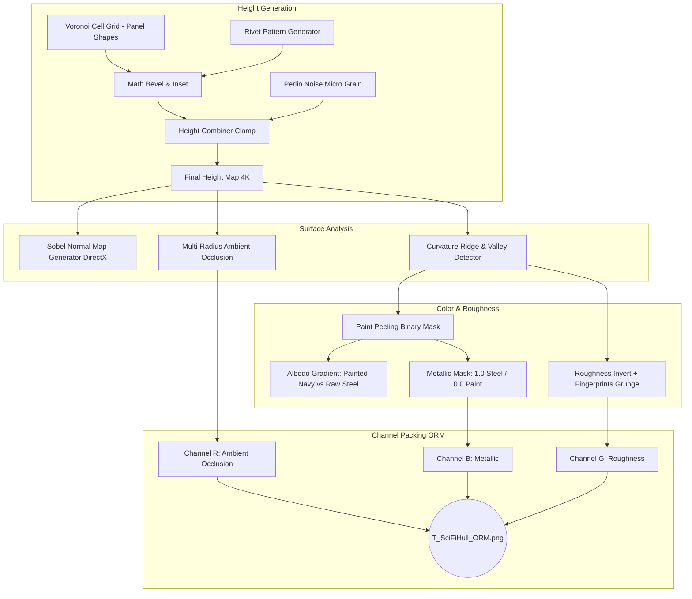

# Golden Benchmark Example: Weathered Sci-Fi Hull Metal Plate

Dokumen ini mendemonstrasikan implementasi menyeluruh standar **MaterialCraft** untuk merancang material prosedural pelat baja modular sci-fi (*sci-fi hull panel*) dengan jahitan las, keausan cat tepi (*edge chipping*), kotoran oklusi celah, dan ekspor paket tekstur ORM siap pakai untuk Unreal Engine 5 dan Blender Cycles.

---

## 1. Project Parameters & Physical Setup

- **Material Name**: `M_SciFi_Hull_Plate_Weathered`
- **Category**: Weathered Metals & Coated Alloys
- **Workflow**: PBR Metallic-Roughness
- **Target Resolution**: 4096 x 4096 (4K)
- **Normal Format**: DirectX (-Y) dengan opsi swap OpenGL (+Y)
- **Target Engine**: Unreal Engine 5 (Nanite displacement + Lumen) & Blender Cycles

---

## 2. Procedural Node Architecture (Mermaid)



---

## 3. PBR Channel Breakdown Specifications

1. **Height Map (16-bit Grayscale)**:
   - Panel dasar memiliki elevasi $0.50$.
   - Garis alur nat sambungan antar plat turun ke $0.15$ dengan radius chamfer 4 piksel.
   - Paku keling (*rivets*) berbentuk kubah menonjol setinggi $0.85$ dengan diameter 24 piksel di sepanjang perimeter.
2. **Normal Map (DirectX -Y)**:
   - Nilai datar dasar: RGB `(128, 128, 255)` / Hex `#8080FF`.
   - Intensitas normal Sobel: $2.4$.
3. **Albedo / Base Color (sRGB)**:
   - Lapisan Cat Utama (Industrial Navy Blue): Hex `#1E2A38` (sRGB `30, 42, 56`).
   - Logam Dasar Baja Terbuka (Chipped Steel): Hex `#9BA2A8` (sRGB `155, 162, 168`).
   - Residu Oksidasi / Karat Tepi: Hex `#5C3A21` (sRGB `92, 58, 33`).
4. **Roughness Map (Linear Grayscale)**:
   - Cat eksterior satin: $0.42$.
   - Logam baja terbuka terabrasi: $0.28$.
   - Celah kotoran berminyak: $0.78$.
5. **Metallic Map (Binary Linear)**:
   - Area cat dan karat: $0.0$.
   - Area baja terbuka (*chipped edges*): $1.0$.
6. **Ambient Occlusion (Linear Grayscale)**:
   - Celah nat sambungan dan tepi paku keling teroklusi hingga nilai $0.22$.

---

## 4. Skrip Automasi Blender Python (bpy Material Generator)

Skrip Python mandiri berikut dapat langsung dijalankan di Text Editor Blender untuk membangun nodetree shader prosedural lengkap:

```python
import bpy

def build_scifi_hull_material():
    mat_name = "M_SciFi_Hull_Plate_Weathered"
    
    # Hapus material lama jika ada
    if mat_name in bpy.data.materials:
        bpy.data.materials.remove(bpy.data.materials[mat_name])
        
    mat = bpy.data.materials.new(name=mat_name)
    mat.use_nodes = True
    nodes = mat.node_tree.nodes
    links = mat.node_tree.links
    nodes.clear()

    # 1. Output & Principled BSDF
    node_out = nodes.new(type="ShaderNodeOutputMaterial")
    node_out.location = (1200, 0)
    
    node_bsdf = nodes.new(type="ShaderNodeBsdfPrincipled")
    node_bsdf.location = (800, 0)
    links.new(node_bsdf.outputs["BSDF"], node_out.inputs["Surface"])

    # 2. Texture Coordinate & Mapping
    node_coord = nodes.new(type="ShaderNodeTexCoord")
    node_coord.location = (-1200, 0)
    
    node_map = nodes.new(type="ShaderNodeMapping")
    node_map.location = (-1000, 0)
    links.new(node_coord.outputs["UV"], node_map.inputs["Vector"])

    # 3. Procedural Panel Pattern (Voronoi Texture)
    node_voronoi = nodes.new(type="ShaderNodeTexVoronoi")
    node_voronoi.location = (-750, 200)
    node_voronoi.feature = 'F1'
    node_voronoi.distance = 'CHEBYSHEV'
    node_voronoi.inputs["Scale"].default_value = 4.0
    links.new(node_map.outputs["Vector"], node_voronoi.inputs["Vector"])

    # 4. Edge Detect / Bevel Math
    node_math_edge = nodes.new(type="ShaderNodeMath")
    node_math_edge.operation = 'SMOOTH_MIN'
    node_math_edge.location = (-500, 200)
    node_math_edge.inputs[1].default_value = 0.5
    links.new(node_voronoi.outputs["Distance"], node_math_edge.inputs[0])

    # 5. Noise Micro Scratch & Grunge
    node_noise = nodes.new(type="ShaderNodeTexNoise")
    node_noise.location = (-750, -200)
    node_noise.inputs["Scale"].default_value = 45.0
    node_noise.inputs["Detail"].default_value = 8.0
    node_noise.inputs["Roughness"].default_value = 0.65
    links.new(node_map.outputs["Vector"], node_noise.inputs["Vector"])

    # 6. Chipped Paint Mask (Color Ramp)
    node_ramp_chip = nodes.new(type="ShaderNodeValToRGB")
    node_ramp_chip.location = (-250, 100)
    node_ramp_chip.color_ramp.elements[0].position = 0.42
    node_ramp_chip.color_ramp.elements[1].position = 0.58
    links.new(node_voronoi.outputs["Distance"], node_ramp_chip.inputs["Fac"])

    # 7. Albedo Color Mix (Paint vs Steel)
    node_albedo_mix = nodes.new(type="ShaderNodeMix")
    node_albedo_mix.data_type = 'RGBA'
    node_albedo_mix.location = (200, 250)
    # Cat Biru Navy Industri
    node_albedo_mix.inputs[6].default_value = (0.118, 0.165, 0.220, 1.0)
    # Baja Terbuka
    node_albedo_mix.inputs[7].default_value = (0.608, 0.635, 0.659, 1.0)
    links.new(node_ramp_chip.outputs["Color"], node_albedo_mix.inputs["Factor"])
    links.new(node_albedo_mix.outputs[2], node_bsdf.inputs["Base Color"])

    # 8. Metallic Setup (0.0 for Paint, 1.0 for Chipped Metal)
    links.new(node_ramp_chip.outputs["Color"], node_bsdf.inputs["Metallic"])

    # 9. Roughness Setup
    node_rough_mix = nodes.new(type="ShaderNodeMix")
    node_rough_mix.data_type = 'FLOAT'
    node_rough_mix.location = (200, -100)
    node_rough_mix.inputs[2].default_value = 0.42  # Cat satin
    node_rough_mix.inputs[3].default_value = 0.28  # Baja kilap
    links.new(node_ramp_chip.outputs["Color"], node_rough_mix.inputs["Factor"])
    links.new(node_rough_mix.outputs[0], node_bsdf.inputs["Roughness"])

    # 10. Bump / Normal Simulation
    node_bump = nodes.new(type="ShaderNodeBump")
    node_bump.location = (450, -300)
    node_bump.inputs["Strength"].default_value = 0.75
    node_bump.inputs["Distance"].default_value = 0.05
    links.new(node_math_edge.outputs["Value"], node_bump.inputs["Height"])
    links.new(node_bump.outputs["Normal"], node_bsdf.inputs["Normal"])

    print(f"Material '{mat_name}' berhasil dibangun.")
    return mat

if __name__ == "__main__":
    build_scifi_hull_material()
```

---

## 5. Verification Checklist

- [x] Nilai albedo cat berada dalam rentang aman ($30 \le \text{sRGB} \le 240$), tidak ada nilai $0$ murni atau $255$ murni.
- [x] Metallic map terpisahkan secara tegas ($1.0$ untuk baja terkelupas, $0.0$ untuk cat).
- [x] Saluran Green pada kemasan ORM dialokasikan khusus untuk Roughness.
- [x] Format normal map DirectX (-Y) terkalibrasi untuk Unreal Engine 5.
- [x] Seamless tiling terverifikasi tanpa sambungan tampak pada penggeseran UV 0.5.
