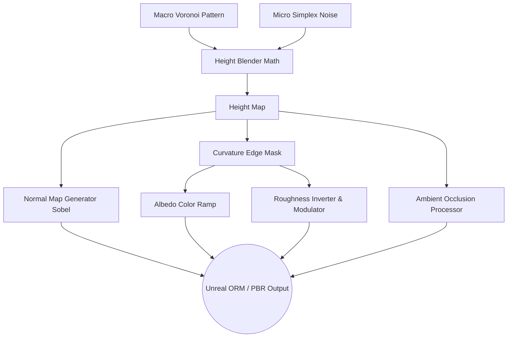

# Modul 04: Standard Output Format & Pipeline Specification

Modul ini mendefinisikan format baku laporan perancangan material prosedural di **MaterialCraft**, mencakup diagram alir node, resep parameter teknis, dan skrip implementasi (Blender Python Shader Nodes / Unreal Engine Material Graph).

---

## 1. Struktur Baku Laporan MaterialCraft

Setiap respons perancangan material prosedural harus mengikuti urutan bagian berikut:

```markdown
# MaterialCraft Technical Specification: [Nama Material]

## 1. Ringkasan Fisika Material (PBR Identity)
- Workflow: [metallic_roughness / specular_glossiness]
- Kategori Permukaan: [Logam / Dielektrik / Organik / Hibrida]
- Resolusi Tekstur: [2048x2048 / 4096x4096]
- Normal Format: [DirectX (-Y) / OpenGL (+Y)]

## 2. Diagram Pohon Jaringan Node (Procedural Node Graph)
[Mermaid diagram alur sinyal dari noise generator hingga output PBR maps]

## 3. Spesifikasi Saluran Tekstur (Channel Breakdown)
- Albedo / Base Color: [Deskripsi color mapping & sRGB range]
- Height / Displacement: [Frekuensi makro, meso, mikro & min-max limits]
- Normal Map: [Intensitas kalkulasi gradien Sobel]
- Roughness: [Inversi height, variasi kotoran/grunge, rentang nilai]
- Metallic: [Mask biner konduktor vs isolator]
- Ambient Occlusion: [Radius sampling & kedalaman oklusi]

## 4. Skrip Implementasi Prosedural (Code Block)
[Kode lengkap Python Blender bpy shader nodes / HLSL / OSL / Unreal Blueprint logic]

## 5. Matriks Saluran Kemasan (Channel Packing Specification)
[Penjelasan packing ORM / MaskMap]

## 6. Checklist Verifikasi Standar PBR
- [ ] Checklist kepatuhan konservasi energi & batasan nilai
```

---

## 2. Diagram Pohon Node Standar (Mermaid)

Contoh diagram wajib yang harus disertakan:


