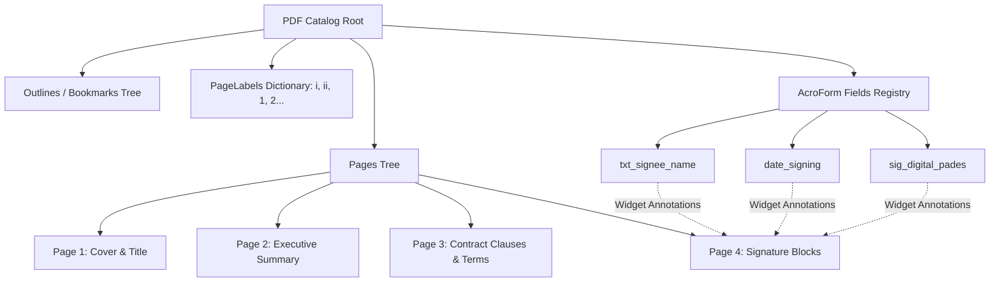

# Modul 04: Standard Output Format & Pipeline Architecture

Modul ini mendefinisikan template baku laporan perancangan dokumen dan skrip pemrosesan PDF di **PdfCraft**, mencakup diagram alir arsitektur dokumen, parameter teknis, dan kode implementasi siap pakai.

---

## 1. Struktur Baku Laporan PdfCraft

Setiap respons perancangan atau restrukturisasi dokumen PDF harus mengikuti urutan berikut:

```markdown
# PdfCraft Technical Specification: [Judul Dokumen / Pipeline]

## 1. Parameter & Standar Dokumen (Document Specs)
- Tipe Dokumen: [legal-contracts / interactive-forms / technical-reports / custom]
- Standar PDF: [PDF/A-2b / PDF 1.7]
- Ukuran Kertas & Margin: [A4 / Letter, Margins mm]
- Enkripsi & Keamanan: [AES-256 / None / Permissions Flags]

## 2. Diagram Arsitektur Dokumen (Mermaid)
[Mermaid diagram struktur halaman, hierarki bookmark, dan alur form fields]

## 3. Spesifikasi Halaman & Navigasi (Layout & Navigation Breakdown)
- Struktur Halaman & PageLabels: [Penomoran halaman logis]
- Pohon Bookmark: [Daftar isi interaktif]
- Metadata XMP: [Title, Author, Subject, Keywords, PDF/A Intent]

## 4. Skrip Automasi Python (PyMuPDF / ReportLab Code Block)
[Kode lengkap mandiri yang dapat langsung dijalankan untuk generate atau manipulasi PDF]

## 5. Spesifikasi Formulir & Redaksi (Jika Relevan)
- Form Fields & Javascript Rules
- Area Redaksi Permanen

## 6. Checklist Verifikasi & Kepatuhan
- [ ] Checklist kepatuhan standar arsip & keamanan
```

---

## 2. Contoh Diagram Arsitektur Dokumen (Mermaid)


