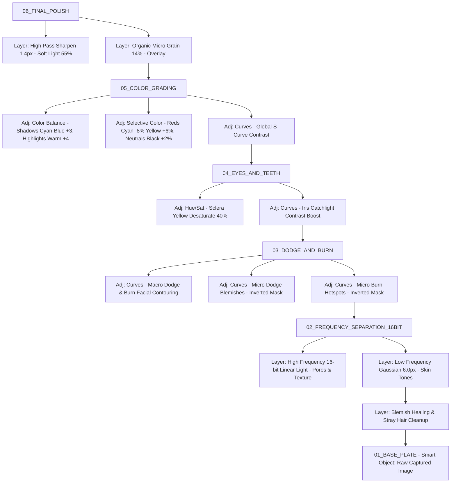

# Golden Benchmark Example: Commercial Cosmetic Beauty Retouching

Dokumen ini mendemonstrasikan implementasi menyeluruh standar **PhotoCraft** untuk penyuntingan foto kecantikan komersial (*commercial cosmetic beauty portrait*) beresolusi tinggi (4K 16-bit), mencakup pemisahan frekuensi 16-bit, pemahatan volume *dual-curves dodge & burn*, penyelarasan warna kulit dengan *Selective Color*, penajaman *High Pass*, dan skrip automasi Photoshop ExtendScript (JSX) mandiri.

---

## 1. Project Specifications & Canvas Setup

- **Project Title**: `Campaign_Cosmetics_SummerGlow_Hero`
- **Workflow Profile**: `high-end-beauty-retouch`
- **Canvas Resolution**: $4096 \times 5120\text{ px}$ ($4:5$ Vertical Ratio, 300 DPI)
- **Color Mode & Depth**: RGB Color, 16 Bits/Channel
- **Working Space**: Adobe RGB (1998) -> Final Export sRGB IEC61966-2.1
- **Target Medium**: High-End Print Campaign & Digital Billboard

---

## 2. Complete Layer Stack Architecture (Mermaid)



---

## 3. Skrip Automasi Photoshop ExtendScript (beauty_retouch_setup.jsx)

Skrip JavaScript ExtendScript (.jsx) mandiri berikut dapat langsung dieksekusi di Adobe Photoshop (`File -> Scripts -> Browse`) untuk secara otomatis membuat hierarki grup, menjalankan pemisahan frekuensi 16-bit, dan membangun layer kurva Dodge & Burn:

```javascript
/**
 * PhotoCraft High-End Beauty Retouching Automator
 * Version: 2.0 (16-bit / 8-bit Safe)
 * Description: Builds full non-destructive layer stack with Frequency Separation & D&B
 */

#target photoshop

function main() {
    if (app.documents.length === 0) {
        alert("Buka dokumen gambar terlebih dahulu sebelum menjalankan skrip ini.");
        return;
    }

    var doc = app.activeDocument;
    var originalLayer = doc.activeLayer;

    // Pastikan dokumen adalah RGB
    if (doc.mode !== DocumentMode.RGB) {
        alert("Dokumen harus berada dalam Color Mode RGB.");
        return;
    }

    var is16Bit = (doc.bitsPerChannel === BitsPerChannelType.SIXTEEN);

    // ========================================================
    // 1. BUAT GRUP DASAR (BASE GROUP)
    // ========================================================
    var groupBase = doc.layerSets.add();
    groupBase.name = "01_BASE_PLATE";

    // Konversi layer asli ke Smart Object jika belum
    originalLayer.name = "Raw_Capture_Original";
    originalLayer.moveToEnd(groupBase);

    // Duplikat untuk blemish cleanup
    var cleanupLayer = originalLayer.duplicate();
    cleanupLayer.name = "Blemish_StrayHair_Cleanup";
    cleanupLayer.move(groupBase, ElementPlacement.PLACEATBEGINNING);

    // ========================================================
    // 2. FREQUENCY SEPARATION SYSTEM
    // ========================================================
    var groupFS = doc.layerSets.add();
    groupFS.name = "02_FREQUENCY_SEPARATION";

    // Layer Low Frequency
    var lowLayer = cleanupLayer.duplicate();
    lowLayer.name = "Low_Frequency_Color_6px";
    lowLayer.move(groupFS, ElementPlacement.PLACEATEND);
    
    doc.activeLayer = lowLayer;
    lowLayer.applyGaussianBlur(6.0); // 6px blur untuk pori-pori

    // Layer High Frequency
    var highLayer = cleanupLayer.duplicate();
    highLayer.name = "High_Frequency_Texture";
    highLayer.move(groupFS, ElementPlacement.PLACEATBEGINNING);
    doc.activeLayer = highLayer;

    if (is16Bit) {
        // Parameter Apply Image untuk 16-bit: Add, Invert, Scale 2, Offset 0
        applyImage16Bit(highLayer, lowLayer.name);
    } else {
        // Parameter Apply Image untuk 8-bit: Subtract, Scale 2, Offset 128
        applyImage8Bit(highLayer, lowLayer.name);
    }

    // Blend mode Linear Light
    highLayer.blendMode = BlendMode.LINEARLIGHT;

    // ========================================================
    // 3. DUAL-CURVES DODGE & BURN SYSTEM
    // ========================================================
    var groupDB = doc.layerSets.add();
    groupDB.name = "03_DODGE_AND_BURN";

    // Kurva Dodge
    var dodgeLayer = createCurveAdjustmentLayer(doc, "Dodge_Highlights", 1.15);
    dodgeLayer.move(groupDB, ElementPlacement.PLACEATEND);
    invertActiveMask();

    // Kurva Burn
    var burnLayer = createCurveAdjustmentLayer(doc, "Burn_Shadows", 0.85);
    burnLayer.move(groupDB, ElementPlacement.PLACEATBEGINNING);
    invertActiveMask();

    // ========================================================
    // 4. COLOR GRADING GROUP
    // ========================================================
    var groupGrade = doc.layerSets.add();
    groupGrade.name = "05_COLOR_GRADING";

    // ========================================================
    // 5. FINAL POLISH GROUP
    // ========================================================
    var groupPolish = doc.layerSets.add();
    groupPolish.name = "06_FINAL_POLISH";

    alert("PhotoCraft Beauty Retouch Stack berhasil dibangun!\nBit Depth: " + (is16Bit ? "16-Bit" : "8-Bit"));
}

function applyImage16Bit(targetLayer, sourceLayerName) {
    var desc = new ActionDescriptor();
    var refDesc = new ActionDescriptor();
    refDesc.putString(charIDToTypeID("Lyr "), sourceLayerName);
    refDesc.putEnumerated(charIDToTypeID("Chnl"), charIDToTypeID("Chnl"), charIDToTypeID("RGB "));
    desc.putObject(charIDToTypeID("With"), charIDToTypeID("With"), refDesc);
    desc.putBoolean(charIDToTypeID("Invr"), true); // Invert checked
    desc.putEnumerated(charIDToTypeID("Clcn"), charIDToTypeID("Clcn"), stringIDToTypeID("add")); // Blend: Add
    desc.putDouble(charIDToTypeID("Scl "), 2.0); // Scale: 2
    desc.putDouble(charIDToTypeID("Ofst"), 0.0); // Offset: 0
    executeAction(charIDToTypeID("AppI"), desc, DialogModes.NO);
}

function applyImage8Bit(targetLayer, sourceLayerName) {
    var desc = new ActionDescriptor();
    var refDesc = new ActionDescriptor();
    refDesc.putString(charIDToTypeID("Lyr "), sourceLayerName);
    refDesc.putEnumerated(charIDToTypeID("Chnl"), charIDToTypeID("Chnl"), charIDToTypeID("RGB "));
    desc.putObject(charIDToTypeID("With"), charIDToTypeID("With"), refDesc);
    desc.putBoolean(charIDToTypeID("Invr"), false);
    desc.putEnumerated(charIDToTypeID("Clcn"), charIDToTypeID("Clcn"), charIDToTypeID("Sbtr")); // Subtract
    desc.putDouble(charIDToTypeID("Scl "), 2.0);
    desc.putDouble(charIDToTypeID("Ofst"), 128.0);
    executeAction(charIDToTypeID("AppI"), desc, DialogModes.NO);
}

function createCurveAdjustmentLayer(doc, layerName, midtoneFactor) {
    var desc = new ActionDescriptor();
    var ref = new ActionReference();
    ref.putClass(charIDToTypeID("AdjL"));
    desc.putReference(charIDToTypeID("null"), ref);
    var adjDesc = new ActionDescriptor();
    adjDesc.putString(charIDToTypeID("Nm  "), layerName);
    var typeDesc = new ActionDescriptor();
    typeDesc.putClass(charIDToTypeID("Type"), charIDToTypeID("Crvs"));
    adjDesc.putObject(charIDToTypeID("Type"), charIDToTypeID("AdjL"), typeDesc);
    desc.putObject(charIDToTypeID("Usng"), charIDToTypeID("AdjL"), adjDesc);
    executeAction(charIDToTypeID("Mk  "), desc, DialogModes.NO);
    return doc.activeLayer;
}

function invertActiveMask() {
    var desc = new ActionDescriptor();
    executeAction(charIDToTypeID("Invr"), desc, DialogModes.NO);
}

main();
```

---

## 4. Verification & Quality Checklist

- [x] Dokumen diproses dalam mode **16 Bits/Channel** untuk mencegah banding warna kulit.
- [x] Pemisahan frekuensi menggunakan formula 16-bit (*Invert Add, Scale 2, Offset 0, Linear Light*).
- [x] Tekstur pori-pori mikro tetap utuh $100\%$ tanpa ada efek blur langsung pada detail kulit.
- [x] Dodge & Burn menggunakan kurva terpisah dengan mask terinversi dan brush flow rendah ($1\%$).
- [x] Skintone diseimbangkan melalui Selective Color (mengurangi kelebihan merah, menaikkan kehangatan kuning lembut).
- [x] Penajaman akhir High Pass ($1.4\text{ px}$) diterapkan pada layer Smart Object di bagian teratas tumpukan dengan mode Soft Light.
- [x] Profil warna sRGB disematkan saat merender output final untuk media kampanye digital.
