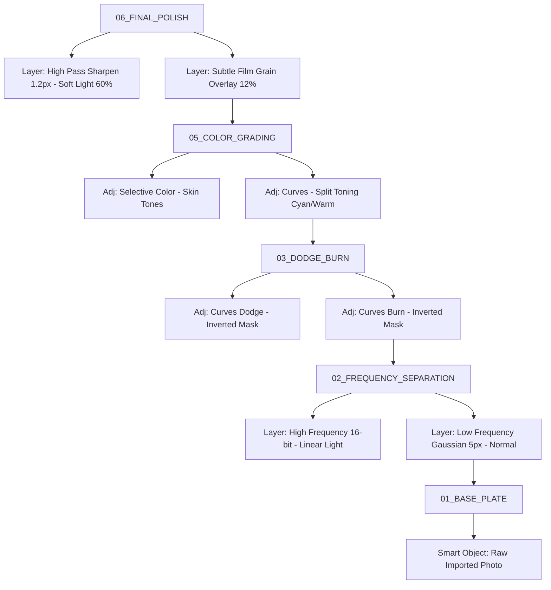

# Modul 04: Standard Output Format & Pipeline Architecture

Modul ini mendefinisikan template baku laporan spesifikasi penyuntingan gambar di **PhotoCraft**, mencakup diagram tumpukan layer, parameter blending, dan skrip automasi (Photoshop JSX ExtendScript / Python PIL & OpenCV).

---

## 1. Struktur Baku Laporan PhotoCraft

Setiap respons perancangan editing atau compositing di PhotoCraft wajib mengikuti urutan berikut:

```markdown
# PhotoCraft Technical Specification: [Judul Proyek / Suntingan]

## 1. Parameter Kanvas & Profil Warna (Canvas Setup)
- Resolusi & Dimensi: [Width x Height px, DPI]
- Color Mode & Bit Depth: [RGB / CMYK, 8-bit / 16-bit]
- Working Color Space: [sRGB / Adobe RGB 1998 / ProPhoto RGB]
- Target Output: [Web E-Commerce / Editorial Print / Billboard]

## 2. Diagram Susunan Tumpukan Layer (Layer Stack Diagram)
[Mermaid diagram tumpukan layer dari Base Plate bawah hingga Export Sharpening atas]

## 3. Rincian Grup & Parameter Layer (Layer Specifications Table)
- Nama Layer / Group: [Penamaan terstruktur]
- Blend Mode: [Normal / Linear Light / Soft Light / Screen / Multiply]
- Opacity & Flow: [Persentase nilai]
- Tipe Mask: [Vector Path / Bitmap Mask / Clipping Mask / Lum Mask]

## 4. Skrip Automasi (Photoshop JSX ExtendScript / Python Script)
[Kode lengkap mandiri yang dapat langsung dijalankan untuk membangun layer stack atau proses batch]

## 5. Instruksi Langkah Demi Langkah (Step-by-Step Retouch Protocol)
- Protokol pembersihan blemish
- Formula frequency separation
- Kurva color grading

## 6. Checklist Verifikasi & Kualitas Akhir
- [ ] Checklist non-destruktif, isolasi tepi, dan profil ekspor
```

---

## 2. Contoh Diagram Susunan Layer (Mermaid)


