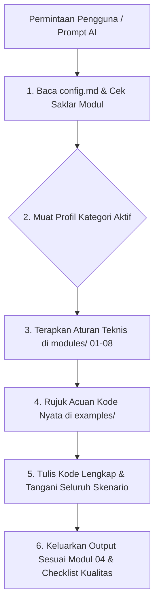

# 🎨 ArtCraft Suite — AI Skills & Design Hub

[](https://www.typescriptlang.org/)
[](https://nodejs.org/)
[](https://www.npmjs.com/)
[](https://github.com/ipan140/Artcraft-skill-app)
[](./LICENSE)

Koleksi panduan dan modul skill otomasi cerdas (*third-party agent skills*) independen untuk ekosistem aplikasi **ArtCraft (Craft App Suite)**. Dibuat untuk memandu kecerdasan buatan (AI) agar menghasilkan standar desain, kode, formula, model 3D, timeline audio/video, dan dokumen profesional yang presisi.

---

## ⚡ Quickstart — Interactive CLI & One-Liner Installers

Pilih dan pasang skill ArtCraft ke proyek atau workspace AI Anda (**Antigravity**, **Cursor**, **Claude Code**, **GitHub Copilot**, **Roo Code**) dalam hitungan detik menggunakan CLI interaktif ala `shadcn/ui`:

```bash
# 🚀 Jalankan CLI Interaktif (Tanpa perlu clone)
npx artcraft-skill init
```

Atau gunakan skrip installer one-liner otomatis (curl / PowerShell):

```bash
# 🐧 Linux & macOS (Terminal)
curl -fsSL https://raw.githubusercontent.com/ipan140/Artcraft-skill-app/master/install.sh | bash

# 🪟 Windows (PowerShell)
irm https://raw.githubusercontent.com/ipan140/Artcraft-skill-app/master/install.ps1 | iex
```

### 💻 Tampilan CLI Terminal Wizard

```
 ╭──────────────────────────────────────────────────╮
 │   🎨 ARTCRAFT AI SKILLS SUITE — CLI INSTALLER    │
 │   Modular AI Agent Skills for ArtCraft Apps      │
 ╰──────────────────────────────────────────────────╯

◆  Pilih platform target AI:
●  Google Antigravity (.agents/skills)
○  Cursor AI (.cursor/skills)
○  Claude Code (.claude/skills)
○  GitHub Copilot / VS Code (.github/skills)
○  Roo Code / Roo Cline (.roo/skills)
○  Custom Directory...

◆  Pilih skill ArtCraft yang ingin Anda instal:
◼  [PILIH SEMUA] Instal seluruh 19 Skill ArtCraft Suite
◻  FigCraft       — UI/UX Design System, Responsive & Accessible React
◻  AniCraft       — Micro-Interactions, 12 Principles & Motion Specs
◻  CADCraft       — Parametric 2D/3D CAD, ISO Drafting & ezdxf
◻  SolidCraft     — Parametric Solid Modeling, DFM, Fits & CadQuery
◻  ...
```

### 🛠️ Perintah CLI Tersedia

| Perintah | Deskripsi |
| :--- | :--- |
| `npx artcraft-skill` atau `npx artcraft-skill init` | Membuka wizard interaktif checklist untuk memilih platform target dan skill ArtCraft |
| `npx artcraft-skill init --all` | Menginstal ke-19 skill ArtCraft sekaligus ke platform terpilih |
| `npx artcraft-skill add <skills...>` | Menginstal skill tertentu secara langsung (contoh: `npx artcraft-skill add figcraft solidcraft`) |
| `npx artcraft-skill add --all -p ./my-skills` | Menginstal semua skill ke direktori kustom |
| `npx artcraft-skill list` | Menampilkan katalog visual 19 skill ArtCraft lengkap yang dikelompokkan per kategori |

---

> [!IMPORTANT]
> ### ⚖️ Pernyataan Batasan Kepemilikan & Disclaimer
> * **Kepemilikan Ivano Rossi Sugiyanto**: Hak cipta **HANYA** berlaku atas dokumen instruksi AI (*agent skills*), berkas panduan `SKILL.md`, saklar `config.md`, modul spesifikasi, profil kategori, dan contoh implementasi kode yang ada di dalam repositori ini.
> * **Bukan Pemilik Aplikasi ArtCraft**: **Ivano Rossi Sugiyanto BUKAN pemilik, bukan pembuat, dan tidak mengklaim kepemilikan apa pun atas perangkat lunak/aplikasi ArtCraft** (FigCraft, AniCraft, CADCraft, CraftAnything, DeckCraft, DesignCraft, EffectCraft, FilmCraft, GridCraft, LightCraft, MailCraft, MaterialCraft, PdfCraft, PhotoCraft, SolidCraft, SoundCraft, TextureCraft, VectorCraft, WordCraft). Seluruh aplikasi, kode sumber software, logo, ikon, dan merek dagang ArtCraft adalah milik sah dan eksklusif dari developer resmi ArtCraft / Tangram Labs.
> * **Sifat Proyek**: Repositori ini murni merupakan alat bantu pendamping independen (*Third-Party AI Companion Tool*) agar pengguna mendapatkan hasil terbaik saat menggunakan aplikasi ArtCraft.

---

## 👤 Hak Cipta Modul Skill (Skill Copyright)

```text
Skill Collection Copyright (c) 2026-present Ivano Rossi Sugiyanto. All rights reserved.
Independent AI instructions designed for the ArtCraft App Suite.
Licensed under the ArtCraft Agent Skills End-User License (see LICENSE file).
```

* **Penulis / Kreator Koleksi Skill**: **Ivano Rossi Sugiyanto**
* **Masa Berlaku Hak Cipta**: **2026 – Present (Terus Aktif & Otomatis Diperbarui Setiap Tahun)**
* **Target Ekosistem yang Didukung**: ArtCraft App Suite (19 Aplikasi)
* **Versi Rilis**: **2.1.0 (Full Modular Architecture Release — 285 Berkas Spesifikasi & Modul)**

---

## 🏗️ Standar Arsitektur Modular 15-Berkas (The FigCraft Standard)

Seluruh **19 aplikasi** dalam repositori ini telah distandarisasi ke dalam arsitektur modular yang konsisten, tangguh, dan dapat dikustomisasi secara terprogram:

```
[NamaAplikasi]Craft/
├── config.md                     # 1. Panel Kendali Sentral (Target Selector, Tech Stack, Module Switches)
├── SKILL.md                      # 2. Panduan Master AI (Flowchart Mermaid, 5 Prioritas, Larangan Ketat AI)
├── [kategori]/                   # 3. Empat Profil Target Khusus (4 berkas profil mendalam)
│   ├── profil-1.md
│   ├── profil-2.md
│   ├── profil-3.md
│   └── custom-template.md
├── modules/                      # 4. Delapan Modul Aturan & Spesifikasi Teknis (01-08)
│   ├── 01-fondasi-standar.md
│   ├── 02-pemrosesan-inti.md
│   ├── 03-aturan-presisi.md
│   ├── 04-output-format.md      # Template baku laporan & diagram Mermaid wajib
│   ├── 05-fitur-spesifik-1.md
│   ├── 06-fitur-spesifik-2.md
│   ├── 07-optimasi-integrasi.md
│   └── 08-tooling-ekspor.md
└── examples/                     # 5. Golden Benchmark Implementation (Contoh nyata produksi siap pakai)
    └── golden-example.md
```

### Diagram Alur Eksekusi AI Lintas Aplikasi



---

## 📚 Katalog 19 Skill Aplikasi ArtCraft

Setiap aplikasi memiliki folder mandiri yang memuat berkas konfigurasi, modul spesifikasi, profil kategori, dan contoh benchmark nyata:

| No | Folder Skill | Aplikasi Terkait | Profil Kategori | Modul Teknis (8 Modul) | Golden Benchmark Contoh |
| :---: | :--- | :--- | :--- | :--- | :--- |
| 1 | [FigCraft](./FigCraft) | FigCraft | `devices/` (Desktop, Mobile, Tablet, Custom) | Design System, Architecture, Coding, Output, States/Motion, Assets, A11y, i18n | `card-example.md` (React Card + Skeleton + Dark Mode) |
| 2 | [AniCraft](./AniCraft) | AniCraft | `styles/` (UI Micro, Motion Graphics, Character, Custom) | 12 Principles, Easing Graph, Morphing, Output, Lottie JSON, Parenting, SMIL, Codecs | `interactive-hamburger-morph-example.md` (Hamburger Morph + Framer Motion) |
| 3 | [CADCraft](./CADCraft) | CADCraft | `disciplines/` (Mechanical, Architectural, Civil, Custom) | ISO Drafting, Dimensioning, Layer Mgmt, Output, Sectioning, Assembly/BOM, Title Blocks, Tooling | `mechanical-flange-example.md` (Flensa Mesin + Skrip ezdxf Python) |
| 4 | [CraftAnything](./CraftAnything) | Craft Anything | `targets/` (Web App, Mobile App, Canvas Game, Custom) | DOM Deconstruction, API Reverse, Style Tokens, Output, State Logic, Performance, Security, Tooling | `trello-kanban-rebuild-example.md` (Rekonstruksi Trello Kanban React) |
| 5 | [DeckCraft](./DeckCraft) | DeckCraft | `audiences/` (Board, Investor, Keynote, Custom) | Minto Pyramid, Visual Hierarchy, Data Charts, Output, Cognitive Ease, Speaker Notes, Aspect 16:9, Tooling | `executive-pitch-example.md` (Slide Marp + CSS Paged Media) |
| 6 | [DesignCraft](./DesignCraft) | DesignCraft | `publications/` (Magazine, Novel, Brochure, Custom) | Grid & Baseline, Typography Hierarchy, Facing Pages, Output, Pre-Press CMYK, Editorial Layout, Covers, Tooling | `magazine-spread-example.md` (Editorial Spread + HTML/CSS Paged Media) |
| 7 | [EffectCraft](./EffectCraft) | EffectCraft | `shots/` (Greenscreen, CG Comp, Tracking, Custom) | Linear Workflow 32-bit, Keying & Despill, 2D/3D Tracking, Output, Deep Compositing, CG Multipass, Color Grading, Tooling | `hero-greenscreen-comp-example.md` (Skrip Nuke Python VFX Compositing) |
| 8 | [FilmCraft](./FilmCraft) | FilmCraft | `genres/` (Cinema, Commercial, Docu, Custom) | NLE Workflow, Rhythmic Pacing, Color Grading Rec.709, Output, Audio Ducking, Multi-Cam, Motion Graphics, Tooling | `commercial-ad-timeline-example.md` (Timeline OTIO OpenTimelineIO) |
| 9 | [GridCraft](./GridCraft) | GridCraft | `models/` (Financial 3-Sheet, SaaS, Inventory, Custom) | 3-Sheet Modeling, Modern Formulas (LET/LAMBDA), Dynamic Formatting, Output, Error Handling, Scenarios, Auditing, Tooling | `saas-financial-model-example.md` (Model Finansial SaaS + Skrip openpyxl) |
| 10 | [LightCraft](./LightCraft) | LightCraft | `genres/` (Portrait, Landscape, Architecture, Custom) | RAW Conversion, Exposure S-Curve, Color Calibration HSL, Output, Local Masking, Optics Distortion, Noise/Sharpening, Tooling | `golden-hour-portrait-example.md` (Preset XMP XML Adobe Camera Raw) |
| 11 | [MailCraft](./MailCraft) | MailCraft | `scenarios/` (Executive, Client, Meeting, Custom) | Subject Line & BLUF, Action Items, Calendar Payload, Output, Tone & Diplomacy, Follow-up Cadence, Signatures, Deliverability | `executive-approval-request-example.md` (Email Persetujuan CFO + Payload .ics) |
| 12 | [MaterialCraft](./MaterialCraft) | MaterialCraft | `materials/` (Metals, Dielectrics, Organics, Custom) | PBR Cook-Torrance, Height Sculpting, Normal DirectX/OpenGL, Output, Albedo Tinting, Roughness Breakup, ORM Packing, Shaders | `weathered-sci-fi-metal-example.md` (Pelat Baja Sci-Fi + Skrip Blender Python) |
| 13 | [PdfCraft](./PdfCraft) | PdfCraft | `documents/` (Legal, Forms, Technical Reports, Custom) | PDF/A-2b Archival, Interactive AcroForms, Bookmarks & PageLabels, Output, Redaction & Sanitization, AES-256, Compression, Tooling | `enterprise-vendor-agreement-example.md` (Kontrak Vendor + Skrip PyMuPDF fitz) |
| 14 | [PhotoCraft](./PhotoCraft) | PhotoCraft | `workflows/` (Beauty, Product, Matte Painting, Custom) | Layer Stack 6-Tingkat, Frequency Separation 16-bit, Dodge & Burn, Output, Advanced Masking, Color Grading, Light Wrap, Sharpening | `commercial-cosmetic-retouch-example.md` (Retouching 4K 16-bit + Skrip Photoshop JSX) |
| 15 | [SolidCraft](./SolidCraft) | SolidCraft | `manufacturing/` (CNC, Injection, 3D Print, Sheet Metal) | Sketch Constraints, Feature Tree Order, DFM & Draft, Output, ISO 286 Fits & GD&T, Assembly Mates, Sheet Metal, CadQuery | `precision-gearbox-housing-example.md` (Flensa Bearing CNC + Skrip Python CadQuery) |
| 16 | [SoundCraft](./SoundCraft) | SoundCraft | `productions/` (Podcast, Cinema, Music, Game SFX) | Vocal Channel Strip, Equalization & Noise, Dynamics & Expander, Output, Sidechain Ducking, Spatial Reverb, LUFS -16.0, FFmpeg | `commercial-podcast-master-example.md` (Master Podcast + Skrip FFmpeg filtergraph) |
| 17 | [TextureCraft](./TextureCraft) | TextureCraft | `assets/` (Hard-Surface, Organic, Stylized, Custom) | UV Unwrapping & UDIM, Mesh Map Baking, Smart Materials, Output, Smart Masks, Decals & Stencils, Skin SSS, ORM Packing | `sci-fi-weapon-texturing-example.md` (Senjata Plasma 4K UDIM + Skrip Substance Painter) |
| 18 | [VectorCraft](./VectorCraft) | VectorCraft | `domains/` (Logos, Icons, Editorial, Custom) | Bézier Anchor Extrema, Pixel-Grid Snapping, Boolean Pathfinder, Output, Gradients, Typography to Outlines, SVGO, Export | `fintech-logo-system-example.md` (Logo Fintech AegisPay + Kode SVG teroptimasi) |
| 19 | [WordCraft](./WordCraft) | WordCraft | `templates/` (Annual Report, Tender RFP, Academic, SOP) | Heading Hierarchy 1-3, Executive Summary BLUF, Data Tables, Output, Section Breaks, Citations APA 7th, Callouts, python-docx | `enterprise-cloud-transformation-proposal-example.md` (Proposal Tender + Skrip python-docx) |

---

## 🚀 Panduan Tata Cara Penggunaan (How to Use)

### 1. Cara Mengarahkan AI ke Skill Tertentu
Saat Anda memberikan instruksi kepada asisten AI (seperti Antigravity, Claude Code, Cursor, atau Copilot), sebutkan nama aplikasinya secara spesifik. AI akan secara otomatis memuat pedoman dari `SKILL.md` aplikasi bersangkutan:

* **Contoh untuk FigCraft**:
  > *"Gunakan standar **FigCraft** untuk membuat komponen kartu keranjang belanja e-commerce lengkap dengan dark mode, skeleton loading, dan aksesibilitas WCAG AA."*
* **Contoh untuk AniCraft**:
  > *"Rancang animasi mikro tombol toggle switch dengan **AniCraft** menggunakan kurva cubic-bezier(0.16, 1, 0.3, 1) dan hasilkan komponen React Framer Motion."*
* **Contoh untuk CADCraft**:
  > *"Gunakan **CADCraft** untuk merancang gambar kerja flensa poros mekanikal dengan toleransi ISO 286 H7 dan ekspor ke skrip Python ezdxf."*
* **Contoh untuk SolidCraft**:
  > *"Buat langkah-langkah pemodelan parametrik benda padat di **SolidCraft** untuk rumah bantalan aluminium CNC dan sertakan skrip CadQuery Python."*
* **Contoh untuk WordCraft**:
  > *"Susun proposal tender pengadaan cloud 10 halaman menggunakan **WordCraft** lengkap dengan ringkasan BLUF, tabel perbandingan biaya, dan sitasi APA 7th."*

### 2. Mengubah Konfigurasi Proyek (`config.md`)
Sebelum memulai pekerjaan besar pada salah satu aplikasi, Anda dapat membuka berkas `config.md` pada folder aplikasi tersebut untuk mengatur parameter teknis proyek:
- **Di FigCraft**: Ubah `target_device` ke `"mobile"` jika fokus mendesain antarmuka ponsel.
- **Di AniCraft**: Ubah `framerate_fps` ke `60` dan pilih `export.primary_format` ke `"lottie_json"`.
- **Di CADCraft**: Ubah `standard` ke `"ansi"` jika proyek Anda menggunakan satuan inci (*imperial*).
- **Di FilmCraft**: Ubah `project_format` ke `"vertical_reels"` jika ingin membuat video format vertikal TikTok/Reels 9:16.
- **Di SoundCraft**: Sesuaikan `target_loudness_lufs` ke `-16.0` untuk podcast atau `-23.0` untuk siaran televisi EBU R128.

### 3. Penempatan di Repositori Proyek (Auto-Discovery)
Jika Anda memiliki proyek koding atau desain tertentu di tempat lain dan ingin AI agen membaca skill ini secara otomatis:
- **Cara Otomatis (Direkomendasikan)**: Buka terminal pada root proyek Anda dan jalankan `npx artcraft-skill init`. Pilih platform AI yang Anda gunakan (Antigravity, Cursor, Claude Code, GitHub Copilot, atau Roo Code), dan CLI akan otomatis menaruh folder skill ke direktori standar agen tersebut.
- **Cara Manual**: Salin folder skill pilihan Anda (misal: folder `FigCraft` atau `SolidCraft`) ke dalam direktori skill target:
  - Google Antigravity: `.agents/skills/<NamaFolder>`
  - Cursor AI: `.cursor/skills/<NamaFolder>`
  - Claude Code: `.claude/skills/<NamaFolder>`
  - GitHub Copilot: `.github/skills/<NamaFolder>`
  - Roo Code: `.roo/skills/<NamaFolder>`

---

## 🔒 Ketentuan Hukum & Lisensi (License)

Untuk membaca rincian teks hukum lengkap mengenai batasan hak cipta skill dan pengakuan merek dagang resmi ArtCraft, silakan buka berkas **[LICENSE](./LICENSE)**.
