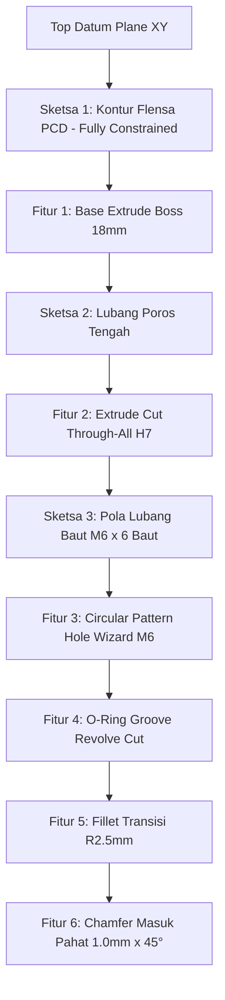

# Modul 04: Standard Output Format & Pipeline Architecture

Modul ini mendefinisikan template baku laporan perancangan benda padat parametrik di **SolidCraft**, mencakup diagram alir pohon fitur (*feature tree*), tabel parameter rekayasa, dan kode implementasi parametrik (Python CadQuery / OpenSCAD).

---

## 1. Struktur Baku Laporan SolidCraft

Setiap respons perancangan model solid 3D harus mengikuti urutan berikut:

```markdown
# SolidCraft Engineering Specification: [Nama Komponen / Perakitan]

## 1. Parameter Desain & Manufaktur (Engineering Specs)
- Metode Manufaktur: [CNC Machined / Injection Molded / 3D Printed / Sheet Metal]
- Material & Massa Jenis: [Aluminium 6061-T6 / ABS Plastic / Stainless 304]
- Satuan Kerja: [Millimeters, Linear Precision 0.001]
- Kelas Toleransi: [ISO 2768-m (Medium) / ISO 286 Fit Class]

## 2. Diagram Pohon Fitur Rekayasa (Feature Tree Diagram)
[Mermaid diagram urutan langkah dari Datum Planes hingga Cosmetic Fillets]

## 3. Tabel Parameter Sketsa & Dimensi (Parametric Table)
- Nama Variabel: [e.g., `bore_diameter`, `wall_thickness`, `flange_pcd`]
- Nilai Nominal & Toleransi: [e.g., `50.0 mm H7 (+0.030/-0.000)`]
- Relasi Persamaan: [e.g., `pcd = bore_diameter + 30.0`]

## 4. Skrip Automasi Parametrik (Python CadQuery / OpenSCAD Code)
[Kode lengkap mandiri yang dapat langsung dieksekusi untuk menghasilkan geometri solid STEP / STL]

## 5. Analisis DFM & Catatan Manufaktur (Manufacturing Notes)
- Tooling clearance & draft validation
- Rekomendasi penjepitan ragum / orientasi cetak

## 6. Checklist Verifikasi Rekayasa Solid
- [ ] Checklist kendala penuh, eliminasi sudut tajam, dan kepatuhan STEP
```

---

## 2. Contoh Diagram Pohon Fitur (Mermaid)


