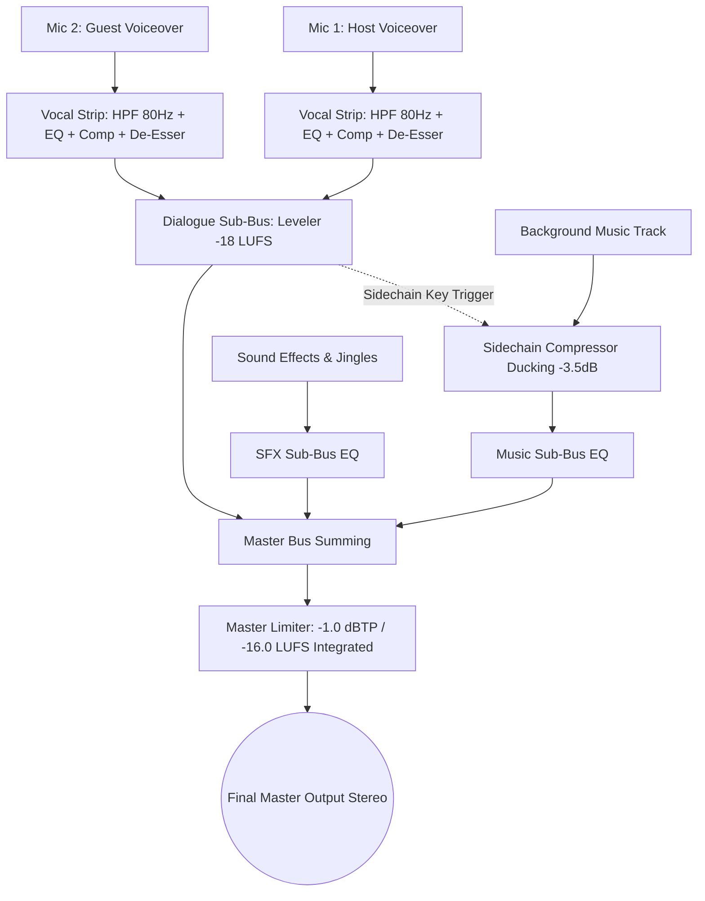

# Modul 04: Standard Output Format & Pipeline Architecture

Modul ini mendefinisikan template baku laporan rekayasa audio di **SoundCraft**, mencakup diagram perutean bus sinyal (*routing bus diagram*), tabel parameter channel strip, dan skrip implementasi (FFmpeg complex audio filtergraphs / REAPER session automation).

---

## 1. Struktur Baku Laporan SoundCraft

Setiap respons perancangan mixing atau mastering audio wajib mengikuti urutan berikut:

```markdown
# SoundCraft Audio Engineering Specification: [Judul Proyek / Produksi]

## 1. Target Format & Kepatuhan Kenyaringan (Loudness Specs)
- Standar Penyiaran: [EBU R128 / ITU-R BS.1770-4 / Web Streaming]
- Target Integrated Loudness: [-14.0 LUFS / -16.0 LUFS / -23.0 LUFS]
- True Peak Ceiling: [-1.0 dBTP / -0.5 dBTP]
- Sampling Rate & Bit Depth: [48000 Hz / 24-bit PCM]

## 2. Diagram Alir Perutean Bus Sinyal (Signal Routing Mermaid)
[Mermaid diagram alur audio dari track instrumen/vokal -> Sub-bus -> Sidechain Ducking -> Master]

## 3. Tabel Parameter Channel Strip (Processing Parameters)
- Track Name: [Voiceover / Music / SFX]
- Equalizer Curves: [Frekuensi, Gain dB, Q factor]
- Compressor Settings: [Threshold, Ratio, Attack ms, Release ms, Makeup dB]
- De-Esser & Limiter Settings: [Frekuensi, Threshold, Ceiling dB]

## 4. Skrip Automasi Audio (FFmpeg Audio Filtergraph / Shell Script)
[Perintah baris tunggal atau skrip mandiri FFmpeg filter_complex untuk memproses audio secara presisi]

## 5. Instruksi Langkah Demi Langkah Mixing & Ducking
- Rincian penataan sidechain ducking vokal terhadap musik
- Protokol mastering akhir

## 6. Checklist Verifikasi & Kepatuhan LUFS
- [ ] Checklist True Peak, LUFS terpadu, dan ketiadaan distorsi fase
```

---

## 2. Contoh Diagram Perutean Bus (Mermaid)


