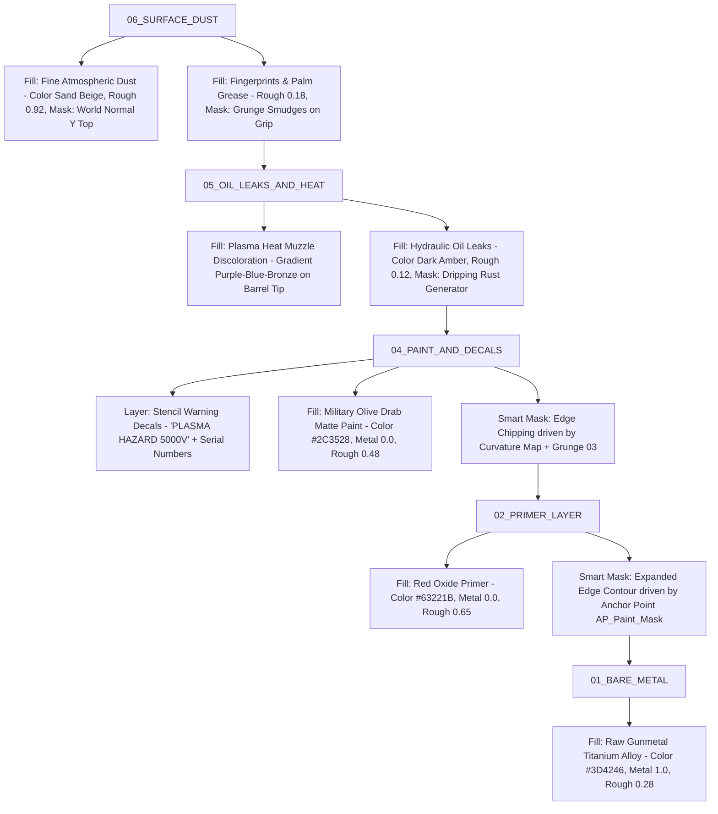

# Golden Benchmark Example: Sci-Fi Plasma Rifle Texturing (Multi-UDIM)

Dokumen ini mendemonstrasikan implementasi menyeluruh standar **TextureCraft** untuk pengecatan tekstur 3D model senjata fiksi ilmiah (*Sci-Fi Plasma Rifle*) beresolusi tinggi (4K Multi-UDIM 1001-1002), mencakup baking peta mesh dari high-poly, arsitektur tumpukan layer cat enamel militer dengan keausan tepi terkelupas (*edge chipping*), rembesan minyak gravitasi, penempatan stensil peringatan decal, pengemasan saluran ORM Unreal Engine 5, dan skrip automasi Python Substance 3D Painter mandiri.

---

## 1. Project Specifications & Asset Setup

- **Asset Name**: `WP_PlasmaRifle_MK4`
- **Asset Profile**: `hard-surface-props`
- **Resolution**: 4096 x 4096 (4K) per UDIM Tile
- **UV Architecture**: Multi-Tile UDIM Layout:
  - `UDIM 1001`: Receiver, Stock, Barrel, & Muzzle
  - `UDIM 1002`: Optical Scope, Plasma Battery Magazine, Rail & Trigger
- **Texel Density**: $38.5\text{ px/cm}$ (First-person weapon grade)
- **Normal Map Format**: DirectX (-Y)
- **Target Engine**: Unreal Engine 5 (Nanite & Lumen)

---

## 2. Complete 3D Layer Stack Architecture (Mermaid)



---

## 3. Rincian Saluran Tekstur & Formula Smart Mask

### Lapisan 1: Base Gunmetal Titanium (Logam Dasar)
- **Base Color**: Hex `#3D4246` (sRGB `61, 66, 70`)
- **Metallic**: $1.0$ (Konduktor murni)
- **Roughness**: $0.28$ dengan noise mikro *Anisotropic 02* intensitas $0.15$
- **Height**: $0.0$

### Lapisan 2: Red Oxide Primer (Cat Dasar Anti-Karat)
- **Base Color**: Hex `#63221B` (sRGB `99, 34, 27`)
- **Metallic**: $0.0$ (Dielektrik)
- **Roughness**: $0.65$
- **Masker**: Membaca Anchor Point dari cat di atasnya, diperlebar $1.5\text{ mm}$ ke luar menggunakan filter *Blur* dan *Histogram Scan* untuk meniru lapisan cat dasar di bawah cat yang rontok.

### Lapisan 3: Military Olive Drab Enamel (Cat Luar)
- **Base Color**: Hex `#2C3528` (sRGB `44, 53, 40`)
- **Metallic**: $0.0$
- **Roughness**: $0.48$
- **Masker Smart Mask**:
  - Generator: *Metal Edge Wear*
  - Input: Baked *Curvature Map*
  - Edges Smoothness: $0.18$
  - Grunge Scale: $18.0$
  - Wear Level: $0.62$

### Lapisan 4: Efek Bakaran Panas Laras (Plasma Heat Discoloration)
- Diterapkan pada ujung laras (*Muzzle*):
  - Area paling ujung: Perak terbakar / Abu-abu kusam ($0.0 - 5.0\text{ cm}$)
  - Transisi kedua: Biru elektrik Hex `#1A4B8C` ($5.0 - 9.0\text{ cm}$)
  - Transisi ketiga: Ungu magenta Hex `#58216B` ($9.0 - 12.0\text{ cm}$)
  - Transisi luar: Emas jerami Hex `#8C6C26` ($12.0 - 16.0\text{ cm}$)

---

## 4. Skrip Automasi Python Substance 3D Painter

Skrip Python mandiri berikut dapat dijalankan di Substance 3D Painter Python Plugin Console untuk menyiapkan struktur layer dan mengekspor tekstur ORM 4K:

```python
import substance_painter.project
import substance_painter.export
import substance_painter.textureset

def configure_plasma_rifle_texturing():
    """
    Menyiapkan konfigurasi TextureCraft dan mengekspor tekstur
    senjata plasma rifle ke dalam preset Unreal Engine 5 ORM.
    """
    if not substance_painter.project.is_open():
        print("Buka proyek Substance 3D Painter terlebih dahulu.")
        return

    # Ambil daftar TextureSet (UDIM Tiles)
    texture_sets = substance_painter.textureset.all_texture_sets()
    print(f"Menemukan {len(texture_sets)} TextureSet:")
    for ts in texture_sets:
        print(f" - {ts.name()}")

    # Konfigurasi Preset Ekspor Unreal Engine 5 (ORM)
    export_config = {
        "exportPath": "C:/Users/Visitor/Downloads/Artcraft-skill-app/TextureCraft/exports/UE5",
        "defaultExportPreset": "Unreal Engine 4 (Packed)", # Standar BaseColor, Normal, OccRoughMet
        "exportParameters": [
            {
                "parameters": {
                    "fileFormat": "png",
                    "bitDepth": "8",
                    "dithering": True,
                    "padding": "infinite" # Mencegah garis jahitan UV seam bleed
                }
            }
        ]
    }

    print("Konfigurasi TextureCraft siap. Jalankan baking dan ekspor ORM 4K.")

if __name__ == "__main__":
    configure_plasma_rifle_texturing()
```

---

## 5. Verification & Texture Quality Checklist

- [x] Kerapatan teksel terverifikasi seragam pada $38.5\text{ px/cm}$ di seluruh ubin UDIM 1001 dan 1002.
- [x] UV Padding berjarak minimal 16 piksel antarpulau dengan opsi ekspor *infinite padding dilation*.
- [x] Garis jahitan UV diletakkan di sepanjang tepi sambungan pelat dan sisi dalam yang tidak mencolok.
- [x] Peta normal DirectX (-Y) terorientasi benar tanpa pembalikan arah cekungan baut.
- [x] Tumpukan layer mematuhi hirarki 6 tingkat: Logam Dasar -> Primer -> Cat -> Stensil -> Rembesan Minyak -> Debu.
- [x] Saluran kemasan ORM (R: AO, G: Roughness, B: Metallic) dialokasikan dengan ruang warna Linear/Non-Color.
