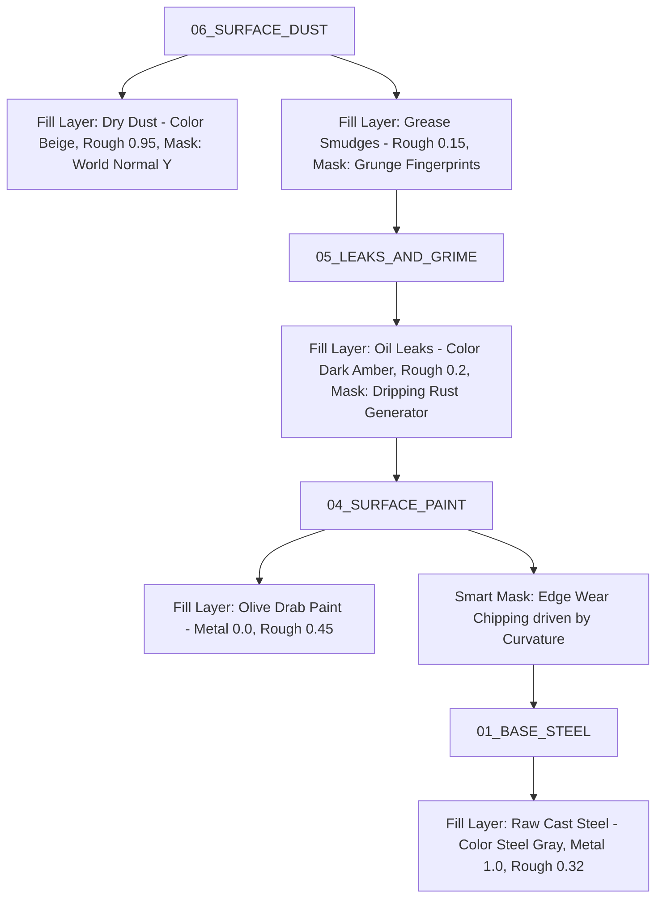

# Modul 04: Standard Output Format & Pipeline Architecture

Modul ini mendefinisikan template baku laporan spesifikasi pengecatan tekstur 3D di **TextureCraft**, mencakup diagram tumpukan layer, parameter generator smart mask, dan skrip automasi (Substance 3D Painter Python API / Blender Texture Paint script).

---

## 1. Struktur Baku Laporan TextureCraft

Setiap respons perancangan tekstur aset 3D harus mengikuti urutan berikut:

```markdown
# TextureCraft Technical Specification: [Nama Aset 3D / Properti]

## 1. Parameter Aset & Arsitektur UV (Asset & UV Setup)
- Tipe Aset: [hard-surface-props / organic-characters / stylized-handpainted / custom]
- Resolusi & Layout UV: [4096 x 4096 (4K), UDIM Tiles 1001-1002 / Standard 0-1]
- Texel Density Target: [e.g., 20.48 px/cm]
- Target Engine Render: [Unreal Engine 5 (Nanite/Lumen) / Unity HDRP / Blender Cycles]

## 2. Diagram Tumpukan Layer Pengecatan (Layer Stack Diagram)
[Mermaid diagram susunan tumpukan layer dari Base Metal bawah hingga Dust atas]

## 3. Rincian Lapisan & Masker Cerdas (Layer & Smart Mask Specs)
- Nama Layer / Folder: [Penamaan terstruktur]
- Saluran Aktif: [Color, Metal, Rough, Normal, Height]
- Generator Mask: [Curvature Edge Damage / AO Dirt Crevices / Position Gradient]
- Nilai Roughness & Metallic: [Rentang nilai fisik]

## 4. Skrip Automasi Texturing (Substance Painter Python / Tooling Code)
[Kode lengkap mandiri yang dapat langsung dijalankan untuk setup material atau export preset]

## 5. Instruksi Langkah Demi Langkah Pengecatan (Texturing Workflow)
- Urutan proses baking mesh maps
- Penerapan Anchor Points
- Penempatan stensil decal

## 6. Checklist Verifikasi & Kualitas Akhir
- [ ] Checklist texel density, padding jahitan UV, dan kepatuhan ORM
```

---

## 2. Contoh Diagram Susunan Layer Texturing (Mermaid)


