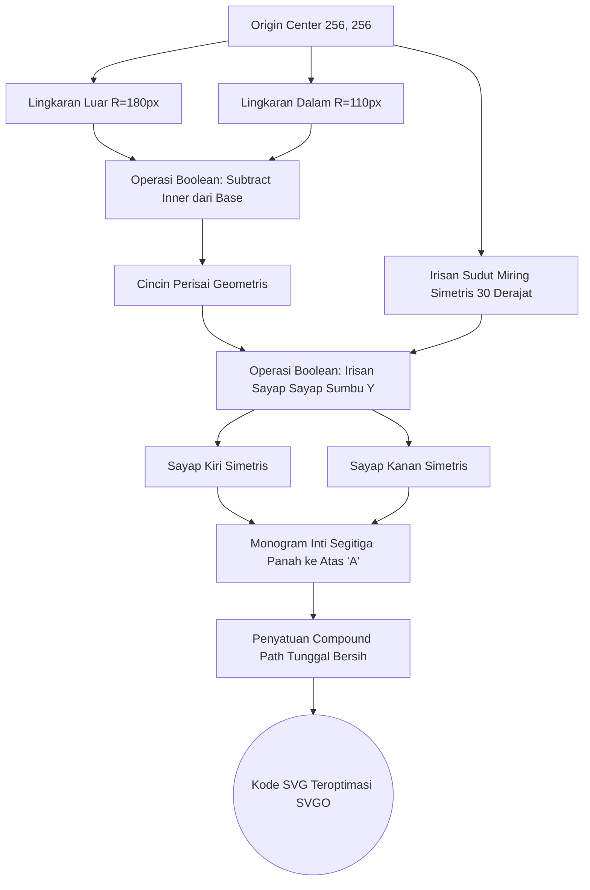

# Golden Benchmark Example: Modern Fintech Brandmark & Icon System

Dokumen ini mendemonstrasikan implementasi menyeluruh standar **VectorCraft** untuk pembuatan lambang merek perusahaan teknologi finansial modern (*Fintech Brandmark & App Icon*), mencakup cetak biru konstruksi geometris lingkaran rasio emas (*Golden Ratio Circles*), operasi boolean pathfinder yang bersih, efisiensi titik simpul extrema, kode SVG produksi mandiri yang tervalidasi dan teroptimasi SVGO, serta varian palet warna monokrom.

---

## 1. Project Specifications & Geometric Blueprint

- **Brand Name**: `AegisPay Technologies`
- **Domain Category**: `brand-identity-logos`
- **Concept Metaphor**: Perisai Keamanan (*Shield of Trust*) dipadukan dengan Sayap Dinamis (*Dynamic Ascending Wings*) dan Monogram huruf 'A'.
- **Canvas Base Grid**: $512 \times 512\text{ px}$ (ViewBox: `0 0 512 512`)
- **Center Coordinate**: $(256.0, 256.0)$
- **Color Identity**:
  - Primary Gradient: Cyan Elektrik `#00F2FE` ke Biru Kerajaan `#4FACFE`
  - Dark Accent: Midnight Navy `#0A192F`
  - Monokrom: Hitam Murni `#000000` dan Putih Murni `#FFFFFF`

---

## 2. Geometric Construction Architecture (Mermaid)



---

## 3. Kode SVG Produksi Teroptimasi (Production-Ready SVG)

Kode markup SVG mandiri berikut valid, terbebas dari tag editor pihak ketiga, siap disematkan langsung ke dalam kode HTML, React JSX, atau disimpan sebagai berkas `.svg`:

```xml
<svg xmlns="http://www.w3.org/2000/svg" viewBox="0 0 512 512" width="100%" height="100%">
  <defs>
    <!-- Gradien Utama: Cyan Elektrik ke Royal Blue -->
    <linearGradient id="aegisPrimaryGrad" x1="12%" y1="88%" x2="88%" y2="12%">
      <stop offset="0%" stop-color="#0052D4"/>
      <stop offset="50%" stop-color="#4364F7"/>
      <stop offset="100%" stop-color="#6FB1FC"/>
    </linearGradient>

    <!-- Gradien Bayangan Lipatan Sayap -->
    <linearGradient id="aegisDarkWing" x1="0%" y1="0%" x2="100%" y2="100%">
      <stop offset="0%" stop-color="#0A192F"/>
      <stop offset="100%" stop-color="#1E3C72"/>
    </linearGradient>
  </defs>

  <!-- Latar Belakang Lingkaran Halus (Opsional untuk App Icon) -->
  <rect width="512" height="512" rx="112" fill="#0A0E17"/>

  <!-- Grup Simbol Utama AegisPay -->
  <g id="Aegis_Brandmark_Symbol">
    <!-- Sayap Kiri Luar (Left Wing) -->
    <path d="M256 64 C200 130 112 180 96 280 C84 355 130 420 196 444 L256 420 L220 348 C180 332 156 292 164 244 C172 196 220 152 256 120 Z" 
          fill="url(#aegisPrimaryGrad)"/>

    <!-- Sayap Kanan Luar (Right Wing - Mirrored) -->
    <path d="M256 64 C312 130 400 180 416 280 C428 355 382 420 316 444 L256 420 L292 348 C332 332 356 292 348 244 C340 196 292 152 256 120 Z" 
          fill="url(#aegisPrimaryGrad)" opacity="0.92"/>

    <!-- Inti Monogram Segitiga Tengah 'A' (Apex Growth Diamond) -->
    <path d="M256 156 L312 288 L280 288 L256 236 L232 288 L200 288 Z M256 312 L288 384 L256 404 L224 384 Z" 
          fill="#FFFFFF"/>
  </g>
</svg>
```

---

## 4. Skrip Automasi Python Pembuat Geometri Vektor (svgwrite Generator)

Skrip Python mandiri berikut dapat langsung dijalankan untuk membangun berkas SVG secara terprogram:

```python
import math

def generate_fintech_brandmark(filename="aegis_brandmark.svg"):
    svg_content = """<svg xmlns="http://www.w3.org/2000/svg" viewBox="0 0 512 512" width="512" height="512">
  <defs>
    <linearGradient id="aegisPrimaryGrad" x1="12%" y1="88%" x2="88%" y2="12%">
      <stop offset="0%" stop-color="#0052D4"/>
      <stop offset="50%" stop-color="#4364F7"/>
      <stop offset="100%" stop-color="#6FB1FC"/>
    </linearGradient>
  </defs>
  <rect width="512" height="512" rx="112" fill="#0A0E17"/>
  <g id="Aegis_Brandmark_Symbol">
    <path d="M256 64 C200 130 112 180 96 280 C84 355 130 420 196 444 L256 420 L220 348 C180 332 156 292 164 244 C172 196 220 152 256 120 Z" fill="url(#aegisPrimaryGrad)"/>
    <path d="M256 64 C312 130 400 180 416 280 C428 355 382 420 316 444 L256 420 L292 348 C332 332 356 292 348 244 C340 196 292 152 256 120 Z" fill="url(#aegisPrimaryGrad)" opacity="0.92"/>
    <path d="M256 156 L312 288 L280 288 L256 236 L232 288 L200 288 Z M256 312 L288 384 L256 404 L224 384 Z" fill="#FFFFFF"/>
  </g>
</svg>"""
    
    with open(filename, "w", encoding="utf-8") as f:
        f.write(svg_content)
    print(f"Berkas SVG berhasil digenerate: {filename}")

if __name__ == "__main__":
    generate_fintech_brandmark()
```

---

## 5. Verification & Vector Standards Checklist

- [x] Titik simpul kurva diletakkan pada titik ekstrem (Extrema) dengan handle tegak lurus sumbu $X/Y$.
- [x] Koordinat path dibulatkan ke nilai bulat integer atau desimal rapi tanpa angka acak panjang.
- [x] Seluruh path tertutup sempurna dengan perintah penutup `Z` (*Closed Paths*).
- [x] Berkas SVG bebas dari tag metadata editor Adobe Illustrator atau Inkscape.
- [x] Kode SVG menyertakan atribut `viewBox="0 0 512 512"` untuk fleksibilitas ukuran responsif tak terbatas.
- [x] Uji reduksi ukuran berhasil: siluet perisai dan panah pertumbuhan tetap terbaca jelas pada ukuran $16 \times 16\text{ px}$.
