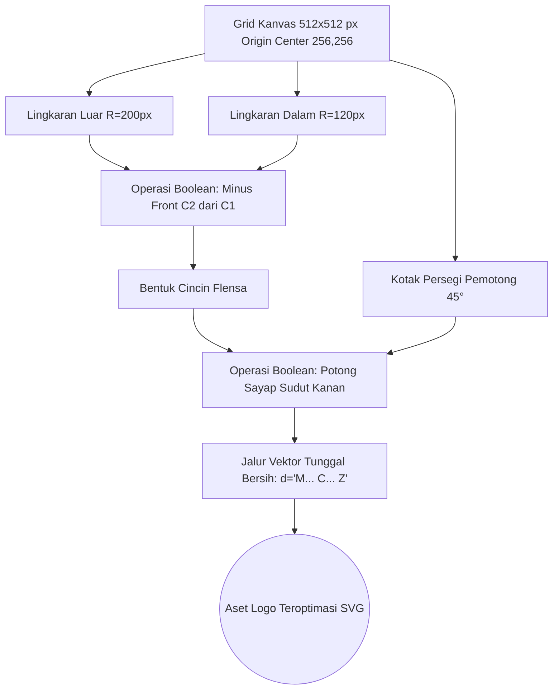

# Modul 04: Standard Output Format & Pipeline Architecture

Modul ini mendefinisikan template baku laporan perancangan grafis vektor di **VectorCraft**, mencakup cetak biru konstruksi geometris (*geometric blueprint*), rincian koordinat path, dan kode SVG produksi bersih mandiri (*clean standalone SVG markup*).

---

## 1. Struktur Baku Laporan VectorCraft

Setiap respons perancangan grafik vektor harus mengikuti urutan berikut:

```markdown
# VectorCraft Technical Specification: [Nama Aset Vektor / Logo / Ikon]

## 1. Parameter Kanvas & Kisi Vektor (Canvas Specs)
- Domain Kategori: [brand-identity-logos / iconography-systems / editorial / custom]
- Ukuran Kanvas Dasar & ViewBox: [e.g., 24x24 px / 512x512 px / 1000x1000]
- Skema Warna: [Hex / sRGB / CMYK Swatches]
- Toleransi Presisi Titik: [2 desimal pembulatan]

## 2. Diagram Cetak Biru Konstruksi Geometri (Mermaid Blueprint)
[Mermaid diagram pembentukan geometri dari lingkaran primitif dasar hingga operasi boolean akhir]

## 3. Rincian Jalur Path Vektor (Path Geometry Breakdown)
- Path 1: [Fungsi bentuk, perintah d="..." SVG, status fill/stroke]
- Path 2: [Relasi boolean terhadap Path 1]
- Penggunaan Anchor Extrema & Nilai Radius

## 4. Kode SVG Produksi Bersih (Clean SVG Code Block)
[Kode lengkap mandiri SVG 1.1/2.0 yang valid, teroptimasi, tanpa tag editor pihak ketiga]

## 5. Panduan Implementasi & Skalabilitas (Usage Guide)
- Skala minimum yang diizinkan (e.g. 16px favicon)
- Variasi warna monokrom (hitam di atas putih, putih di atas hitam)

## 6. Checklist Verifikasi & Kualitas Vektor
- [ ] Checklist anchor economy, snapping grid, dan teks-ke-outlines
```

---

## 2. Contoh Diagram Konstruksi Geometri (Mermaid)


