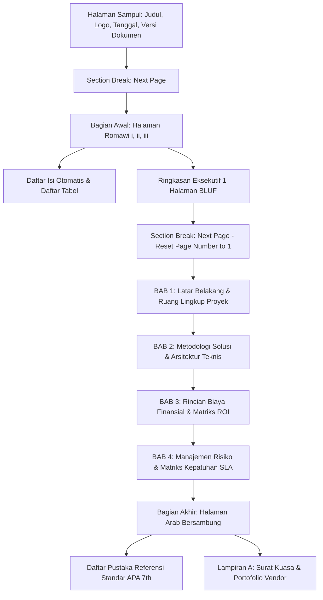

# Modul 04: Standard Output Format & Pipeline Architecture

Modul ini mendefinisikan template baku laporan penyusunan naskah di **WordCraft**, mencakup diagram struktur bab dokumen (*document architecture diagram*), tabel spesifikasi gaya tipografi, dan skrip generator Python mandiri berbasis `python-docx`.

---

## 1. Struktur Baku Laporan WordCraft

Setiap respons perancangan naskah atau dokumen resmi wajib mengikuti urutan berikut:

```markdown
# WordCraft Document Engineering Specification: [Judul Dokumen]

## 1. Parameter Naskah & Pengaturan Halaman (Page Specs)
- Template Profil: [corporate-annual-report / tender-proposal / academic / sop]
- Ukuran Kertas & Margin: [A4 (210x297mm), Left 30mm, Right 25mm, Top/Bottom 25.4mm]
- Preset Tipografi: [Corporate Inter/Calibri / Academic Times New Roman]
- Gaya Sitasi & Referensi: [APA 7th Edition / IEEE / Chicago]

## 2. Diagram Struktur Naskah Dokumen (Document Flow Mermaid)
[Mermaid diagram struktur dari Halaman Sampul -> Prelims Romawi -> Bab Isi -> Lampiran]

## 3. Matriks Hirarki Judul & Gaya Teks (Styles & Numbering Matrix)
- Heading 1, 2, 3: [Ukuran font pt, warna, spasi sebelum/setelah, page-break]
- Body Text: [Line spacing, paragraph spacing]
- Header & Footer: [Penomoran halaman Romawi i-ii vs Desimal 1-20]

## 4. Skrip Automasi Python (python-docx Generator Code Block)
[Kode lengkap mandiri yang dapat langsung dijalankan untuk memproduksi berkas .docx siap buka di MS Word]

## 5. Draf Teks Lengkap Dokumen (Full Structured Text Draft)
- Halaman Sampul & Metadata
- Ringkasan Eksekutif BLUF
- Bab Utama dengan Tabel & Kotak Callout

## 6. Checklist Verifikasi Format & Kerapian Dokumen
- [ ] Checklist widow/orphan control, penomoran desimal, dan daftar isi otomatis
```

---

## 2. Contoh Diagram Struktur Dokumen (Mermaid)


